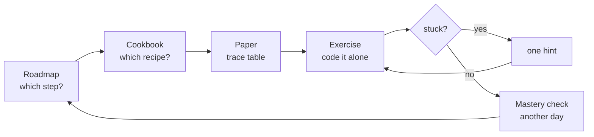

# C# Programming Fundamentals

[](https://github.com/lfarci/csharp-programming-fundamentals/actions/workflows/checks.yml)
[](https://codespaces.new/lfarci/csharp-programming-fundamentals?quickstart=1)

A friendly companion for a beginner C# course. You learn **loop recipes** and practise with many small exercises. Each exercise adds **one** new difficulty.

## Start here


1. Get the course: `git clone https://github.com/lfarci/csharp-programming-fundamentals.git` (or fork it first if you want your own copy on GitHub). Details in [**Getting started**](docs/getting-started.md#2-get-the-files-on-your-computer).
   - You write **only** in `practice/`, through `./ex start`, `./ex check`, `./ex run` and `./ex next`. Never edit `Program.cs`, project files, `tests/` or `solutions/`.
   - Before each session: `git pull` to get new exercises. Your own files are never overwritten.
2. Read [**How to read an exercise**](docs/reading-an-exercise.md) (10 minutes).
3. Do your first exercises: [L01](exercises/L01-trace-a-loop.md) and [L02](exercises/L02-boundaries.md) on paper. Then, in a terminal:

   ```bash
   ./ex start L03     # creates your file practice/L03_CountUpAndDown.cs
   ./ex check         # tests it: every example says OK or NOT YET
   ```

   (Windows: `.\ex start L03`, `.\ex check`.)
4. When every example is OK, `./ex check` says **DONE**. See how far you are with `./ex progress`, and go on with `./ex next`.
5. Next time, open the [**Roadmap**](ROADMAP.md) and follow the plan for today.

> **Book:** *The C# Player's Guide* (5th edition) is a **parallel reading track**. Each roadmap step says which level to read. The book's challenges stay in the book (tracked in [C# Quest Tracker](https://lfarci.github.io/csharp-quest-tracker/)).

## Where do I go?

| I want to… | Go to |
| --- | --- |
| See the whole path, week by week | [**ROADMAP**](ROADMAP.md) |
| Learn the reusable loop recipes | [**Cookbook**](cookbook/README.md) — 12 recipes + [how to combine them](cookbook/combining-recipes.md) |
| Understand an exercise before coding | [**How to read an exercise**](docs/reading-an-exercise.md) (+ fill-in worksheet) |
| Pick an exercise | [**Exercise inventory**](exercises/README.md) (63 original + Project Euler + teacher topics) |
| See which exercise comes before which | [Dependency graph](exercises/dependency-graph.md) |
| Get set up, start and check an exercise | [Getting started](docs/getting-started.md) · [Practice folder](practice/README.md) |
| Check my answer (after trying!) | [Solutions](solutions/README.md) |
| Track what I have done | `./ex progress` in a terminal, or the paper [progress checklist](docs/progress-checklist.md) |
| Understand a word | [Glossary](docs/glossary.md) |
| Write or review pages (coaches) | [Learner persona](docs/learner-persona.md) · [Writing guide](docs/writing-guide.md) |
| Learn how to attack a problem | [From a problem statement to an algorithm](docs/problem-solving.md) · [How to practice](docs/how-to-practice.md) |

## Every session



## Principles

- **Loops are a means, recipes are the goal.** Count, add up, find the biggest, take digits apart, draw a shape.
- **Paper first:** predict the output and trace the variables before running the code.
- **One new difficulty at a time:** guided → independent → challenge.
- **Hints before solutions.** A topic is mastered when you solve a *new variation* alone, on another day.
- **No shortcuts** in the loop exercises: no LINQ, no `Math.Pow`, no ready-made helpers. The loop *is* the exercise.

## Sources

- [The C# Player's Guide](https://csharpplayersguide.com/) — parallel reading track only. Its challenges are **not** listed or copied here.
- [Microsoft Learn — C# docs](https://learn.microsoft.com/en-us/dotnet/csharp/) — linked from every roadmap step.
- [Project Euler](https://projecteuler.net/archives) — a few optional milestones (#1, #6, #2, #4, #5).
- University teacher exercises (factorial, Fibonacci, Armstrong) — used as assessments; statements not copied.

All custom exercises are original. Visuals are Mermaid diagrams (rendered by GitHub) and the SVGs in [`assets/`](assets/).

Working on this repo (coach or AI agent)? Read [AGENTS.md](AGENTS.md).
