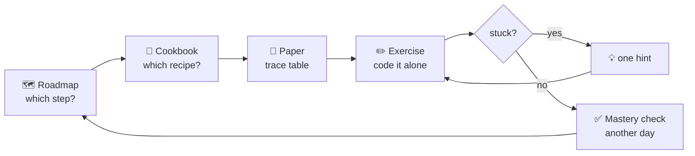

# C# Programming Fundamentals 🎮

A friendly, **recipe-first** companion for a beginner C# course: a clear path, reusable loop recipes, and many small exercises that each add **one** new difficulty.

> 📖 **Parallel track:** *The C# Player's Guide*, 5th edition. Each roadmap step tells you which level to read alongside it. Book challenges are **not** repeated here (track them in [C# Quest Tracker](https://lfarci.github.io/csharp-quest-tracker/)). This repo is about **problem-solving techniques** and **original exercises**.

> 🔎 **New here? Start with [How to read an exercise](docs/reading-an-exercise.md)** — what to look for in a statement, how to organize your ideas, and what to do when you are stuck.

## 🧭 Where do I go?

| I want to… | Go to |
| --- | --- |
| See the whole path, week by week | 🗺️ [**ROADMAP**](ROADMAP.md) |
| Learn the reusable loop recipes | 🍳 [**Cookbook**](cookbook/README.md) — 12 recipes + [how to combine them](cookbook/combining-recipes.md) |
| Understand an exercise before coding | 🔎 [**How to read an exercise**](docs/reading-an-exercise.md) (+ fill-in worksheet) |
| Pick an exercise | 📚 [**Exercise inventory**](exercises/README.md) (55 original + Project Euler + teacher topics) |
| See which exercise comes before which | 🕸️ [Dependency graph](exercises/dependency-graph.md) |
| Write and run my code | ✏️ [practice/](practice/README.md) (one console project) |
| Check my answer (after trying!) | 🔑 [solutions/](solutions/README.md) |
| Learn how to attack a problem | 🧠 [From a problem statement to an algorithm](docs/problem-solving.md) · [How to practice](docs/how-to-practice.md) |

## 🚀 Start here (today)

1. Open the [ROADMAP](ROADMAP.md) and read **§2 "Where are we now?"** and **§5 Catch-up plan**.
2. Session 1: do [L01](exercises/L01-trace-a-loop.md) and [L02](exercises/L02-boundaries.md) **on paper**, then [A01](exercises/A01-sum-1-to-n.md).
3. Before each exercise, fill the [reading worksheet](docs/reading-an-exercise.md#4-the-worksheet-copy-it), read its recipe in the [cookbook](cookbook/README.md) and fill a trace table.

## Principles

- **Loops are a means, recipes are the goal.** Count, add up, find the biggest, take digits apart, draw a shape.
- **Paper first:** predict the output and trace the variables before running the code.
- **One new difficulty at a time:** guided → independent → challenge.
- **Hints before solutions.** A topic is mastered when you solve a *new variation* alone, on another day.
- **No shortcuts** in the loop exercises: no LINQ, no `Math.Pow`, no ready-made helpers. The loop *is* the exercise.

## Sources

- [The C# Player's Guide](https://csharpplayersguide.com/) — parallel reading track only. Its challenges are **not** listed or copied here.
- [Microsoft Learn — C# docs](https://learn.microsoft.com/en-us/dotnet/csharp/) — linked from every roadmap step.
- [Project Euler](https://projecteuler.net/archives) — a few optional milestones (#1, #6, #2, #4, #5).
- University teacher exercises (factorial, Fibonacci, Armstrong) — used as assessments; statements not copied.

All custom exercises are original. Visuals are Mermaid diagrams (rendered by GitHub) and the SVGs in [`assets/`](assets/).
