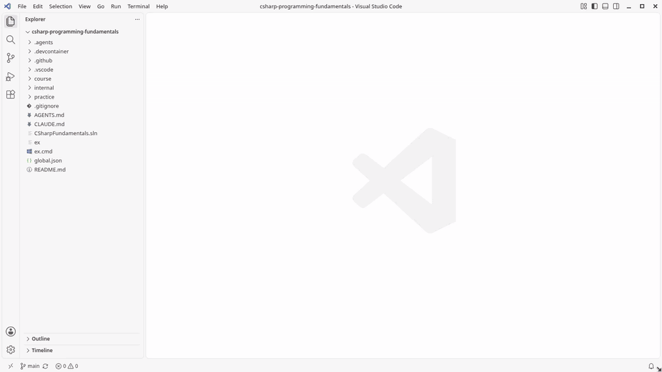

# C# Programming Fundamentals

[](https://github.com/lfarci/csharp-programming-fundamentals/actions/workflows/checks.yml)
[](https://codespaces.new/lfarci/csharp-programming-fundamentals?quickstart=1)

A self-paced companion for a first C# course: small exercises on loops and the basics, reusable loop recipes, and a checker (`./ex`) that tests your code.

**Read it on the website: <https://lfarci.github.io/csharp-programming-fundamentals/>** (search, progress ticks, the demo video).



## Quick start

```bash
git clone https://github.com/lfarci/csharp-programming-fundamentals.git
cd csharp-programming-fundamentals
./ex start L03     # creates your file practice/L03_CountUpAndDown.cs
./ex check         # tests it: every example says OK or NOT YET
```

On Windows, type `.\ex` instead of `./ex`. Full setup: [Getting started](course/docs/getting-started.md).

## What is inside

| Folder | What it holds | Yours? |
| --- | --- | --- |
| [`practice/`](practice/README.md) | **Your code**, one file per exercise (created by `./ex start`, ignored by Git). | Yes, the only folder you edit |
| [`course/`](course/README.md) | What you read: the [roadmap](course/ROADMAP.md), the [exercises](course/exercises/README.md), [learn](course/learn/README.md) (theory from Microsoft Learn), the [cookbook](course/cookbook/README.md) of loop recipes and the [study skills](course/docs/README.md). | No, read it |
| [`internal/`](internal/README.md) | Course machinery: the tests behind `./ex check`, the reference solutions, the generator, the website. | No, never needed |

## Sources

- [Microsoft Learn: C# docs](https://learn.microsoft.com/en-us/dotnet/csharp/), linked from each theme.
- [Project Euler](https://projecteuler.net/archives): a few optional extra challenges.

All exercises are original. Working on this repo (coach or AI agent)? Read [AGENTS.md](AGENTS.md).
