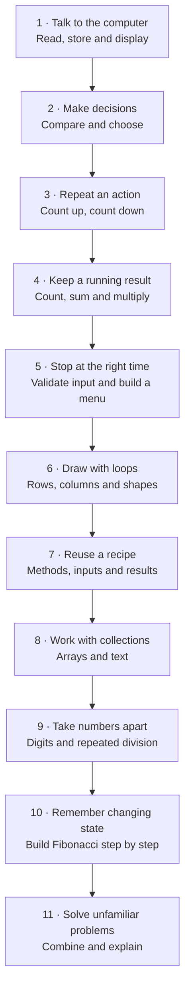

# Your C# learning adventure

Build small things, understand how they work, then combine what you know.

This is a **path of skills, not a calendar**. Spend about 20–40 minutes per session. Start at the earliest checkpoint you cannot yet complete independently. Already comfortable with variables and conditions? Check stages 1–2 briefly, then begin at stage 3.

## The path

The order below is our teaching choice. Microsoft Learn supplies language references and supporting lessons; it does not prescribe this exact sequence. **Tracing, debugging and testing belong to every stage.**

## Stage checkpoints

Exercises marked **planned** describe the next inventory additions; they are not published exercise sheets yet. Existing IDs link to the [exercise inventory](exercises/README.md).

| Stage | What you will make | C# tools | Recipe you learn | Ready to continue when... |
| --- | --- | --- | --- | --- |
| **1. Read, store and display** | A greeting, temperature converter, small bill calculator (**planned**) | Console input/output; `int`, `double`, `decimal`, `string`, `bool`; assignment; arithmetic; conversion | Input → calculation → output | You can explain each variable, update its value and predict a short straight-line program. |
| **2. Compare and choose** | Even/odd checker, ticket price, largest of three values (**planned**) | Comparisons; `if/else`; `&&`, `||`, `!`; remainder `%` | Classify a value; combine conditions | You can choose examples covering every branch, including equality and boundary values. |
| **3. Repeat a predictable action** | Count up/down; multiplication table (L01–L04) | `for`; initialization, condition, update; scope | Walk through a range | You can trace every iteration, explain `<` versus `<=`, and make the loop terminate. |
| **4. Keep a running result** | Sum 1…N, count multiples, sum even values, factorial, two totals (A01–A05) | A result variable outside the loop; conditional updates | Counter; sum; running product; filter then accumulate | You can choose the initial value and explain what the result means after each iteration. |
| **5. Repeat until something happens** | Input validation, sum until zero, guessing game, repeating menu (**planned**); L05 for sentinel counting | `while`, `do/while`; `int.TryParse`; `switch` for a menu | Sentinel; retry; stop condition | You can say what makes the loop stop, exclude a sentinel from results and handle a first input that immediately stops. |
| **6. Draw rows and columns** | Solid rectangle → right triangle → hollow rectangle → checkerboard (**planned**) | Nested `for`; `Console.Write` / `WriteLine`; coordinate conditions | Outer loop chooses a row; inner loop visits columns | You can trace a 2×3 drawing, reset the column loop each row and explain where each newline belongs. |
| **7. Give a recipe a name** | Turn earlier calculations and drawings into methods (**planned**) | Parameters; return values; `void`; local variables | Separate input, calculation and display; compose small operations | You can call one calculation with different inputs and explain returned values versus printed output. |
| **8. Process arrays and text** | Sum, maximum, occurrence count (R01–R03); reverse an array and count vowels (**planned**) | Arrays; zero-based indexes; `Length`; `for`, `foreach`; string traversal | Traverse; search; track a best value | You can distinguish index and value, avoid out-of-range access and explain how an empty collection changes the task. |
| **9. Take a number apart** | Last digit → remove digit → digit count → digit sum (D01–D04); reverse digits (**planned**) | Integer `/`; `%`; working copy; `while` or `do/while` | Extract → process → remove | You can trace 352 → 35 → 3 → 0, preserve the original input and treat zero as a one-digit number. |
| **10. Remember previous values** | Trace two moving values; generate Fibonacci without an array (S01–S02) | Temporary variables; ordered assignments | Calculate next → shift previous/current | You can explain why overwriting a value too early loses information, and handle N=0, 1 and 2. |
| **11. Combine recipes independently** | Multiples challenge, numeric palindrome, Armstrong (M01–M03); small grade analyser or console drawing tool (**planned**) | Previously learned tools | Decompose → select patterns → combine → verify | Given only a prompt, you can explain a plan, implement it and test normal and edge cases without a solution template. |

## A loop is a tool: choose it for the job

| Your intention | A good first choice | Example |
| --- | --- | --- |
| Visit a range or repeat a known number of times | `for` | Print 1…10; draw 6 columns; multiply factors 1…N. |
| Repeat while a condition holds; possibly zero times | `while` | Remove digits until none remain; accept values until a sentinel. |
| Do the action once before checking whether to repeat | `do/while` | Show a menu at least once or ask for input again. |
| Visit each item without needing its position | `foreach` | Sum the values in an array. |
| Need a position, neighbouring items or to replace array elements | Indexed `for` | Reverse an array or compare adjacent values. |

These are useful defaults, not exclusive rules. First describe **what repeats and what stops it**; then choose the syntax.

## The recipes behind the exercises

| Recipe | What the remembered value means | Starting point | Gradual practice |
| --- | --- | --- | --- |
| Counter | How many items matched so far | `count = 0` | Count all inputs → count even inputs → count target occurrences. |
| Sum accumulator | Total of processed values | `total = 0` | Sum 1…N → sum only even values → average using a sum and a count. |
| Product accumulator | Product of processed factors | `product = 1` | Multiply a few factors → factorial → integer powers. |
| Best value so far | Largest/smallest processed value | First item of a nonempty sequence | Maximum of three → maximum of an array, including all-negative values. |
| Search flag | Whether a match has been found | `found = false` | Find a target → detect whether any value violates a rule. |
| Nested traversal | Current row and current column | Restart columns for every row | Rectangle → triangle → border → checkerboard. |
| Digit processing | Unprocessed part of a number | A copy of the original | Extract one digit → sum digits → reverse digits. |
| Moving state | Values needed to calculate the next step | Problem-specific initial values | Trace assignments → Fibonacci. |

Use the existing [pattern cookbook](patterns/README.md) for loops, accumulation, digits, state and array traversal. Search and nested-loop recipes are planned additions.

**Important distinctions:** an average needs both sum and count, and requires a decision when count is zero. A maximum should not start at zero if all inputs may be negative. A factorial starts with a product of 1, so 0! is 1. Keep factorial exercises within 0…12 for `int`; define safe input limits for powers and Fibonacci too.

## Make the maths visible before coding

Every maths-based exercise should state its definition, a tiny worked example and valid inputs. The learner should be practising programming rather than guessing the maths.

- **Sum:** 1 + 2 + 3 + 4 = 10. Add one value each iteration.
- **Factorial:** 4! = 1 × 2 × 3 × 4 = 24; 0! = 1. Reuse a running product.
- **Integer power:** 3⁴ = 3 × 3 × 3 × 3 = 81. Start with nonnegative exponents and define exponent zero as returning 1 for these exercises.
- **Fibonacci:** define F₀=0 and F₁=1; each next value is the sum of the previous two. Distinguish “print the first N values” from “return the value at position N”.
- **Armstrong:** 153 = 1³ + 5³ + 3³. The exponent is the number of digits, not always 3. Practise integer powers and digit counting before combining them.

For Armstrong, first check one candidate. Searching a whole interval comes later: it adds another loop around the candidate check.

## A visual bridge: from one line to a drawing

Before nested loops, print a single row of 4 stars. Then repeat that row 3 times. Only then vary the number or content of columns.

| Drawing challenge | Row rule | Column / character rule |
| --- | --- | --- |
| Solid rectangle | Repeat for the requested height | Print the requested width of stars. |
| Right triangle | Rows numbered 1…height | Row r contains r stars. |
| Hollow rectangle | Visit every row | Print a star on the first/last row or first/last column; otherwise a space. |
| Checkerboard | Visit every row | Choose one of two characters using the parity of row + column. |

**Drawing a grid does not require a 2D array.** First generate characters directly. Later, store a small grid in a rectangular array and revisit the same row/column traversal if the course needs it. Third dimensions and more complex shapes are optional extensions.

## How to use each stage

1. **Predict:** read a tiny example and say what it will output.
2. **Trace:** record the changing variables on paper.
3. **Modify:** change one rule in a working example.
4. **Build:** solve a small prompt from a blank file.
5. **Transfer:** solve a different-looking problem using the same recipe, then explain the choice.

Use [How to practice](docs/how-to-practice.md). A checkpoint is passed through independent work and explanation, then a fresh variation in a later session. Finishing one familiar exercise is not enough.

For each loop, ask: **What changes? What do I remember? When do I stop?** Test the smallest allowed input, a typical input and a boundary. Use a debugger or temporary output to inspect values.

## Where to begin right now

For the current difficulties, briefly verify stages 1–2, then focus on **3 → 4 → 5**. Add stage 6 as visual practice once single loops are comfortable. Do not wait to finish the entire roadmap before returning to university assignments:

- **Factorial:** stages 3–4; add stage 7 if a method is required.
- **Fibonacci:** stages 3–4 and the state recipe in stage 10; arrays are not required.
- **Armstrong:** stage 4 plus digit processing and integer powers; methods help separate the steps.

This is a prerequisite shortcut for urgent assignments, not an instruction to skip the foundations.

## Supporting resources

- [Microsoft Learn: first steps with C#](https://learn.microsoft.com/en-us/training/paths/csharp-first-steps/) for variables, console interaction, arithmetic and decisions.
- [Microsoft Learn: add logic to C# console applications](https://learn.microsoft.com/en-us/training/paths/get-started-c-sharp-part-3/) for conditions, scope and loops.
- [C# iteration reference](https://learn.microsoft.com/en-us/dotnet/csharp/language-reference/statements/iteration-statements/) to check the behaviour of `for`, `foreach`, `while` and `do/while`.
- [Microsoft Learn: create methods](https://learn.microsoft.com/en-us/training/paths/get-started-c-sharp-part-5/) as supporting lessons for stage 7.
- *The C# Player's Guide*, 5th edition remains the main book. Choose chapters matching the stage; track its challenges in [C# Quest Tracker](https://lfarci.github.io/csharp-quest-tracker/).
- Project Euler is **optional transfer practice**, after learning the recipes: [#1](https://projecteuler.net/problem=1) after conditional sums, [#6](https://projecteuler.net/problem=6) after two accumulators, [#2](https://projecteuler.net/problem=2) after Fibonacci.

Classes, inheritance, LINQ, recursion and advanced syntax are outside this initial fundamentals path. Add them later when the course or a project calls for them.
