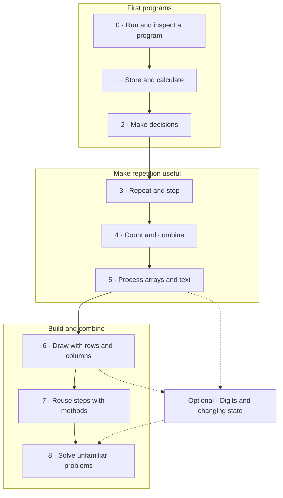

# Your C# learning journey

Build small things, understand how they work, then combine what you know. This is a **sequence of skills, not a calendar**: take 20–40 minutes per session and revisit a step whenever you need it. University deadlines can take priority.

The goal is to look at a new problem, break it into steps, and choose the C# tools yourself. Each stop connects **language → problem-solving pattern → something you can build**.

## The route

Solid arrows show the core route; dotted arrows show optional extensions. Start digits and state updates after stop 5. Only Armstrong requires the nested-loop practice from stop 6; the optional branch is not a prerequisite for the core final projects.

## Stops and checkpoints

Exercise IDs link to sections of the [exercise inventory](exercises/README.md). These are practice prompts, not completed lessons or solutions.

| Stop | C# tools to learn | Thinking pattern and practice | Ready to move on when… |
| --- | --- | --- | --- |
| **0 · Run and inspect** | Console project, top-level statements, `Console.WriteLine`, compiler messages | Execute instructions in order; predict a short program; change its output; fix a missing semicolon. **[B01](exercises/README.md#b--first-programs-and-values)** | You can create/run a program and explain the difference between a compiler error and a wrong answer. |
| **1 · Store and calculate** | `int`, `double`, `decimal`, `bool`, `string`; assignment; arithmetic; interpolation | Input → transformation → output. Build a receipt and a temperature converter. Compare integer and fractional division. **[B02–B03](exercises/README.md#b--first-programs-and-values)** | You can trace reassignment, choose a suitable type, and explain why `5 / 2` is 2. |
| **2 · Make decisions** | Comparisons, `%`, `&&`, `\|\|`, `!`, `if` / `else if` / `else`; blocks and scope | Split a problem into cases. Check parity, choose a ticket price, validate a range. **[C01–C03](exercises/README.md#c--decisions)** | You can explain which branch runs and test values below, at, and above a boundary. |
| **3 · Repeat and stop** | `for`, `while`, `do` / `while`; loop bounds; `Console.ReadLine`, `int.TryParse` | Repeat an action; identify what changes and why it stops. Count down, print a times table, ask again after invalid input. **[L01–L04](exercises/README.md#l--loop-mechanics), [L06](exercises/README.md#l--loop-mechanics)** | You can trace every iteration, avoid off-by-one errors, and justify your loop choice. |
| **4 · Count and combine** | `++`, `+=`, `*=`; conditions inside loops | Counter, sum, product, conditional accumulation. Count entries until zero, add a series, compute factorial, then track two totals. **[L05](exercises/README.md#l--loop-mechanics), [A01–A06](exercises/README.md#a--counters-and-accumulators)** | You can explain why sums start at 0 and products at 1, and keep initialization outside the loop. |
| **5 · Process arrays and text** | `int[]`, indexing from 0, `Length`, `foreach`, indexed `for`; string characters | Traverse, search, count, find a maximum, build a modified result. **[R01–R06](exercises/README.md#r--arrays)** | You distinguish positions from values, handle an empty input deliberately, and use `foreach` when positions are unnecessary. |
| **6 · Draw with rows and columns** | Nested loops, `Console.Write` vs `WriteLine`; row/column conditions; then `int[,]` and `GetLength` | Repeat once per row, then once per cell. Draw a rectangle, triangle, hollow frame, and checkerboard; then total grid rows. **[G01–G05](exercises/README.md#g--drawings-and-grids)** | You can explain the inner loop resetting for every row and why a height × width rectangle visits height × width cells. |
| **7 · Reuse steps with methods** | Parameters, return types, `return`, local scope; simple local functions | Decompose a working solution: separate calculation from console interaction. Extract `Sum`, `Factorial`, and a rectangle printer. **[F01–F03](exercises/README.md#f--reusable-steps)** | You can call a method with different inputs, explain its contract, and distinguish returning from printing. |
| **8 · Solve unfamiliar problems** | Combine familiar tools; debug and check results | Plan inputs, outputs, examples, state, and stopping conditions before coding. Build a score report or drawing menu; attempt **[M01](exercises/README.md#m--mixed-assessments-do-not-reveal-patterns-ahead-of-time)**, then optional **[M02–M03](exercises/README.md#m--mixed-assessments-do-not-reveal-patterns-ahead-of-time)**. | You can solve two fresh variations without step-by-step hints, including one on another day. |

Start with fixed values so input handling does not obscure the algorithm. Introduce interactive numeric input at stop 3: `TryParse` distinguishes a valid integer from invalid text; range checks are a separate decision. Do not introduce `try` / `catch` just to read the first number.

Already know the basics? Try [B03](exercises/README.md#b--first-programs-and-values), [C03](exercises/README.md#c--decisions), and [L01–L02](exercises/README.md#l--loop-mechanics) without help. Enter at the first checkpoint you cannot explain independently.

## Choosing a loop by the problem

| What must repeat? | Useful first choice | Example and stopping rule |
| --- | --- | --- |
| An action for each position in a known range | `for` | Print 1 through N; stop after N. Also useful for indexed array updates. |
| An action until a condition changes | `while` | Read values until 0; exclude the sentinel from the calculation. It may run zero times. |
| An interaction that must happen at least once | `do` / `while` | Show a menu, then check whether the user chose to quit. |
| An action for every value in a collection | `foreach` | Add every array value without managing an index. |
| An action for every cell of a drawing | Nested loops | Outer loop chooses the row; inner loop chooses the column. |

These are choices based on intent, not rigid rules. `break` and `continue` can come later, once the learner can explain the ordinary stopping condition.

## The visual milestone: a terminal drawing studio

Build [G01–G04](exercises/README.md#g--drawings-and-grids) incrementally. Draw on paper first, label rows and columns starting at zero, then decide which character belongs in each cell.

| Build | Rule to discover | Example dimensions | Check |
| --- | --- | --- | --- |
| Filled rectangle | Every cell prints `*`; newline after each row | height 3, width 5 | 3 lines, 5 stars on each line |
| Growing triangle | Row r has r + 1 stars | height 4 | Row lengths 1, 2, 3, 4 |
| Hollow frame | Print `*` on the first/last row or column; spaces inside | height 3, width 5 | First/last rows full; middle row has 2 stars |
| Checkerboard | Choose a character from the parity of row + column | height 4, width 6 | Adjacent cells differ horizontally and vertically |

**A drawing does not need a stored 2D array.** First generate characters directly with nested loops. Introduce a 2D array in [G05](exercises/README.md#g--drawings-and-grids) when the task needs stored cell values. Later, methods can turn each drawing into a reusable command.

## Optional number-puzzle branch

Follow this branch after stop 5; take Armstrong after the nested-loop practice in stop 6.

| Pattern | Prerequisites | Practice and boundary |
| --- | --- | --- |
| [Digit extraction](patterns/digits.md) | Integer division, remainder, `while`, accumulation | [D01–D04](exercises/README.md#d--digit-manipulation) → [M02](exercises/README.md#m--mixed-assessments-do-not-reveal-patterns-ahead-of-time). Work with nonnegative integers; zero has one digit. |
| [State updates](patterns/state-updates.md) | Assignment, temporary values, bounded loops | [S01–S02](exercises/README.md#s--variable-state) → optional Euler #2. Compute the next value before overwriting the old ones. |
| Combine digit count, integer powers, and a sum | Digit extraction, product accumulator, nested repetition | [M03](exercises/README.md#m--mixed-assessments-do-not-reveal-patterns-ahead-of-time): Armstrong numbers. Preserve the original number and test zero explicitly. |

Factorial belongs at stop 4: it needs a running product, not digit extraction or Fibonacci. Keep numeric inputs small enough for the chosen type; [A04](exercises/README.md#a--counters-and-accumulators) uses `int` and 0 ≤ N ≤ 12. For an initial Fibonacci exercise, use 0 ≤ N ≤ 20. Overflow can become a separate lesson later.

## Final builds: choose one

- **Score report:** for an array of scores from 0 to 100, report count, sum, average, maximum, and how many are at least 50. Define the empty-array result before coding; avoid integer division in the average. Extract calculation methods.
- **Drawing studio:** offer rectangle, triangle, frame, checkerboard, and quit. Validate positive dimensions, separate menu input from drawing methods, and return to the menu after each drawing.
- **Number toolbox (optional branch):** offer digit sum, factorial, and palindrome checks with explicit input limits and reusable calculation methods.

For each build: solve one example by hand, write a short plan, implement the smallest working version, and check normal, boundary, and invalid inputs. Ask for hints before solutions. Use the routine in [How to practice](docs/how-to-practice.md).

## Sources and companion material

This route is a teaching proposal for this repository. Microsoft Learn documents the C# tools; the ordering, milestones, and original practice prompts here connect those tools to problem-solving.

- [Microsoft Learn: first C# programs](https://learn.microsoft.com/en-us/training/paths/get-started-c-sharp-part-1/) — beginner explanations and guided practice for output, variables, and arithmetic.
- [Iteration statements](https://learn.microsoft.com/en-us/dotnet/csharp/language-reference/statements/iteration-statements) — precise behavior of `for`, `foreach`, `while`, and `do` / `while`.
- [Arrays](https://learn.microsoft.com/en-us/dotnet/csharp/language-reference/builtin-types/arrays) — indexing, traversal, and multidimensional arrays.
- [Local functions](https://learn.microsoft.com/en-us/dotnet/csharp/programming-guide/classes-and-structs/local-functions) — reusable steps inside a top-level program; introduce only basic parameters and returns initially.
- [Int32.TryParse](https://learn.microsoft.com/en-us/dotnet/api/system.int32.tryparse) — safe numeric input conversion.
- *The C# Player's Guide*, 5th edition: keep it as the main textbook and use the existing [Quest Tracker](https://lfarci.github.io/csharp-quest-tracker/) for its challenges. Level 11 complements stops 3–4; Level 12 complements stop 5.
- Optional transfer practice: [Euler #1](https://projecteuler.net/problem=1) after conditional accumulation, [#6](https://projecteuler.net/problem=6) after two accumulators, and [#2](https://projecteuler.net/problem=2) after Fibonacci. These are extensions, not prerequisites.

Classes, inheritance, LINQ, recursion, and larger collections can follow this route. None is required to complete these milestones.
