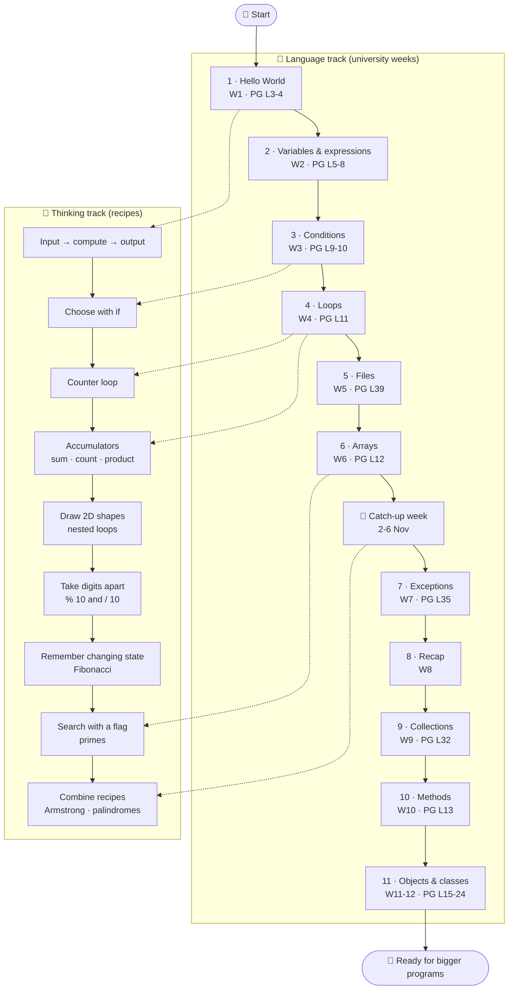
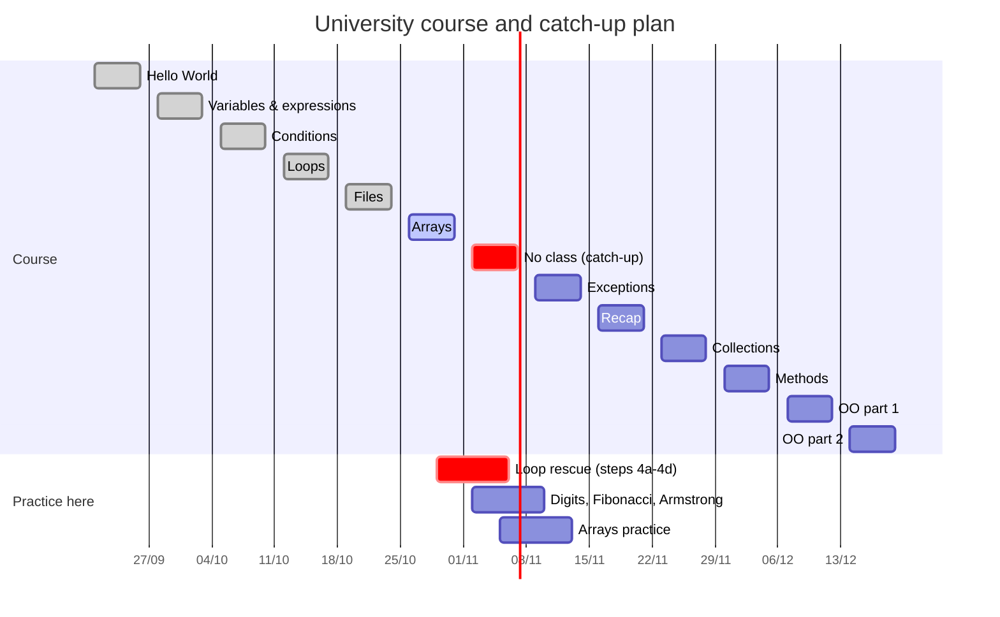
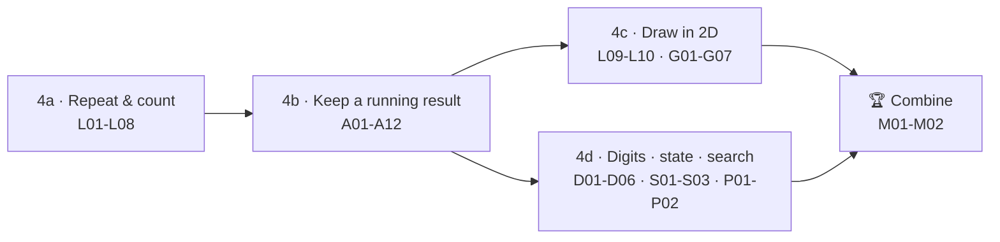
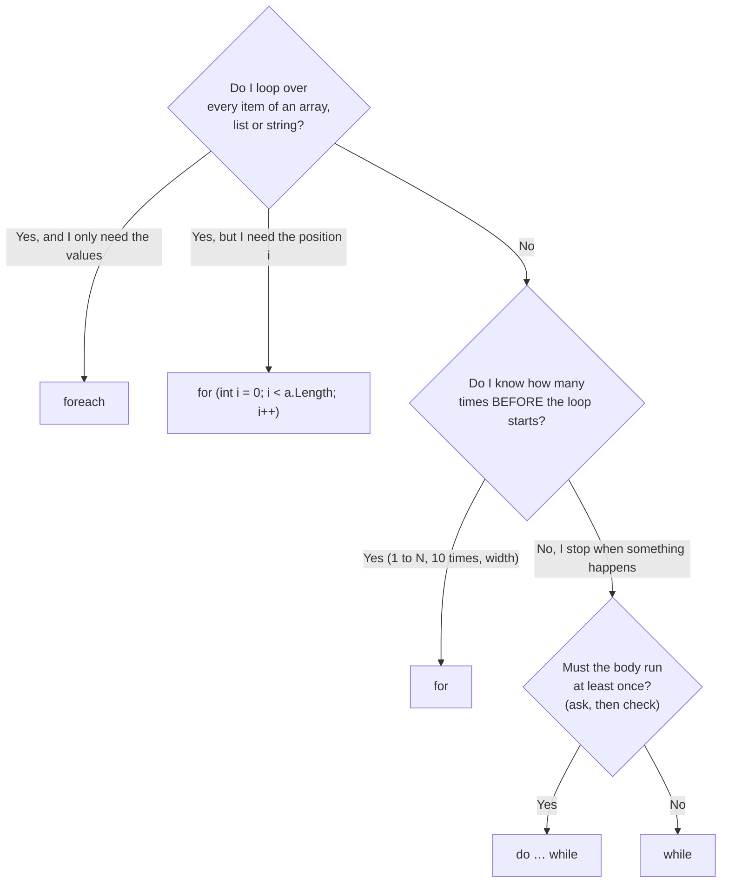
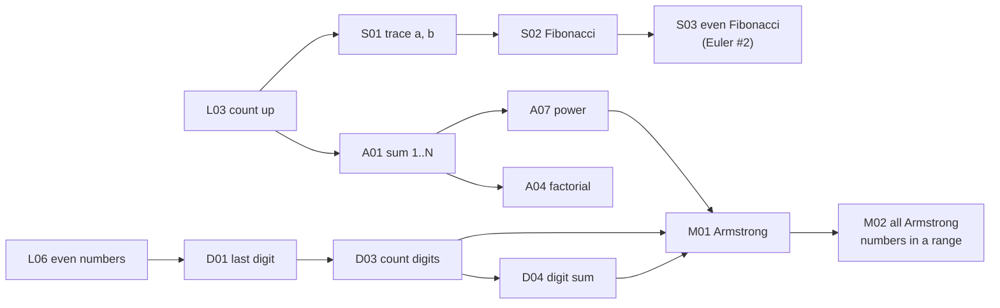

🏠 [Home](README.md) › 🗺️ Roadmap

# 🗺️ Your C# roadmap

Welcome! This page is the map. Follow the path one step at a time.

> 📍 **You are here (29 October):** the course is at [Step 6 · Arrays](#step-6--arrays--week-6-2610--you-are-here). Your practice is at the [catch-up plan](#5-catch-up-plan-29-oct--10-nov), session 1.
You do not need to be fast. You need to be able to **explain** what your code does.

There are **two tracks** that walk side by side:

- 🧱 **Language track** – the C# tools: variables, `if`, loops, arrays, files, methods, classes… (this follows the university course).
- 🧠 **Thinking track** – the *recipes* that solve problems: count, add up, find the biggest, take a number apart, draw a shape… Loops are only the *means*. The recipes are the *goal*.

> 📖 **Parallel track — the book:** *The C# Player's Guide*, 5th edition (PG). Each step says which **PG level** to read *alongside* it. Its challenges stay in the book (tracked in [C# Quest Tracker](https://lfarci.github.io/csharp-quest-tracker/)); they are **not** repeated here. This repo focuses on **problem-solving techniques** and **original exercises**.
>
> 🔎 **First skill, before any step:** learn [how to read an exercise](docs/reading-an-exercise.md) — what to look for, how to organize your ideas, and what to do when stuck. Use its worksheet for every exercise.

## 1. The path at a glance

Dotted arrows show *when* a thinking step becomes possible. The thinking track is where most of the practice happens.

## 2. Where are we now? (28 October 2026)

The course is now on **arrays**, but loops are the real gap. The plan: use the free week (2–6 Nov) to rebuild loops with the recipes. See [§5 Catch-up plan](#5-catch-up-plan-29-oct--10-nov).

## 3. The steps

Each step has: its **objectives** (what you can do at the end), what you learn, the book level to read alongside, the Microsoft Learn docs, the recipes, the exercises, and a **"ready when"** check.
The steps are written for one learner: see [who this course is for](docs/learner-persona.md). Exercise IDs link to the [exercise inventory](exercises/README.md). Recipes link to the [cookbook](cookbook/README.md).

### Step 1 · Hello World — week 1 (21/9)

- 🎯 **Objectives — after this step you can:** write a program that prints text; read one line the user types; explain the difference between `Write` and `WriteLine`.

- **Learn:** what a program is, `Console.WriteLine`, `Console.Write`, `Console.ReadLine`, running a program.
- 📖 **Read alongside (PG):** Level 3 (Hello World), Level 4 (comments).
- **Docs:** [Tutorial: Hello World](https://learn.microsoft.com/en-us/dotnet/csharp/tour-of-csharp/tutorials/hello-world) · [`Console.ReadLine`](https://learn.microsoft.com/en-us/dotnet/api/system.console.readline) · [Learn path: first steps with C#](https://learn.microsoft.com/en-us/training/paths/csharp-first-steps/)
- **Exercises:** [B01](exercises/B01-hello-you.md)
- ✅ **Ready when:** you can write a program that asks for your name and greets you, from a blank file.

### Step 2 · Variables, types & expressions — week 2 (28/9)

- 🎯 **Objectives — after this step you can:** store a value in a variable of the right type; turn text into a number with `int.Parse`; predict the result of `/` and `%` on whole numbers.

- **Learn:** `int`, `double`, `string`, `bool`; assigning; `+ - * /`; **integer division** and the **remainder `%`**; converting text to a number (`int.Parse`); string interpolation `$"..."`.
- 📖 **Read alongside (PG):** Levels 5–8 (Variables, Type system, Math, Console 2.0).
- **Docs:** [Tutorial: numbers in C#](https://learn.microsoft.com/en-us/dotnet/csharp/tour-of-csharp/tutorials/numbers-in-csharp) · [Built-in types](https://learn.microsoft.com/en-us/dotnet/csharp/language-reference/builtin-types/built-in-types) · [Arithmetic operators (`/`, `%`)](https://learn.microsoft.com/en-us/dotnet/csharp/language-reference/operators/arithmetic-operators) · [String interpolation](https://learn.microsoft.com/en-us/dotnet/csharp/language-reference/tokens/interpolated)
- **Recipe:** *input → compute → output*.
- **Exercises:** [B02](exercises/B02-rectangle-calculator.md), [B03](exercises/B03-seconds-to-hms.md)
- ✅ **Ready when:** you can say what `17 / 5` and `17 % 5` give (3 and 2) and why. *This is the secret key for the digit recipes later.*

### Step 3 · Conditions — week 3 (05/10)

- 🎯 **Objectives — after this step you can:** choose between 2 or more cases with `if` / `else if` / `else`; combine tests with `&&` and `||`; list the boundary values to test.

- **Learn:** `if` / `else if` / `else`, comparisons `== != < <= > >=`, `&&`, `||`, `!`, `switch`.
- 📖 **Read alongside (PG):** Level 9 (Decision making), Level 10 (Switches).
- **Docs:** [Selection statements (`if`, `switch`)](https://learn.microsoft.com/en-us/dotnet/csharp/language-reference/statements/selection-statements) · [Comparison operators](https://learn.microsoft.com/en-us/dotnet/csharp/language-reference/operators/comparison-operators) · [Boolean logical operators](https://learn.microsoft.com/en-us/dotnet/csharp/language-reference/operators/boolean-logical-operators) · [Tutorial: branches and loops](https://learn.microsoft.com/en-us/dotnet/csharp/tour-of-csharp/tutorials/branches-and-loops)
- **Recipe:** *classify a value* (even/odd with `% 2`, ranges with `&&`).
- **Exercises:** [C01](exercises/C01-even-or-odd.md)–[C04](exercises/C04-grade-from-a-score.md)
- ✅ **Ready when:** you can test every branch of your `if`, including the boundary value (for example exactly 18 in an age check).

### Step 4 · Loops — week 4 (12/10) ⭐ the big one

- 🎯 **Objectives — after this step you can:** predict and trace a loop on paper; name the recipe an exercise needs; write a counter loop, an accumulator and a nested loop from a blank file; find an off-by-one bug.

Loops get **four small sub-steps**. Do not jump to Fibonacci or Armstrong before 4a–4c feel easy.

- **Learn:** `for`, `while`, `do … while`, `break`, `continue`; tracing a loop on paper.
- 📖 **Read alongside (PG):** Level 11 (Looping).
- **Docs:** [Iteration statements (`for`, `foreach`, `while`, `do`)](https://learn.microsoft.com/en-us/dotnet/csharp/language-reference/statements/iteration-statements) · [Jump statements (`break`, `continue`)](https://learn.microsoft.com/en-us/dotnet/csharp/language-reference/statements/jump-statements) · [Learn module: `for` loops](https://learn.microsoft.com/en-us/training/modules/csharp-for/) · [Learn module: `do-while` and `while`](https://learn.microsoft.com/en-us/training/modules/csharp-do-while/) · [Learn path: add logic to console apps](https://learn.microsoft.com/en-us/training/paths/get-started-c-sharp-part-3/)
- **Recipes:** [counter loop](cookbook/01-counter-loop.md), [accumulator](cookbook/02-accumulator.md), [conditional accumulator](cookbook/03-conditional-accumulator.md), [min/max tracker](cookbook/04-min-max.md), [flag/search](cookbook/05-flag-search.md), [digit extraction](cookbook/06-digit-extraction.md), [state update](cookbook/07-state-update.md), [nested grid](cookbook/08-nested-grid.md), [input validation](cookbook/09-input-validation.md), [sentinel loop](cookbook/10-sentinel-loop.md).
- **Exercises:** [L01](exercises/L01-trace-a-loop.md)–[L08](exercises/L08-guess-the-number.md) · [A01](exercises/A01-sum-1-to-n.md)–[A10](exercises/A10-sum-of-a-series.md) with 🧩 arrange [A11](exercises/A11-arrange-sum-of-squares.md) and 🐞 fix [A12](exercises/A12-fix-count-multiples-of-7.md) · bridge to 2D: [L09](exercises/L09-draw-a-row.md), [L10](exercises/L10-numbers-on-one-line.md), 🧩 arrange [G07](exercises/G07-arrange-a-square.md) · [G01](exercises/G01-rectangle.md)–[G06](exercises/G06-pyramid.md) · [D01](exercises/D01-last-digit.md)–[D06](exercises/D06-palindrome-number.md) with 🐞 fix [D07](exercises/D07-fix-digit-sum.md) · [S01](exercises/S01-trace-updates.md)–[S03](exercises/S03-even-fibonacci-sum.md) · [P01](exercises/P01-is-it-prime.md)–[P02](exercises/P02-primes-up-to-n.md) · [M01](exercises/M01-armstrong-number.md)–[M02](exercises/M02-armstrong-numbers-in-a-range.md) · Project Euler #1, #6, #2.
- ✅ **Ready when:** you can solve factorial, Fibonacci and the Armstrong check from a blank file **and** explain your trace table.

### Step 5 · Files — week 5 (19/10)

- 🎯 **Objectives — after this step you can:** write lines to a file and read them back; turn the lines into numbers and add them up.

- **Learn:** write lines to a text file, read them back (`File.WriteAllLines`, `File.ReadAllLines`, `File.Exists`).
- 📖 **Read alongside (PG):** Level 39 (*The Long Game*). It is late in the book: read only the file part.
- **Docs:** [`File` class](https://learn.microsoft.com/en-us/dotnet/api/system.io.file) · [How to read text from a file](https://learn.microsoft.com/en-us/dotnet/standard/io/how-to-read-text-from-a-file)
- **Recipe:** reading a file gives you an array of lines → use [array traversal](cookbook/11-array-traversal.md) + [accumulator](cookbook/02-accumulator.md).
- **Exercises:** [F01](exercises/F01-numbers-file.md)
- ✅ **Ready when:** you can save numbers to a file, read them back and add them up.

### Step 6 · Arrays — week 6 (26/10) ← *you are here*

- 🎯 **Objectives — after this step you can:** create an array and read `values[i]`; visit every element without going out of range; reuse a step-4 recipe on an array or a string.

- **Learn:** create an array, index from `0`, `.Length`, loop over it with `for` and `foreach`.
- 📖 **Read alongside (PG):** Level 12 (Arrays).
- **Docs:** [Arrays](https://learn.microsoft.com/en-us/dotnet/csharp/language-reference/builtin-types/arrays) · [Iteration statements (`foreach`)](https://learn.microsoft.com/en-us/dotnet/csharp/language-reference/statements/iteration-statements)
- **Recipes:** [array traversal](cookbook/11-array-traversal.md) — *every loop recipe from step 4 works on arrays too!* [string building](cookbook/12-string-building.md) for text.
- **Exercises:** [R01](exercises/R01-sum-an-array.md)–[R05](exercises/R05-reverse-an-array.md) with 🐞 fix [R06](exercises/R06-fix-largest-value.md) · [T01](exercises/T01-count-a-letter.md)–[T03](exercises/T03-count-and-keep-digits.md)
- ✅ **Ready when:** you can explain the difference between `i` (the position) and `values[i]` (the value).

### 🛟 Catch-up week — 2–6 November (no class)

The best moment to fix loops for good. See [§5](#5-catch-up-plan-29-oct--10-nov).

### Step 7 · Exceptions — week 7 (09/11)

- 🎯 **Objectives — after this step you can:** explain what a crash (exception) is; stop bad input from crashing your program with `TryParse` or `try` / `catch`.

- **Learn:** what a crash is, `try` / `catch`, `int.TryParse` as a way to avoid crashes.
- 📖 **Read alongside (PG):** Level 35 (Error handling and exceptions).
- **Docs:** [Exceptions (fundamentals)](https://learn.microsoft.com/en-us/dotnet/csharp/fundamentals/exceptions/) · [`try`/`catch` statements](https://learn.microsoft.com/en-us/dotnet/csharp/language-reference/statements/exception-handling-statements) · [`int.TryParse`](https://learn.microsoft.com/en-us/dotnet/api/system.int32.tryparse)
- **Recipe:** [input validation loop](cookbook/09-input-validation.md) (+ `try`/`catch`).
- **Exercises:** [E01](exercises/E01-safe-number-reader.md)
- ✅ **Ready when:** typing `abc` instead of a number does not crash your program.

### Step 8 · Recap — week 8 (16/11)

🎯 **Objective:** solve one exercise per recipe from a blank file, without hints, and explain your trace table.

Redo one exercise per recipe **without hints**: [A04](exercises/A04-factorial.md), [G05](exercises/G05-checkerboard.md), [D04](exercises/D04-digit-sum.md), [S02](exercises/S02-fibonacci.md), [R02](exercises/R02-largest-in-an-array.md), [M01](exercises/M01-armstrong-number.md). Then try Project Euler #2. Missed one? Go back to that recipe.

### Step 9 · Collections — week 9 (23/11)

- 🎯 **Objectives — after this step you can:** create a `List<int>`, add and remove values; choose between an array and a list, and say why.

- **Learn:** `List<T>` that can grow (`Add`, `Remove`, `Count`), loop over it with `foreach`.
- 📖 **Read alongside (PG):** Level 32 (Generics, `List<T>`).
- **Docs:** [Tutorial: collections (List)](https://learn.microsoft.com/en-us/dotnet/csharp/tour-of-csharp/tutorials/list-collection) · [`List<T>`](https://learn.microsoft.com/en-us/dotnet/api/system.collections.generic.list-1) · [Collections overview](https://learn.microsoft.com/en-us/dotnet/standard/collections/)
- **Recipes:** same as arrays + [sentinel loop](cookbook/10-sentinel-loop.md) to fill the list.
- **Exercises:** [K01](exercises/K01-shopping-list.md)
- ✅ **Ready when:** you can explain when to pick an array (fixed size) and when a `List` (it grows).

### Step 10 · Methods — week 10 (30/11)

- 🎯 **Objectives — after this step you can:** write a method with parameters and a `return`; call it with different values; split a long program into small named methods.

- **Learn:** give a recipe a name: parameters, `return`, `void`.
- 📖 **Read alongside (PG):** Level 13 (Methods).
- **Docs:** [Methods](https://learn.microsoft.com/en-us/dotnet/csharp/methods) · [Learn path: create methods](https://learn.microsoft.com/en-us/training/paths/get-started-c-sharp-part-5/)
- **Recipe:** one recipe = one method (`CountDigits`, `Power`, `IsArmstrong`).
- **Exercises:** [N01](exercises/N01-armstrong-with-methods.md)
- ✅ **Ready when:** you can turn your Armstrong solution into 3 small methods.

### Step 11 · Objects & classes — weeks 11–12 (07/12, 14/12)

- 🎯 **Objectives — after this step you can:** describe a class and an object in your own words; write a small class with a constructor and a method; create objects with `new`.

- **Learn:** class = a blueprint; object = one thing built from it; fields, constructors, methods, properties.
- 📖 **Read alongside (PG):** Levels 15–24 (Objects, Enums, Tuples, Classes, Information hiding, Properties, Static…).
- **Docs:** [Object-oriented programming in C#](https://learn.microsoft.com/en-us/dotnet/csharp/fundamentals/object-oriented/) · [Classes](https://learn.microsoft.com/en-us/dotnet/csharp/fundamentals/types/classes)
- **Exercises:** no original exercises here yet — follow the book alongside; come back to the recipes whenever a method needs a loop.
- ✅ **Ready when:** you can write a small `Point` class and explain what `new` does.

## 4. Which loop should I use?

A loop is a tool. First say **what repeats** and **what makes it stop**. Then pick the loop.

| Loop | Use it when… | Typical exercise |
| --- | --- | --- |
| `for` | you know the number of turns (count from 1 to N, draw `width` stars) | sum 1..N, factorial, multiplication table |
| `while` | you stop when a condition changes and maybe run **zero** times | digits (`while (n > 0)`), Fibonacci up to a limit |
| `do … while` | you must do it **once** before you can check | ask for input until it is valid, menus |
| `foreach` | you visit every item and do not need its position | sum of an array, count letters in a string |

These are good defaults, not laws. Every `for` can be written as a `while`.

## 5. Catch-up plan (29 Oct – 10 Nov)

About **40 minutes per session**. Move on only when the "ready" check works *without help*. Repeating a session is normal.

| # | When | Focus | Recipes | Do these |
| --- | --- | --- | --- | --- |
| 1 | Thu 29/10 | 🔍 Diagnose: trace on paper + [read an exercise](docs/reading-an-exercise.md) | counter loop | [L01](exercises/L01-trace-a-loop.md), [L02](exercises/L02-boundaries.md) on paper, then [L03](exercises/L03-count-up-and-down.md) with the worksheet |
| 2 | Fri 30/10 | `for` / `while`, boundaries | counter loop + first accumulator | [L04](exercises/L04-multiplication-table.md), [L06](exercises/L06-even-numbers.md), [A01](exercises/A01-sum-1-to-n.md) |
| 3 | Mon 2/11 | Accumulators | accumulator | [A02](exercises/A02-count-multiples-of-3.md), [A04](exercises/A04-factorial.md) (factorial), [A05](exercises/A05-sum-square-difference.md) |
| 4 | Tue 3/11 | Loop + `if` | conditional accumulator | [A03](exercises/A03-sum-even-values.md), [A08](exercises/A08-multiples-of-3-or-5.md), Project Euler #1 |
| 5 | Wed 4/11 | Draw in 2D 🎨 | nested grid | [G01](exercises/G01-rectangle.md), [G02](exercises/G02-right-triangle.md), [G03](exercises/G03-multiplication-grid.md), [G05](exercises/G05-checkerboard.md) |
| 6 | Thu 5/11 | Stop when… | sentinel, validation, min/max | [L05](exercises/L05-until-zero.md), [L07](exercises/L07-ask-until-valid.md), [A06](exercises/A06-average-until-zero.md), [A09](exercises/A09-min-and-max-until-zero.md) |
| 7 | Fri 6/11 | Take digits apart | digit extraction | [D01](exercises/D01-last-digit.md), [D02](exercises/D02-remove-last-digit.md), [D03](exercises/D03-count-digits.md), [D04](exercises/D04-digit-sum.md) |
| 8 | Sat 7/11 | Changing state | state update | [S01](exercises/S01-trace-updates.md), [S02](exercises/S02-fibonacci.md) (Fibonacci) |
| 9 | Sun 8/11 | Combine 🏆 | digit + accumulator + compare | [A07](exercises/A07-integer-power.md) (power), [D05](exercises/D05-reverse-a-number.md), [M01](exercises/M01-armstrong-number.md) (Armstrong) |
| 10 | Mon 9/11 | Arrays with the same recipes | array traversal | [R01](exercises/R01-sum-an-array.md), [R02](exercises/R02-largest-in-an-array.md), [R03](exercises/R03-count-matches.md) |
| 11 | Tue 10/11 | Mini test (no hints) | mixed | one of [D06](exercises/D06-palindrome-number.md) / [P01](exercises/P01-is-it-prime.md) / [S03](exercises/S03-even-fibonacci-sum.md), chosen by the coach |

How to run one session: see [How to practice](docs/how-to-practice.md#a-session).

## 6. Shortcuts to the teacher's problems

If a teacher exercise is due *now*, these are the minimum steps:

- **Factorial** = a [product accumulator](cookbook/02-accumulator.md) (start at **1**!).
- **Fibonacci** = a [state update](cookbook/07-state-update.md) with `previous`, `current`, `next`.
- **Armstrong** = [count digits](cookbook/06-digit-extraction.md) + [extract digits](cookbook/06-digit-extraction.md) + power via a [product accumulator](cookbook/02-accumulator.md) + sum + compare. See [Combining recipes](cookbook/combining-recipes.md).

## 7. Make the maths visible first

The goal is to practise *programming*, not to guess maths. Always write the definition and a tiny example on paper:

- **Sum:** 1 + 2 + 3 + 4 = 10.
- **Factorial:** 4! = 1 × 2 × 3 × 4 = 24, and 0! = 1. With `int`, stay at N ≤ 12.
- **Power:** 3⁴ = 3 × 3 × 3 × 3 = 81, and x⁰ = 1.
- **Fibonacci:** 0, 1, 1, 2, 3, 5, 8… each value = the two before added together.
- **Armstrong:** 153 = 1³ + 5³ + 3³ (3 digits → power 3). 9474 = 9⁴ + 4⁴ + 7⁴ + 4⁴ (4 digits → power 4).
- **Prime:** a number ≥ 2 that only divides by 1 and itself. 7 is prime, 9 is not (9 = 3 × 3).
- **Palindrome:** reads the same both ways: 1221, "kayak".

## 8. Extra resources (only when stuck)

- *The C# Player's Guide* (parallel track): official [solutions for the 5th edition](https://csharpplayersguide.com/solutions/5th-edition), for the book challenges only (look **after** trying).
- [Exercism C# track](https://exercism.org/tracks/csharp): extra practice with tests, once the steps above feel OK.
- Project Euler: [#1](https://projecteuler.net/problem=1), [#6](https://projecteuler.net/problem=6), [#2](https://projecteuler.net/problem=2), [#4](https://projecteuler.net/problem=4), [#5](https://projecteuler.net/problem=5) — milestones, not daily homework.

Not in this path (yet): LINQ, recursion, inheritance details, async. They come later, when the course needs them.

---

⬅️ [Home](README.md) · Next: [Getting started](docs/getting-started.md) ➡️
