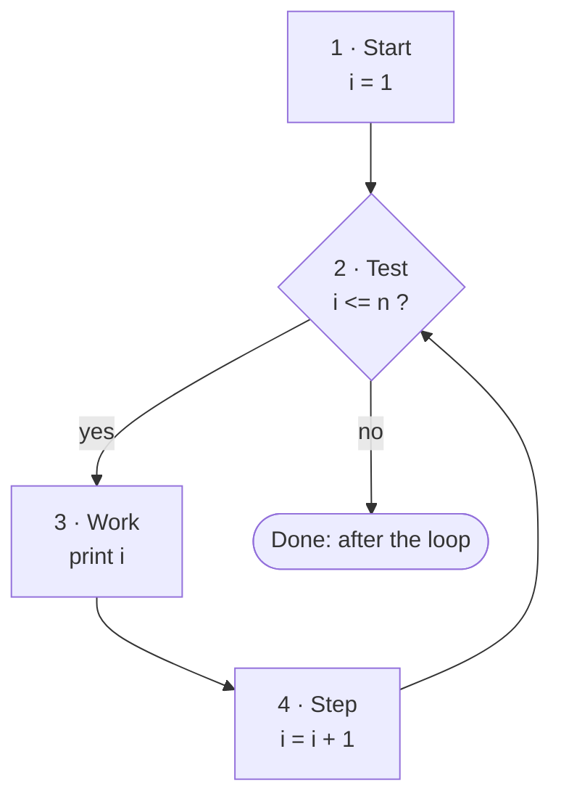

🏠 [Home](../README.md) › 🗺️ [Roadmap](../ROADMAP.md) › 🍳 [Cookbook](README.md) › Recipe 1 · Counter loop

# Recipe 1 · Counter loop — "do it N times"

> The loop with a number that goes up (or down) by a fixed step. It is the base of almost every other recipe.

## 🔎 Recognize it

Trigger words: **"from 1 to N"**, **"N times"**, **"print the numbers…"**, **"count down"**, **"every second number"**, **"table of 7"**.

## 🧠 The idea

A loop has **4 parts**. Say them out loud before you write code:

1. **Start** – where does the counter begin? (`int i = 1`)
2. **Test** – when do we keep going? (`i <= n`)
3. **Work** – what happens with this value? (`Console.WriteLine(i)`)
4. **Step** – how does the counter move? (`i++`)



The test happens **before** each turn, also the first one. So a loop can run **zero** times (for example if `n` is 0).

## 📝 Template

```csharp
for (int i = START; i <= END; i += STEP)
{
    // WORK with i
}
```

The same loop with `while` (the 4 parts are just in different places):

```csharp
int i = START;          // 1 · start
while (i <= END)        // 2 · test
{
    // 3 · WORK with i
    i += STEP;          // 4 · step  (forget it = infinite loop!)
}
```

Variants:

| I want… | Start | Test | Step |
| --- | --- | --- | --- |
| 1, 2, …, N | `i = 1` | `i <= n` | `i++` |
| N, N-1, …, 1 | `i = n` | `i >= 1` | `i--` |
| 0, 2, 4, …, up to N | `i = 0` | `i <= n` | `i += 2` |
| exactly N turns | `i = 0` | `i < n` | `i++` |

## 🔬 Trace table: print 1 to 4

```csharp
for (int i = 1; i <= 4; i++)
{
    Console.WriteLine(i);
}
```

| Turn | `i` at start | `i <= 4`? | Output | `i` after step |
| ---: | ---: | --- | ---: | ---: |
| 1 | 1 | yes | 1 | 2 |
| 2 | 2 | yes | 2 | 3 |
| 3 | 3 | yes | 3 | 4 |
| 4 | 4 | yes | 4 | 5 |
| — | 5 | **no** → stop | | |

After the loop, `i` would be 5. 5 is tested but **not** printed.

## ⚠️ Common mistakes

- **Off by one:** `<` vs `<=`. `i < 5` stops after 4; `i <= 5` prints 5. Check the last turn on paper.
- **Forgot the step** in a `while` → infinite loop (stop it with `Ctrl+C`).
- **Step in the wrong direction:** counting down with `i++`.
- **`;` after the `for (...)`**: `for (...);` runs an empty loop, then the block once.
- **Confusing a loop with an `if`:** an `if` decides once, a loop comes back to the test.

## 🏋️ Mini exercises

1. [**L03**](../exercises/L03-count-up-and-down.md) Print 1 to N, then N to 1.
2. [**L04**](../exercises/L04-multiplication-table.md) Print the multiplication table of N (`N x 1` … `N x 10`).
3. [**L06**](../exercises/L06-even-numbers.md) Print only the even numbers from 2 to N (two ways: `i += 2`, or `i++` with an `if`).

➡️ Next: [Recipe 2 · Accumulator](02-accumulator.md)
