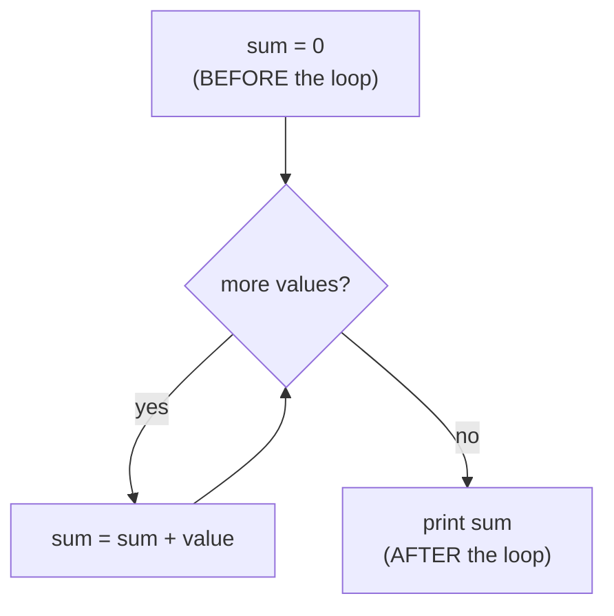

# Recipe 2 · Accumulator — sum, count, product

> Keep **one result box** outside the loop and update it on every turn.


## 🔎 Recognize it

Trigger words: **"sum"**, **"total"**, **"how many"**, **"count"**, **"product"**, **"factorial"**, **"average"**, **"power"**, **"x to the n"**.
If the answer is **one number that sums up many values**, you need an accumulator.

## 🧠 The idea

The box means: *"the result for everything I have seen so far"*.

| The question asks… | Box starts at | On each turn |
| --- | --- | --- |
| how many? (**count**) | `count = 0` | `count++` |
| total? (**sum**) | `sum = 0` | `sum += value` |
| product? (**factorial**, **power**) | `product = 1` | `product *= value` |
| text? (see [recipe 12](12-string-building.md)) | `text = ""` | `text += piece` |

Why does a product start at **1**? Because 0 × anything = 0. 1 is the "neutral" number for ×, like 0 is for +.



## 📝 Template

```csharp
int sum = 0;                 // 1. box BEFORE the loop
for (int i = 1; i <= n; i++)
{
    sum += i;                // 2. update INSIDE the loop
}
Console.WriteLine(sum);      // 3. use it AFTER the loop
```

Factorial (product accumulator):

```csharp
long product = 1;            // starts at 1, not 0!
for (int i = 1; i <= n; i++)
{
    product *= i;
}
```

Power `baseValue` to the `exponent` (multiply the **same** number `exponent` times):

```csharp
int result = 1;
for (int i = 0; i < exponent; i++)
{
    result *= baseValue;
}
```

## 🔬 Trace tables

Sum 1..4:

| `i` | `sum` before | `sum` after |
| ---: | ---: | ---: |
| 1 | 0 | 1 |
| 2 | 1 | 3 |
| 3 | 3 | 6 |
| 4 | 6 | 10 |

Factorial 5! :

| `i` | `product` before | `product` after |
| ---: | ---: | ---: |
| 1 | 1 | 1 |
| 2 | 1 | 2 |
| 3 | 2 | 6 |
| 4 | 6 | 24 |
| 5 | 24 | **120** |

Paper drill: for 3, 5, 2, first **count** values above 2 (answer 2), then **sum** them (answer 8). Same loop, different box.

## ⚠️ Common mistakes

- **Box declared inside the loop** → reset on every turn, and not visible after the loop.
- **Product starting at 0** → always 0.
- **`=` instead of `+=`**: `sum = i` forgets the old value.
- **Printing inside the loop** when only the final answer is asked.
- **Overflow:** `int` goes up to about 2.1 billion. 13! is too big → use `long` (up to 20!).
- **Average with integers:** `sum / count` with two `int`s drops the decimals. Use `(double)sum / count`, and do not divide by 0.

## 🏋️ Mini exercises

1. **A01** Sum 1..N (do not use the formula).
2. **A04** Factorial of N (test N = 0 → 1).
3. **A07** Power: `base` to the `exponent` with a loop.
4. Bonus: **A05** two boxes in one loop (sum and sum of squares) → Project Euler #6.

➡️ Next: [Recipe 3 · Conditional accumulator](03-conditional-accumulator.md)
