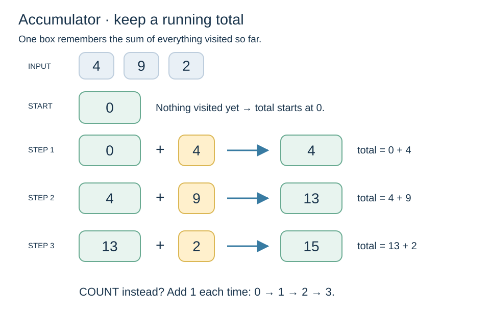
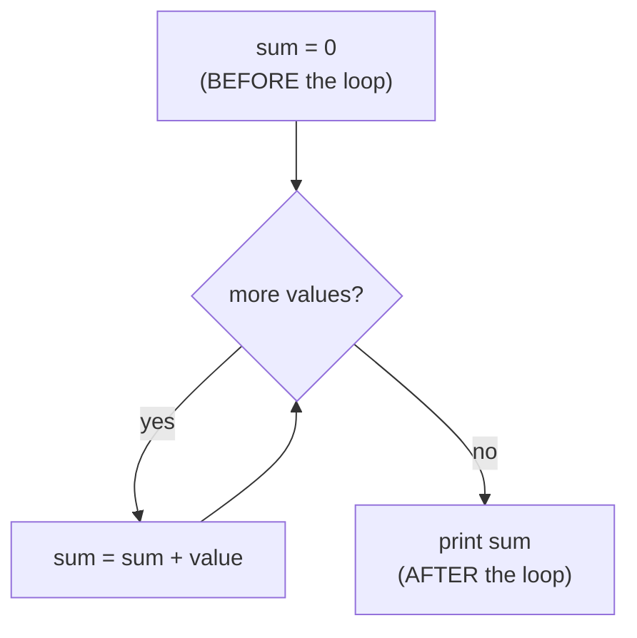

🏠 [Home](../README.md) › 🗺️ [Roadmap](../ROADMAP.md) › 🍳 [Cookbook](README.md) › Recipe 2 · Accumulator

# Recipe 2 · Accumulator — sum, count, product

> Keep **one result box** outside the loop and update it on every turn.



🧭 **How this page works:** 1 goal → predict → trace → the pattern → complete it → your turn. Do the steps in order, with a pen. See [why](../docs/writing-guide.md#2-lesson-format).

## 🎯 1 · Goal

Turn many values into **one** result (a total, a count or a product) with one box that you update on every turn.

## 🔮 2 · Predict

Read this code. **Before** you run it, write down what it prints.

```csharp
int sum = 0;
for (int i = 1; i <= 4; i++)
{
    sum += i;
}
Console.WriteLine(sum);
```

<details><summary>Check your prediction</summary>

It prints `10` (1 + 2 + 3 + 4), **once**, after the loop.

</details>

## 🔬 3 · Trace it

Cover the tables, fill your own, then compare.

Sum 1..4:

| `i` | `sum` before | `sum` after |
| ---: | ---: | ---: |
| 1 | 0 | 1 |
| 2 | 1 | 3 |
| 3 | 3 | 6 |
| 4 | 6 | 10 |

Factorial 5! :

| `i` | `product` before | `product` after |
| ---: | ---: | ---: |
| 1 | 1 | 1 |
| 2 | 1 | 2 |
| 3 | 2 | 6 |
| 4 | 6 | 24 |
| 5 | 24 | **120** |

Paper drill: for 3, 5, 2, first **count** values above 2 (answer 2), then **sum** them (answer 8). Same loop, different box.

## 🧩 4 · The pattern

### Subgoals (the steps, with names you can reuse)

1. **Create the box** before the loop, with a neutral start value (0 for + and count, 1 for ×).
2. **Loop** over the values.
3. **Update the box** inside the loop.
4. **Use the box** after the loop.

Say the subgoal names out loud when you write the code. They are the same in every exercise that uses this recipe.

### 🔎 Recognize it

Trigger words: **"sum"**, **"total"**, **"how many"**, **"count"**, **"product"**, **"factorial"**, **"average"**, **"power"**, **"x to the n"**.
If the answer is **one number that sums up many values**, you need an accumulator.

### 🧠 The idea

The box means: *"the result for everything I have seen so far"*.

| The question asks… | Box starts at | On each turn |
| --- | --- | --- |
| how many? (**count**) | `count = 0` | `count++` |
| total? (**sum**) | `sum = 0` | `sum += value` |
| product? (**factorial**, **power**) | `product = 1` | `product *= value` |
| text? (see [recipe 12](12-string-building.md)) | `text = ""` | `text += piece` |

Why does a product start at **1**? Because 0 × anything = 0. 1 is the "neutral" number for ×, like 0 is for +.



### 📝 Template

```csharp
int sum = 0;                 // 1. box BEFORE the loop
for (int i = 1; i <= n; i++)
{
    sum += i;                // 2. update INSIDE the loop
}
Console.WriteLine(sum);      // 3. use it AFTER the loop
```

Factorial (product accumulator):

```csharp
long product = 1;            // starts at 1, not 0!
for (int i = 1; i <= n; i++)
{
    product *= i;
}
```

Power `baseValue` to the `exponent` (multiply the **same** number `exponent` times):

```csharp
int result = 1;
for (int i = 0; i < exponent; i++)
{
    result *= baseValue;
}
```

## ✍️ 5 · Complete it

Part of the code is given. Fill in the rest on paper.

```csharp
// Factorial: 5! = 1 × 2 × 3 × 4 × 5 = 120. Fill the 2 blanks.
long product = ____;
for (int i = 1; i <= n; i++)
{
    product ____ i;
}
return product;
```

<details><summary>Answer</summary>

`long product = 1;` and `product *= i;`. A product starts at **1**: starting at 0 would always give 0.

</details>

## 🏋️ 6 · Your turn

Now alone, in a real file (`./ex start ID`, then `./ex check`):

1. [**A01**](../exercises/A01-sum-1-to-n.md) Sum 1..N (do not use the formula).
2. [**A04**](../exercises/A04-factorial.md) Factorial of N (test N = 0 → 1).
3. [**A07**](../exercises/A07-integer-power.md) Power: `base` to the `exponent` with a loop.
4. Bonus: [**A05**](../exercises/A05-sum-square-difference.md) two boxes in one loop (sum and sum of squares) → Project Euler #6.

🧩 Arrange-the-lines exercise first, if a blank file feels hard: [**A11**](../exercises/A11-arrange-sum-of-squares.md) sum of squares.

🔁 **Want more of the same?** Do the drill set for this recipe in the [exercise inventory](../exercises/README.md#-drill-sets-same-pattern-many-times): 5 to 12 short exercises that use exactly this pattern.

### 🐞 Debug it

This code has **one** bug. Find it on paper: trace a small example.

```csharp
// Should give 1 + 2 + … + n. SumTo(3) gives 3. Why?
int sum = 0;
for (int i = 1; i <= n; i++)
{
    sum = i;
}
return sum;
```

<details><summary>The bug</summary>

`sum = i` **replaces** the box with `i`, so only the last value is kept. Use `sum += i` (keep the old value and add).

</details>

### ⚠️ Common mistakes

- **Box declared inside the loop** → reset on every turn, and not visible after the loop.
- **Product starting at 0** → always 0.
- **`=` instead of `+=`**: `sum = i` forgets the old value.
- **Printing inside the loop** when only the final answer is asked.
- **Overflow:** `int` goes up to about 2.1 billion. 13! is too big → use `long` (up to 20!).
- **Average with integers:** `sum / count` with two `int`s drops the decimals. Use `(double)sum / count`, and do not divide by 0.

➡️ Next: [Recipe 3 · Conditional accumulator](03-conditional-accumulator.md)
