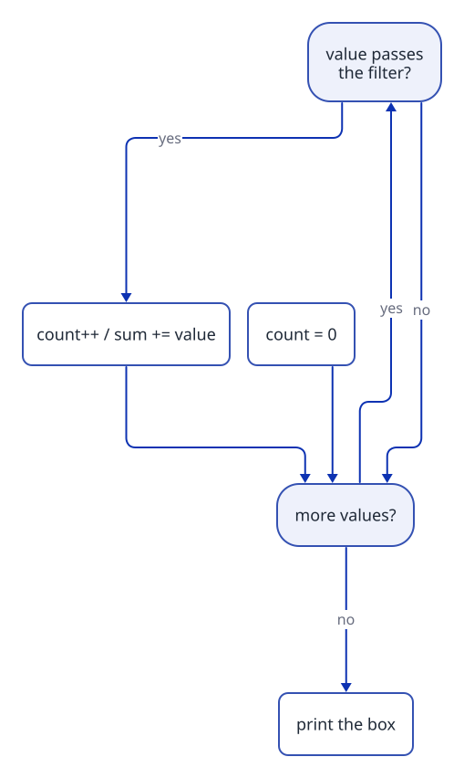

[Home](../README.md) › [Cookbook](README.md) › Recipe 3 · Conditional accumulator

# Recipe 3 · Conditional accumulator — filter, then accumulate

> Recipe 2 + an `if` inside the loop: **only some values** go into the box.

**How this page works:** 1 goal → predict → trace → the pattern → complete it → your turn. Do the steps in order, with a pen. See [why](../docs/writing-guide.md#2-lesson-format).

## 1 · Goal

Add up or count **only the values that pass a test**, by putting an `if` inside the loop.

## 2 · Predict

Read this code. **Before** you run it, write down what it prints.

```csharp
int sum = 0;
for (int i = 1; i <= 6; i++)
{
    if (i % 2 == 0)
    {
        sum += i;
    }
}
Console.WriteLine(sum);
```

<details><summary>Check your prediction</summary>

It prints `12`: only 2, 4 and 6 pass the test `i % 2 == 0`.

</details>

## 3 · Trace it

Trace table: sum of even numbers 1..6. Cover the table, fill your own, then compare.

| `i` | `i % 2 == 0`? | `sum` before | `sum` after |
| ---: | --- | ---: | ---: |
| 1 | no | 0 | 0 |
| 2 | yes | 0 | 2 |
| 3 | no | 2 | 2 |
| 4 | yes | 2 | 6 |
| 5 | no | 6 | 6 |
| 6 | yes | 6 | **12** |

## 4 · The pattern

### Subgoals (the steps, with names you can reuse)

1. **Create the box** before the loop.
2. **Loop** over every value.
3. **Filter:** an `if` with the condition from the sentence (the *that* part).
4. **Update the box** only inside the `if`.
5. **Use the box** after the loop.

Say the subgoal names out loud when you write the code. They are the same in every exercise that uses this recipe.

### Recognize it

Trigger words: **"sum of the even numbers"**, **"how many are divisible by"**, **"count the… that…"**, **"only"**, **"multiples of 3 or 5"**, **"positive values"**.
Pattern of the sentence: *"sum / count the X **that** Y"* → the *that* part is your `if`.

### The idea

Every value is **visited**, but only the ones that pass the **filter** change the box.



Useful filters (using `%`, the remainder):

| Question | Filter |
| --- | --- |
| even? | `x % 2 == 0` |
| odd? | `x % 2 != 0` |
| divisible by 3? | `x % 3 == 0` |
| multiple of 3 **or** 5? | `x % 3 == 0 \|\| x % 5 == 0` |
| between 10 and 20? | `x >= 10 && x <= 20` |

### Template

```csharp
int sum = 0;
for (int i = 1; i <= n; i++)
{
    if (FILTER(i))           // e.g. i % 2 == 0
    {
        sum += i;
    }
}
Console.WriteLine(sum);
```

You can keep **several boxes** in the same loop (count *and* sum, evens *and* odds).

## 5 · Complete it

Part of the code is given. Fill in the rest on paper.

```csharp
// Count the numbers from 1 to n that are multiples of 4. Fill the 2 blanks.
int count = 0;
for (int i = 1; i <= n; i++)
{
    if (____)
    {
        ____;
    }
}
return count;
```

<details><summary>Answer</summary>

`i % 4 == 0` and `count++`.

</details>

## 6 · Your turn

Now alone, in a real file (`./ex start ID`, then `./ex check`):

1. [**A02**](../exercises/A02-count-multiples-of-3.md) Count multiples of 3 from 1 to N.
2. [**A03**](../exercises/A03-sum-even-values.md) Sum the even values from 1 to N.
3. [**A08**](../exercises/A08-multiples-of-3-or-5.md) Sum the multiples of 3 or 5 below N → then [Project Euler #1](https://projecteuler.net/problem=1).

Debugging exercise: [**A12**](../exercises/A12-fix-count-multiples-of-7.md) Fix the bugs: count multiples of 7.

**Want more of the same?** Do the drill set for this recipe in the [exercise inventory](../exercises/README.md#drill-sets-same-pattern-many-times): 5 to 12 short exercises that use exactly this pattern.

### Debug it

This code has **one** bug. Find it on paper: trace a small example.

```csharp
// Should count the odd numbers from 1 to n. Count(5) gives 5. Why?
int count = 0;
for (int i = 1; i <= n; i++)
{
    if (i % 2 != 0)
    {
    }
    count++;
}
return count;
```

<details><summary>The bug</summary>

`count++` is **outside** the `if`, so every value is counted. Move it inside the `{ }` of the `if`.

</details>

### Common mistakes

- Putting the `if` **around the loop** instead of **inside**.
- Counting a value twice: "multiples of 3 or 5" → one `if` with `||`, not two `if`s that both add 15.
- `x % 2 == 1` for "odd" fails with negative numbers (`-3 % 2` is `-1`). Prefer `x % 2 != 0`.
- "below 10" means `i < 10`, not `i <= 10`. Read the boundary words.

Next: [Recipe 4 · Min/max tracker](04-min-max.md)
