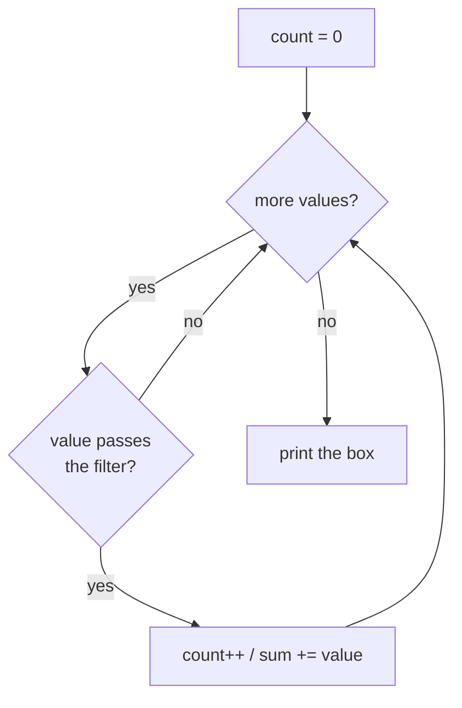

# Recipe 3 · Conditional accumulator — filter, then accumulate

> Recipe 2 + an `if` inside the loop: **only some values** go into the box.

## 🔎 Recognize it

Trigger words: **"sum of the even numbers"**, **"how many are divisible by"**, **"count the… that…"**, **"only"**, **"multiples of 3 or 5"**, **"positive values"**.
Pattern of the sentence: *"sum / count the X **that** Y"* → the *that* part is your `if`.

## 🧠 The idea

Every value is **visited**, but only the ones that pass the **filter** change the box.



Useful filters (using `%`, the remainder):

| Question | Filter |
| --- | --- |
| even? | `x % 2 == 0` |
| odd? | `x % 2 != 0` |
| divisible by 3? | `x % 3 == 0` |
| multiple of 3 **or** 5? | `x % 3 == 0 \|\| x % 5 == 0` |
| between 10 and 20? | `x >= 10 && x <= 20` |

## 📝 Template

```csharp
int sum = 0;
for (int i = 1; i <= n; i++)
{
    if (FILTER(i))           // e.g. i % 2 == 0
    {
        sum += i;
    }
}
Console.WriteLine(sum);
```

You can keep **several boxes** in the same loop (count *and* sum, evens *and* odds).

## 🔬 Trace table: sum of even numbers 1..6

| `i` | `i % 2 == 0`? | `sum` before | `sum` after |
| ---: | --- | ---: | ---: |
| 1 | no | 0 | 0 |
| 2 | yes | 0 | 2 |
| 3 | no | 2 | 2 |
| 4 | yes | 2 | 6 |
| 5 | no | 6 | 6 |
| 6 | yes | 6 | **12** |

## ⚠️ Common mistakes

- Putting the `if` **around the loop** instead of **inside**.
- Counting a value twice: "multiples of 3 or 5" → one `if` with `||`, not two `if`s that both add 15.
- `x % 2 == 1` for "odd" fails with negative numbers (`-3 % 2` is `-1`). Prefer `x % 2 != 0`.
- "below 10" means `i < 10`, not `i <= 10`. Read the boundary words.

## 🏋️ Mini exercises

1. **A02** Count multiples of 3 from 1 to N.
2. **A03** Sum the even values from 1 to N.
3. **A08** Sum the multiples of 3 or 5 below N → then [Project Euler #1](https://projecteuler.net/problem=1).

➡️ Next: [Recipe 4 · Min/max tracker](04-min-max.md)
