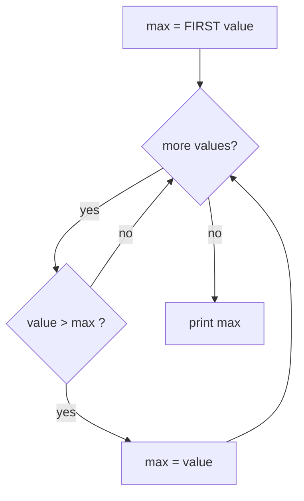

[Home](../README.md) › [Roadmap](../ROADMAP.md) › [Cookbook](README.md) › Recipe 4 · Min / max tracker

# Recipe 4 · Min / max tracker — "the best so far"

> Keep a box with **the best value seen so far**. Each new value challenges the champion.

**How this page works:** 1 goal → predict → trace → the pattern → complete it → your turn. Do the steps in order, with a pen. See [why](../docs/writing-guide.md#2-lesson-format).

## 1 · Goal

Find the largest (or smallest) value by keeping **the best value so far** in a box.

## 2 · Predict

Read this code. **Before** you run it, write down what it prints.

```csharp
int[] values = { -5, -2, -9 };
int max = values[0];
for (int i = 1; i < values.Length; i++)
{
    if (values[i] > max)
    {
        max = values[i];
    }
}
Console.WriteLine(max);
```

<details><summary>Check your prediction</summary>

It prints `-2`. With `int max = 0;` it would wrongly print `0`, a value that is not even in the array.

</details>

## 3 · Trace it

Trace table: -5, -2, -9. Cover the table, fill your own, then compare.

| Value | `value > max`? | `max` after |
| ---: | --- | ---: |
| -5 | (first value) | -5 |
| -2 | yes (-2 > -5) | -2 |
| -9 | no | **-2** |

## 4 · The pattern

### Subgoals (the steps, with names you can reuse)

1. **Crown the first value:** the box starts with the first value, not with 0.
2. **Loop** over the other values.
3. **Challenge:** compare the value with the box.
4. **Replace** the box when the value wins.
5. **Use the box** after the loop.

Say the subgoal names out loud when you write the code. They are the same in every exercise that uses this recipe.

### Recognize it

Trigger words: **"largest"**, **"smallest"**, **"maximum"**, **"minimum"**, **"highest score"**, **"best"**, **"oldest"**, **"longest word"**.

### The idea

Think of a **king of the hill** : the first value is king. Each new value fights the king; if it is bigger, it becomes the new king.



**Start with the first value**, not with 0. If all values are negative (-5, -2, -9), a max starting at 0 would wrongly answer 0.

### Template

With an array:

```csharp
int max = values[0];                 // the first value is king
for (int i = 1; i < values.Length; i++)
{
    if (values[i] > max)
    {
        max = values[i];
    }
}
```

With user input (you do not know the first value yet): use a flag `bool first = true`, or start at `int.MinValue` for max / `int.MaxValue` for min.

Also want **where** the best value is? Keep a second box `maxIndex` and update both together.

## 5 · Complete it

Part of the code is given. Fill in the rest on paper.

```csharp
// Smallest value of the array. Fill the 3 blanks.
int min = ____;
for (int i = 1; i < values.Length; i++)
{
    if (values[i] ____ min)
    {
        min = ____;
    }
}
return min;
```

<details><summary>Answer</summary>

`values[0]`, `<`, `values[i]`.

</details>

## 6 · Your turn

Now alone, in a real file (`./ex start ID`, then `./ex check`):

1. [**C02**](../exercises/C02-largest-of-three.md) Largest of three (no loop: just `if`). Good warm-up.
2. [**R02**](../exercises/R02-largest-in-an-array.md) Largest value of an array.
3. [**A09**](../exercises/A09-min-and-max-until-zero.md) Read numbers until 0, print the smallest and the largest.

Debugging exercise: [**R06**](../exercises/R06-fix-largest-value.md) Fix the bugs: largest value.

### Debug it

This code has **one** bug. Find it on paper: trace a small example.

```csharp
// Should give the largest value. Largest({ 3, 8, 5 }) gives 5. Why?
int max = values[0];
for (int i = 1; i < values.Length; i++)
{
    if (values[i] > values[0])
    {
        max = values[i];
    }
}
return max;
```

<details><summary>The bug</summary>

It compares with `values[0]` (the first value) instead of `max` (the best so far). 8 and 5 both beat 3, so the last one wins. Compare with `max`.

</details>

### Common mistakes

- `max = 0` at the start (fails with negative numbers).
- Using `>=` when you want the **first** position of the max (with `>=` you get the last one).
- Resetting `max` inside the loop.
- Empty input/array: there is no max! Decide what to print before you start.

Next: [Recipe 5 · Flag / search](05-flag-search.md)
