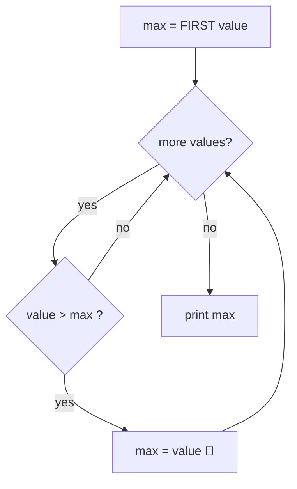

# Recipe 4 · Min / max tracker — "the best so far"

> Keep a box with **the best value seen so far**. Each new value challenges the champion.

## 🔎 Recognize it

Trigger words: **"largest"**, **"smallest"**, **"maximum"**, **"minimum"**, **"highest score"**, **"best"**, **"oldest"**, **"longest word"**.

## 🧠 The idea

Think of a **king of the hill** 👑: the first value is king. Each new value fights the king; if it is bigger, it becomes the new king.



**Start with the first value**, not with 0. If all values are negative (-5, -2, -9), a max starting at 0 would wrongly answer 0.

## 📝 Template

With an array:

```csharp
int max = values[0];                 // the first value is king
for (int i = 1; i < values.Length; i++)
{
    if (values[i] > max)
    {
        max = values[i];
    }
}
```

With user input (you do not know the first value yet): use a flag `bool first = true`, or start at `int.MinValue` for max / `int.MaxValue` for min.

Also want **where** the best value is? Keep a second box `maxIndex` and update both together.

## 🔬 Trace table: -5, -2, -9

| Value | `value > max`? | `max` after |
| ---: | --- | ---: |
| -5 | (first value) | -5 |
| -2 | yes (-2 > -5) | -2 |
| -9 | no | **-2** |

## ⚠️ Common mistakes

- `max = 0` at the start (fails with negative numbers).
- Using `>=` when you want the **first** position of the max (with `>=` you get the last one).
- Resetting `max` inside the loop.
- Empty input/array: there is no max! Decide what to print before you start.

## 🏋️ Mini exercises

1. **C02** Largest of three (no loop: just `if`). Good warm-up.
2. **R02** Largest value of an array.
3. **A09** Read numbers until 0, print the smallest and the largest.

➡️ Next: [Recipe 5 · Flag / search](05-flag-search.md)
