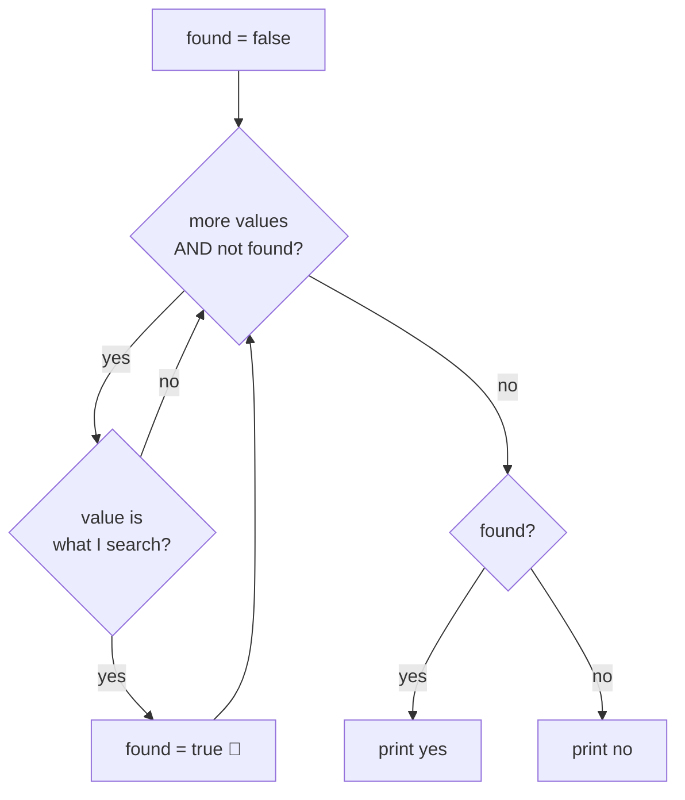

# Recipe 5 · Flag / search — "is there at least one?"

> A `bool` box that starts at one answer and **flips** when you find proof of the other answer.

## 🔎 Recognize it

Trigger words: **"is there"**, **"does it contain"**, **"find"**, **"check if"**, **"is it prime"**, **"all of them…?"**, **"at least one"**, **"position of"**.
The answer is **yes/no** (or a position) → you need a flag.

## 🧠 The idea

- *"Is there at least one…?"* → start `found = false`; one match → `found = true`.
- *"Are they all…?"* → start `allOk = true`; one counter-example → `allOk = false`.
- *"Is n prime?"* = "are all numbers from 2 to n-1 **not** divisors?" → start `isPrime = true`, one divisor → `false`.

You can stop early with `break` when the answer cannot change anymore.



## 📝 Template

```csharp
bool found = false;
for (int i = 0; i < values.Length; i++)
{
    if (values[i] == target)
    {
        found = true;
        break;               // optional: we already know the answer
    }
}
Console.WriteLine(found ? "yes" : "no");
```

Position search: start `int index = -1` (means "not found"), set `index = i` and `break`.

Prime test:

```csharp
bool isPrime = n >= 2;       // 0 and 1 are not prime
for (int d = 2; d * d <= n; d++)   // d <= n - 1 also works, slower
{
    if (n % d == 0)
    {
        isPrime = false;
        break;
    }
}
```

## 🔬 Trace table: is 9 prime?

| `d` | `9 % d` | `isPrime` after |
| ---: | ---: | --- |
| 2 | 1 | true |
| 3 | **0** | **false** → break |

Is 7 prime? d = 2: 7 % 2 = 1 · then 3 × 3 = 9 > 7 → stop. `isPrime` stays **true**.

## ⚠️ Common mistakes

- **Deciding too early:** an `else { found = false; }` inside the loop erases a match found before. The "no" answer can only be given **after** the loop.
- Printing "not found" on every turn instead of once at the end.
- Forgetting 0 and 1 for primes.
- Returning `index` 0 to mean "not found" (0 is a valid position!). Use -1.

## 🏋️ Mini exercises

1. **R04** Find the position of a value in an array (-1 if missing).
2. **P01** Is N prime?
3. **P02** Print all primes up to N (a flag loop **inside** a counter loop).

➡️ Next: [Recipe 6 · Digit extraction](06-digit-extraction.md)
