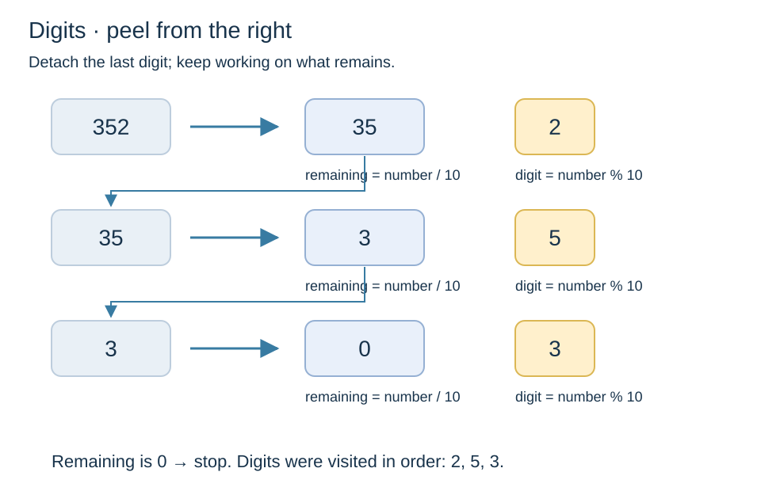
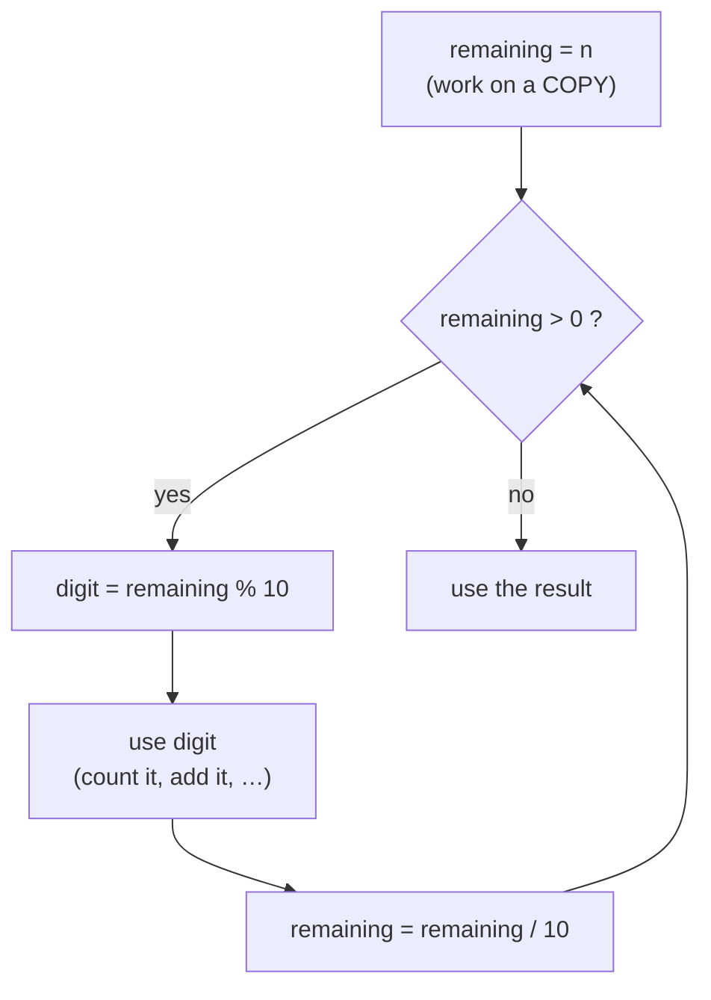

[Home](../README.md) › [Roadmap](../ROADMAP.md) › [Cookbook](README.md) › Recipe 6 · Digit extraction

# Recipe 6 · Digit extraction — `% 10` and `/ 10`

> Peel a number like an onion : take the **last digit**, then **remove** it, until nothing is left.



**How this page works:** 1 goal → predict → trace → the pattern → complete it → your turn. Do the steps in order, with a pen. See [why](../docs/writing-guide.md#2-lesson-format).

## 1 · Goal

Take an `int` apart digit by digit with `% 10` (last digit) and `/ 10` (remove it).

## 2 · Predict

Read this code. **Before** you run it, write down what it prints.

```csharp
int remaining = 352;
int sum = 0;
while (remaining > 0)
{
    sum += remaining % 10;
    remaining /= 10;
}
Console.WriteLine(sum);
```

<details><summary>Check your prediction</summary>

It prints `10` (2 + 5 + 3). The digits come out **right to left**.

</details>

## 3 · Trace it

Trace table: digit sum of 352. Cover the table, fill your own, then compare.

| Turn | `remaining` before | `digit` | `sum` after | `remaining` after |
| ---: | ---: | ---: | ---: | ---: |
| 1 | 352 | 2 | 2 | 35 |
| 2 | 35 | 5 | 7 | 3 |
| 3 | 3 | 3 | **10** | 0 |

Reverse 352: `reversed` goes 0 → 2 → 25 → **253**.

## 4 · The pattern

### Subgoals (the steps, with names you can reuse)

1. **Copy** the number into a work box (keep `n` for later).
2. **Loop while** something is left (`> 0`).
3. **Take** the last digit with `% 10`.
4. **Use** the digit (count, add, build).
5. **Remove** the digit with `/ 10`.

Say the subgoal names out loud when you write the code. They are the same in every exercise that uses this recipe.

### Recognize it

Trigger words: **"digits"**, **"sum of the digits"**, **"number of digits"**, **"reverse the number"**, **"palindrome number"**, **"Armstrong"**, **"contains the digit 7"**.
Any time you must look at the digits of an `int` **without** turning it into text.

### The idea

Two tools from step 2 (variables & expressions):

| Expression | Meaning | 352 gives |
| --- | --- | ---: |
| `n % 10` | the **last digit** (remainder of division by 10) | 2 |
| `n / 10` | the number **without** its last digit (integer division) | 35 |

At every step: **old number = remaining part × 10 + last digit** (352 = 35 × 10 + 2).
Digits come out **right to left**: 2, then 5, then 3.



We use `while`, because we do not know the number of digits in advance.

### Template

```csharp
int remaining = n;              // keep n untouched, you may need it later!
while (remaining > 0)
{
    int digit = remaining % 10; // 1. take the last digit
    // 2. USE digit: count++, sum += digit, …
    remaining /= 10;            // 3. remove it
}
```

Classic uses of the same loop:

| Goal | Box | Update with `digit` |
| --- | --- | --- |
| count digits | `count = 0` | `count++` |
| digit sum | `sum = 0` | `sum += digit` |
| reverse the number | `reversed = 0` | `reversed = reversed * 10 + digit` |
| contains a 7? | `found = false` | `if (digit == 7) found = true` |

## 5 · Complete it

Part of the code is given. Fill in the rest on paper.

```csharp
// Count the digits of n (n > 0). Fill the 3 blanks.
int count = 0;
int remaining = n;
while (remaining ____ 0)
{
    ____;
    remaining ____ 10;
}
return count;
```

<details><summary>Answer</summary>

`>`, `count++`, `/=`. (For `n = 0` this gives 0, but 0 has 1 digit: see the common mistakes.)

</details>

## 6 · Your turn

Now alone, in a real file (`./ex start ID`, then `./ex check`):

1. [**D03**](../exercises/D03-count-digits.md) Count the digits of N (0 has 1 digit).
2. [**D04**](../exercises/D04-digit-sum.md) Sum of the digits of N.
3. [**D05**](../exercises/D05-reverse-a-number.md) Reverse N (1230 → 321) → then [**D06**](../exercises/D06-palindrome-number.md) palindrome number.

Debugging exercise: [**D07**](../exercises/D07-fix-digit-sum.md) Fix the bugs: digit sum.

**Want more of the same?** Do the drill set for this recipe in the [exercise inventory](../exercises/README.md#drill-sets-same-pattern-many-times): 5 to 12 short exercises that use exactly this pattern.

### Debug it

This code has **one** bug. Find it on paper: trace a small example.

```csharp
// Should reverse the digits: Reverse(123) should give 321. It gives 60. Why?
int reversed = 0;
while (n > 0)
{
    int digit = n % 10;
    reversed = reversed + digit * 10;
    n /= 10;
}
return reversed;
```

<details><summary>The bug</summary>

Trace it: 0 + 3 × 10 = 30, then 30 + 2 × 10 = 50, then 50 + 1 × 10 = 60. The digit is multiplied instead of the old result. The old result must move one place left, then the digit is added: `reversed = reversed * 10 + digit;`.

</details>

### Common mistakes

- **Destroying `n`**: if you write `n /= 10`, the original is gone (you need it for palindrome and Armstrong). Work on a copy.
- **Zero:** `while (remaining > 0)` runs 0 times for `n = 0`, but 0 has **1** digit. Handle it (use `do … while`, or an `if`).
- Forgetting `remaining /= 10` → infinite loop.
- Using `double`: `352.0 / 10` is 35.2, not 35. Use `int`.
- Negative numbers: out of scope for the first exercises (or use `Math.Abs`).

Next: [Recipe 7 · State update](07-state-update.md)
