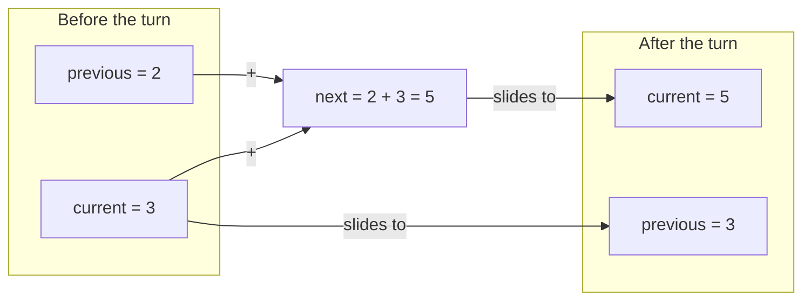

🏠 [Home](../README.md) › 🗺️ [Roadmap](../ROADMAP.md) › 🍳 [Cookbook](README.md) › Recipe 7 · State update with several variables

# Recipe 7 · State update with several variables — Fibonacci

> When the next value depends on **more than one** previous value, keep them in boxes and **move them forward** carefully.


## 🔎 Recognize it

Trigger words: **"each term is the sum of the two previous"**, **"Fibonacci"**, **"sequence"**, **"the next value depends on…"**, **"compare with the previous one"**, **"interest each year"**.

## 🧠 The idea

Fibonacci: 0, 1, 1, 2, 3, 5, 8, 13… Each value = the two before it added.
You only need to remember **two** boxes: `previous` and `current`. Each turn does **3 moves in this order**:

1. `next = previous + current` (compute with the **old** values)
2. `previous = current` (slide left)
3. `current = next` (slide left)



Think of a **conveyor belt** 🎢: the values move one place to the left each turn.

## 📝 Template

```csharp
long previous = 0;
long current = 1;
for (int i = 0; i < n; i++)
{
    Console.WriteLine(previous);   // the value at position i
    long next = previous + current; // 1. compute with OLD values
    previous = current;             // 2. slide
    current = next;                 // 3. slide
}
```

Stop at a limit instead of a count (Project Euler #2) → `while (previous <= limit)`.

## 🔬 Trace table: first 6 Fibonacci numbers

| Turn `i` | printed (`previous`) | `current` | `next` | `previous` after | `current` after |
| ---: | ---: | ---: | ---: | ---: | ---: |
| 0 | 0 | 1 | 1 | 1 | 1 |
| 1 | 1 | 1 | 2 | 1 | 2 |
| 2 | 1 | 2 | 3 | 2 | 3 |
| 3 | 2 | 3 | 5 | 3 | 5 |
| 4 | 3 | 5 | 8 | 5 | 8 |
| 5 | 5 | 8 | 13 | 8 | 13 |

Output: `0 1 1 2 3 5`.

## ⚠️ Common mistakes

- **Wrong order:** `previous = current;` before computing `next` → you lost the old `previous` (you get 3 + 3 = 6 instead of 5).
- No `next` (temporary) variable at all.
- Mixing up "the first N values" and "the value at position N". Read the statement and write the first 6 values on paper.
- `int` overflows after the 46th value → use `long`.

## 🏋️ Mini exercises

1. [**S01**](../exercises/S01-trace-updates.md) Trace `a`, `b`, `next` on paper for 3 turns.
2. [**S02**](../exercises/S02-fibonacci.md) Print the first N Fibonacci numbers.
3. [**S03**](../exercises/S03-even-fibonacci-sum.md) Sum the even Fibonacci numbers up to a limit → [Project Euler #2](https://projecteuler.net/problem=2).

➡️ Next: [Recipe 8 · Nested loops for 2D grids](08-nested-grid.md)
