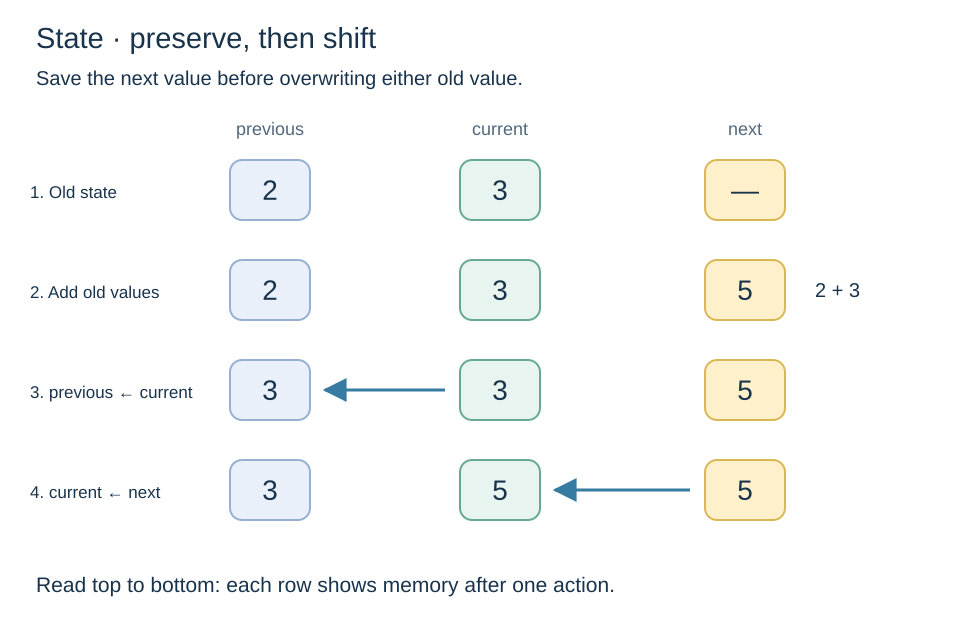
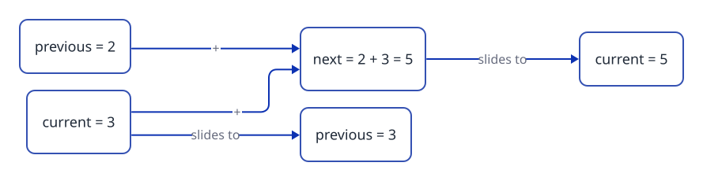

[Home](../README.md) › [Cookbook](README.md) › Recipe 7 · State update with several variables

# Recipe 7 · State update with several variables — Fibonacci

> When the next value depends on **more than one** previous value, keep them in boxes and **move them forward** carefully.



**How this page works:** 1 goal → predict → trace → the pattern → complete it → your turn. Do the steps in order, with a pen. See [why](../docs/writing-guide.md#2-lesson-format).

## 1 · Goal

Compute a sequence where each value depends on the **previous two**, by sliding two boxes forward in the right order.

## 2 · Predict

Read this code. **Before** you run it, write down what it prints.

```csharp
long previous = 0;
long current = 1;
for (int i = 0; i < 6; i++)
{
    Console.WriteLine(previous);
    long next = previous + current;
    previous = current;
    current = next;
}
```

<details><summary>Check your prediction</summary>

It prints `0 1 1 2 3 5` (one per line).

</details>

## 3 · Trace it

Trace table: first 6 Fibonacci numbers. Cover the table, fill your own, then compare.

| Turn `i` | printed (`previous`) | `current` | `next` | `previous` after | `current` after |
| ---: | ---: | ---: | ---: | ---: | ---: |
| 0 | 0 | 1 | 1 | 1 | 1 |
| 1 | 1 | 1 | 2 | 1 | 2 |
| 2 | 1 | 2 | 3 | 2 | 3 |
| 3 | 2 | 3 | 5 | 3 | 5 |
| 4 | 3 | 5 | 8 | 5 | 8 |
| 5 | 5 | 8 | 13 | 8 | 13 |

Output: `0 1 1 2 3 5`.

## 4 · The pattern

### Subgoals (the steps, with names you can reuse)

1. **Set the first two** values.
2. **Loop** for each position.
3. **Use** the current value.
4. **Compute the next value** with the **old** values.
5. **Slide:** `previous` takes `current`, then `current` takes `next`.

Say the subgoal names out loud when you write the code. They are the same in every exercise that uses this recipe.

### Recognize it

Trigger words: **"each term is the sum of the two previous"**, **"Fibonacci"**, **"sequence"**, **"the next value depends on…"**, **"compare with the previous one"**, **"interest each year"**.

### The idea

Fibonacci: 0, 1, 1, 2, 3, 5, 8, 13… Each value = the two before it added.
You only need to remember **two** boxes: `previous` and `current`. Each turn does **3 moves in this order**:

1. `next = previous + current` (compute with the **old** values)
2. `previous = current` (slide left)
3. `current = next` (slide left)



Think of a **conveyor belt** : the values move one place to the left each turn.

### Template

```csharp
long previous = 0;
long current = 1;
for (int i = 0; i < n; i++)
{
    Console.WriteLine(previous);   // the value at position i
    long next = previous + current; // 1. compute with OLD values
    previous = current;             // 2. slide
    current = next;                 // 3. slide
}
```

Stop at a limit instead of a count (Project Euler #2) → `while (previous <= limit)`.

## 5 · Complete it

Part of the code is given. Fill in the rest on paper.

```csharp
// Arrange these 3 lines (the body of the loop, after the WriteLine):
//   current = next;
//   long next = previous + current;
//   previous = current;
```

<details><summary>Answer</summary>

`long next = previous + current;` then `previous = current;` then `current = next;`. Compute first, slide after.

</details>

## 6 · Your turn

Now alone, in a real file (`./ex start ID`, then `./ex check`):

1. [**S01**](../exercises/S01-trace-updates.md) Trace `a`, `b`, `next` on paper for 3 turns.
2. [**S02**](../exercises/S02-fibonacci.md) Print the first N Fibonacci numbers.
3. [**S03**](../exercises/S03-even-fibonacci-sum.md) Sum the even Fibonacci numbers up to a limit → [Project Euler #2](https://projecteuler.net/problem=2).

**Want more of the same?** Do the drill set for this recipe in the [exercise inventory](../exercises/README.md#drill-sets-same-pattern-many-times): 5 to 12 short exercises that use exactly this pattern.

### Debug it

This code has **one** bug. Find it on paper: trace a small example.

```csharp
// Should print 0 1 1 2 3 5. It prints 0 1 2 4 8 16. Why?
long previous = 0;
long current = 1;
for (int i = 0; i < 6; i++)
{
    Console.WriteLine(previous);
    previous = current;
    current = previous + current;
}
```

<details><summary>The bug</summary>

`previous` is overwritten **before** it is used, so `current = previous + current` adds `current` to itself (it doubles). Keep the old value in `next` first.

</details>

### Common mistakes

- **Wrong order:** `previous = current;` before computing `next` → you lost the old `previous` (you get 3 + 3 = 6 instead of 5).
- No `next` (temporary) variable at all.
- Mixing up "the first N values" and "the value at position N". Read the statement and write the first 6 values on paper.
- `int` overflows after the 46th value → use `long`.

Next: [Recipe 8 · Nested loops for 2D grids](08-nested-grid.md)
