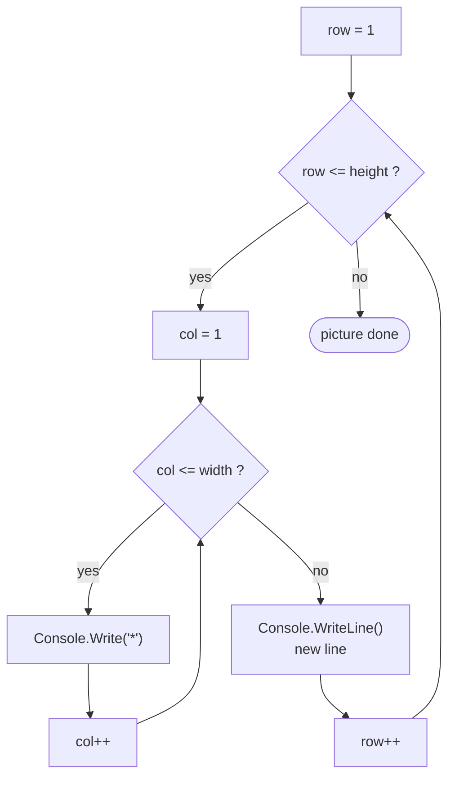

🏠 [Home](../README.md) › 🗺️ [Roadmap](../ROADMAP.md) › 🍳 [Cookbook](README.md) › Recipe 8 · Nested loops

# Recipe 8 · Nested loops — draw 2D grids 🎨

> One loop for the **rows**, one loop inside it for the **columns**. Like writing a page: line after line, letter after letter.

🧭 **How this page works:** 1 goal → predict → trace → the pattern → complete it → your turn. Do the steps in order, with a pen. See [why](../docs/writing-guide.md#2-lesson-format).

## 🎯 1 · Goal

Draw a 2D picture with a loop for the **rows** and, inside it, a loop for the **columns**.

## 🔮 2 · Predict

Read this code. **Before** you run it, write down what it prints.

```csharp
for (int row = 1; row <= 3; row++)
{
    for (int col = 1; col <= row; col++)
    {
        Console.Write("*");
    }
    Console.WriteLine();
}
```

<details><summary>Check your prediction</summary>

A triangle:

```text
*
**
***
```

The inner loop runs `row` times, so each row is one star longer.

</details>

## 🔬 3 · Trace it

Trace table: triangle of height 3. Cover the table, fill your own, then compare.

| `row` | inner loop runs for `col` = | printed line |
| ---: | --- | --- |
| 1 | 1 | `*` |
| 2 | 1, 2 | `**` |
| 3 | 1, 2, 3 | `***` |

Total `Console.Write` calls: 1 + 2 + 3 = 6. The inner loop **starts again from 1** on every row.

## 🧩 4 · The pattern

### Subgoals (the steps, with names you can reuse)

1. **One row first:** a loop with `Console.Write` that prints one row (see [L09](../exercises/L09-draw-a-row.md)).
2. **End the row** with `Console.WriteLine()` after the inner loop.
3. **Repeat the row:** wrap it in an outer loop on `row`.
4. **Shape rule:** change the inner test or the character, using `row` and `col`.

Say the subgoal names out loud when you write the code. They are the same in every exercise that uses this recipe.

### 🔎 Recognize it

Trigger words: **"draw"**, **"rectangle"**, **"triangle"**, **"pyramid"**, **"grid"**, **"board"**, **"table of tables"**, **"every pair"**, **"rows and columns"**.

### 🧠 The idea

- The **outer** loop picks a row: `row`.
- The **inner** loop walks along that row: `col`, printing **without** a newline (`Console.Write`).
- **After** the inner loop: one `Console.WriteLine()` to go to the next line.



**The secret:** the shape is decided by **what the inner loop does in row `row`**. Write a small table "row → what is printed" before coding:

| Shape | Row `row` contains… | Inner test / char rule |
| --- | --- | --- |
| Rectangle `w × h` | `w` stars | `col <= width` |
| Right triangle | `row` stars | `col <= row` |
| Hollow rectangle | star on the border, space inside | `row == 1 \|\| row == h \|\| col == 1 \|\| col == w` |
| Checkerboard | alternate `#` and `.` | `(row + col) % 2 == 0` |
| Pyramid (height h) | `h - row` spaces, then `2*row - 1` stars | two inner loops |
| Multiplication grid | the numbers `row * col` | print `row * col` |

```text
Rectangle 4x3   Triangle 4   Hollow 5x4   Checkerboard 4   Pyramid 3
****            *            *****        #.#.               *
****            **           *   *        .#.#              ***
****            ***          *   *        #.#.             *****
                ****         *****        .#.#
```

### 📝 Template

```csharp
for (int row = 1; row <= height; row++)
{
    for (int col = 1; col <= width; col++)   // <- change THIS test or the char
    {
        Console.Write("*");
    }
    Console.WriteLine();                      // end of the row
}
```

## ✍️ 5 · Complete it

Part of the code is given. Fill in the rest on paper.

Arrange the lines to draw a 3 × 3 square: this is exercise G07.

<details><summary>Answer</summary>

See [G07 · Arrange the lines: a square](../exercises/G07-arrange-a-square.md): you arrange the lines in a real file, and `./ex check G07` tells you if the order is right.

</details>

## 🏋️ 6 · Your turn

Now alone, in a real file (`./ex start ID`, then `./ex check`):

1. [**G01**](../exercises/G01-rectangle.md) Rectangle `width × height`.
2. [**G02**](../exercises/G02-right-triangle.md) Right triangle, then [**G06**](../exercises/G06-pyramid.md) pyramid.
3. [**G05**](../exercises/G05-checkerboard.md) Checkerboard, and [**G03**](../exercises/G03-multiplication-grid.md) multiplication grid (the same idea with numbers).

Warm-ups before G01: [**L09**](../exercises/L09-draw-a-row.md) one row, [**L10**](../exercises/L10-numbers-on-one-line.md) numbers on one line, [**G07**](../exercises/G07-arrange-a-square.md) arrange a square.

🔁 **Want more of the same?** Do the drill set for this recipe in the [exercise inventory](../exercises/README.md#-drill-sets-same-pattern-many-times): 5 to 12 short exercises that use exactly this pattern.

### 🐞 Debug it

This code has **one** bug. Find it on paper: trace a small example.

```csharp
// Should draw a 4 × 2 rectangle. It prints 8 lines with one star each. Why?
for (int row = 1; row <= 2; row++)
{
    for (int col = 1; col <= 4; col++)
    {
        Console.WriteLine("*");
    }
}
```

<details><summary>The bug</summary>

`Console.WriteLine("*")` ends the line after **each** star. Use `Console.Write("*")` inside, and one `Console.WriteLine();` after the inner loop.

</details>

### ⚠️ Common mistakes

- `Console.WriteLine("*")` inside the inner loop → one star per line.
- `Console.WriteLine()` **inside** the inner loop instead of after it.
- Using the same variable name `i` for both loops.
- Declaring `col` before the outer loop → it does not restart at 1.
- Start small: first print **one row** of 4 stars. Then repeat that row 3 times. Then change the rule.

➡️ Next: [Recipe 9 · Input validation loop](09-input-validation.md)
