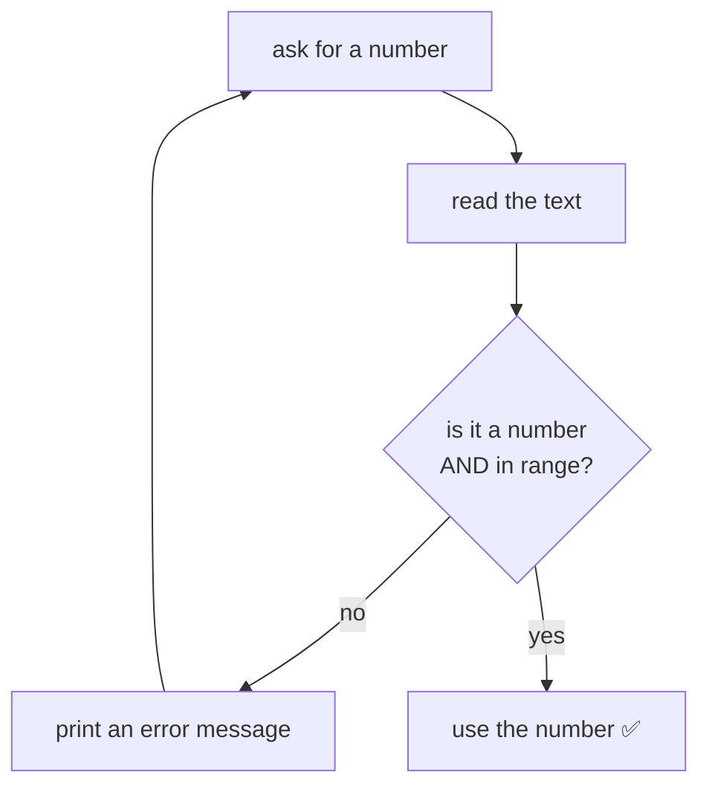

🏠 [Home](../README.md) › 🗺️ [Roadmap](../ROADMAP.md) › 🍳 [Cookbook](README.md) › Recipe 9 · Input validation loop

# Recipe 9 · Input validation loop — "ask again until it is OK"

> Ask, check, and **ask again** while the answer is not valid.

## 🔎 Recognize it

Trigger words: **"between 1 and 10"**, **"must be positive"**, **"ask again"**, **"until the user enters a valid…"**, **"if the input is wrong…"**, **"make sure the program does not crash"**.

## 🧠 The idea

You must ask **at least once** before you can check → `do … while` is the natural fit.



`int.TryParse(text, out int number)` returns `true` if the text **is** a number (and puts it in `number`), `false` otherwise. No crash.

## 📝 Template

```csharp
int number;
bool valid;
do
{
    Console.Write("Enter a number between 1 and 10: ");
    string? text = Console.ReadLine();
    valid = int.TryParse(text, out number) && number >= 1 && number <= 10;
    if (!valid)
    {
        Console.WriteLine("Invalid, try again.");
    }
}
while (!valid);
// here, number is valid
```

Simpler version (before you know `TryParse`):

```csharp
Console.Write("Enter a positive number: ");
int n = int.Parse(Console.ReadLine()!);
while (n <= 0)
{
    Console.Write("Must be positive, try again: ");
    n = int.Parse(Console.ReadLine()!);
}
```

With exceptions (week 7): put `int.Parse` in a `try { } catch (FormatException) { }`.

## 🔬 Trace table: inputs `abc`, `42`, `7`

| Turn | text | `TryParse` | in 1..10? | `valid` | message |
| ---: | --- | --- | --- | --- | --- |
| 1 | abc | false | — | false | Invalid, try again. |
| 2 | 42 | true (42) | no | false | Invalid, try again. |
| 3 | 7 | true (7) | yes | **true** | (loop ends) |

## ⚠️ Common mistakes

- Checking with `if` instead of a loop → only one second chance.
- Reading the input **before** the loop and forgetting to read again **inside** → infinite loop.
- Condition upside down: `while (valid)` instead of `while (!valid)`.
- `&&` vs `||` for ranges: "between 1 and 10" is `n >= 1 && n <= 10`; "outside" is `n < 1 || n > 10`.

## 🏋️ Mini exercises

1. [**L07**](../exercises/L07-ask-until-valid.md) Ask for a number between 1 and 10 until it is valid.
2. [**L08**](../exercises/L08-guess-the-number.md) Guess the number (keep asking until correct, say "higher"/"lower").
3. [**E01**](../exercises/E01-safe-number-reader.md) Read a number safely with `try`/`catch`.

➡️ Next: [Recipe 10 · Sentinel loop](10-sentinel-loop.md)
