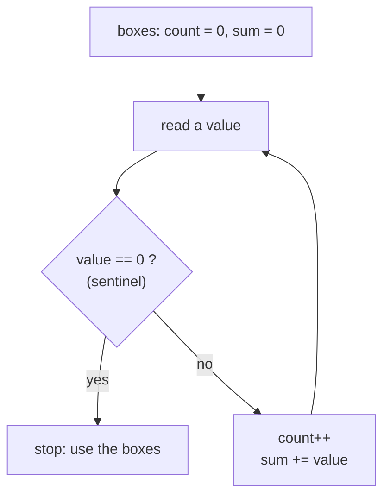

# Recipe 10 · Sentinel loop — "stop when the user types 0"

> Read values **until a special stop value** (the *sentinel*) arrives. The sentinel is **not** part of the data.

## 🔎 Recognize it

Trigger words: **"until the user enters 0"**, **"enter -1 to stop"**, **"until an empty line"**, **"type quit to finish"**, **"you don't know how many numbers"**.

## 🧠 The idea

You don't know how many values will come, so `for` does not fit. Use `while (true)` + `break`, or "read before the loop, read again at the end".
Combine it with any other recipe: count, sum, average, min/max…



## 📝 Template

Version A – `while (true)` + `break` (easiest to read):

```csharp
int count = 0;
int sum = 0;
while (true)
{
    int value = int.Parse(Console.ReadLine()!);
    if (value == 0)
    {
        break;              // the sentinel is NOT processed
    }
    count++;
    sum += value;
}
```

Version B – read first, read again at the end:

```csharp
int value = int.Parse(Console.ReadLine()!);
while (value != 0)
{
    // process value
    value = int.Parse(Console.ReadLine()!);
}
```

## 🔬 Trace table: inputs 4, 7, 1, 0

| Read | sentinel? | `count` | `sum` |
| ---: | --- | ---: | ---: |
| 4 | no | 1 | 4 |
| 7 | no | 2 | 11 |
| 1 | no | 3 | 12 |
| 0 | **yes** → break | 3 | 12 |

Average = 12 / 3 = 4. If the very first value is 0 → count is 0 → **no average** (do not divide by 0!).

## ⚠️ Common mistakes

- Counting or adding the sentinel itself.
- Forgetting to read again inside the loop (version B) → infinite loop.
- Dividing by `count` when `count == 0`.

## 🏋️ Mini exercises

1. **L05** Count the non-zero numbers until 0.
2. **A06** Average of numbers until 0.
3. **A09** Smallest and largest until 0 (combine with [recipe 4](04-min-max.md)).

➡️ Next: [Recipe 11 · Array traversal](11-array-traversal.md)
