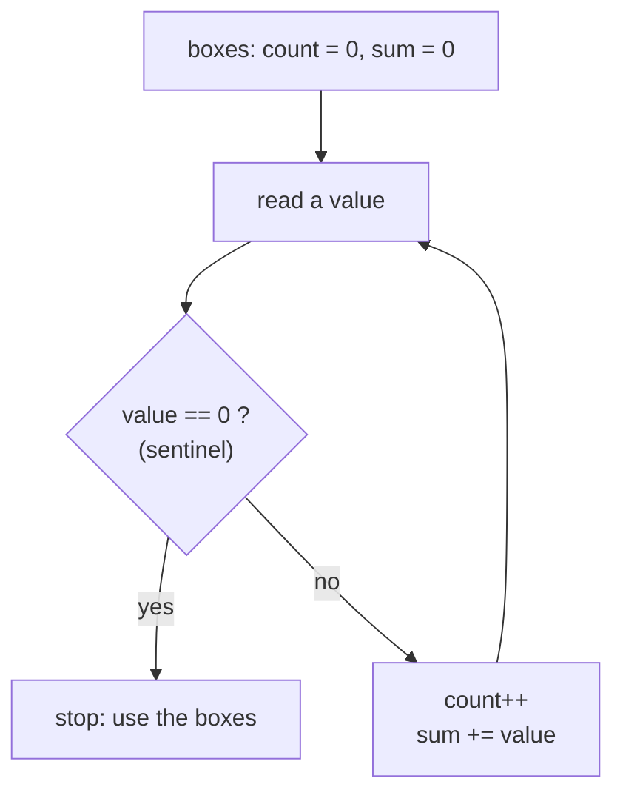

[Home](../README.md) › [Roadmap](../ROADMAP.md) › [Cookbook](README.md) › Recipe 10 · Sentinel loop

# Recipe 10 · Sentinel loop — "stop when the user types 0"

> Read values **until a special stop value** (the *sentinel*) arrives. The sentinel is **not** part of the data.

**How this page works:** 1 goal → predict → trace → the pattern → complete it → your turn. Do the steps in order, with a pen. See [why](../docs/writing-guide.md#2-lesson-format).

## 1 · Goal

Read values until a special **stop value** arrives, and process every value except the stop value.

## 2 · Predict

Read this code. **Before** you run it, write down what it prints.

```csharp
// The user types: 4, 7, 1, 0
int count = 0;
int sum = 0;
while (true)
{
    int value = int.Parse(Console.ReadLine()!);
    if (value == 0)
    {
        break;
    }
    count++;
    sum += value;
}
Console.WriteLine($"{count} values, sum {sum}");
```

<details><summary>Check your prediction</summary>

It prints `3 values, sum 12`. The 0 stops the loop and is **not** counted.

</details>

## 3 · Trace it

Trace table: inputs 4, 7, 1, 0. Cover the table, fill your own, then compare.

| Read | sentinel? | `count` | `sum` |
| ---: | --- | ---: | ---: |
| 4 | no | 1 | 4 |
| 7 | no | 2 | 11 |
| 1 | no | 3 | 12 |
| 0 | **yes** → break | 3 | 12 |

Average = 12 / 3 = 4. If the very first value is 0 → count is 0 → **no average** (do not divide by 0!).

## 4 · The pattern

### Subgoals (the steps, with names you can reuse)

1. **Prepare the boxes** of the recipe you combine (count, sum, max…).
2. **Read** one value.
3. **Stop** on the sentinel, **before** using it.
4. **Process** the value.
5. **Use the boxes** after the loop (careful: maybe 0 values).

Say the subgoal names out loud when you write the code. They are the same in every exercise that uses this recipe.

### Recognize it

Trigger words: **"until the user enters 0"**, **"enter -1 to stop"**, **"until an empty line"**, **"type quit to finish"**, **"you don't know how many numbers"**.

### The idea

You don't know how many values will come, so `for` does not fit. Use `while (true)` + `break`, or "read before the loop, read again at the end".
Combine it with any other recipe: count, sum, average, min/max…



### Template

Version A – `while (true)` + `break` (easiest to read):

```csharp
int count = 0;
int sum = 0;
while (true)
{
    int value = int.Parse(Console.ReadLine()!);
    if (value == 0)
    {
        break;              // the sentinel is NOT processed
    }
    count++;
    sum += value;
}
```

Version B – read first, read again at the end:

```csharp
int value = int.Parse(Console.ReadLine()!);
while (value != 0)
{
    // process value
    value = int.Parse(Console.ReadLine()!);
}
```

## 5 · Complete it

Part of the code is given. Fill in the rest on paper.

```csharp
// Read numbers until -1. Print the largest. Fill the 2 blanks.
int max = int.MinValue;
while (true)
{
    int value = int.Parse(Console.ReadLine()!);
    if (value == ____)
    {
        break;
    }
    if (value > max)
    {
        ____;
    }
}
```

<details><summary>Answer</summary>

`-1` and `max = value;`.

</details>

## 6 · Your turn

Now alone, in a real file (`./ex start ID`, then `./ex check`):

1. [**L05**](../exercises/L05-until-zero.md) Count the non-zero numbers until 0.
2. [**A06**](../exercises/A06-average-until-zero.md) Average of numbers until 0.
3. [**A09**](../exercises/A09-min-and-max-until-zero.md) Smallest and largest until 0 (combine with [recipe 4](04-min-max.md)).

### Debug it

This code has **one** bug. Find it on paper: trace a small example.

```csharp
// Inputs 5, 3, 0. Should print count 2. It prints 3. Why?
int count = 0;
while (true)
{
    int value = int.Parse(Console.ReadLine()!);
    count++;
    if (value == 0)
    {
        break;
    }
}
```

<details><summary>The bug</summary>

`count++` comes **before** the sentinel test, so the 0 is counted. Test the sentinel first, then process.

</details>

### Common mistakes

- Counting or adding the sentinel itself.
- Forgetting to read again inside the loop (version B) → infinite loop.
- Dividing by `count` when `count == 0`.

Next: [Recipe 11 · Array traversal](11-array-traversal.md)
