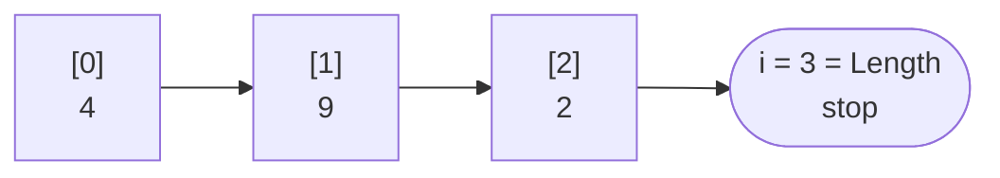

🏠 [Home](../README.md) › 🗺️ [Roadmap](../ROADMAP.md) › 🍳 [Cookbook](README.md) › Recipe 11 · Array traversal

# Recipe 11 · Array traversal — visit every box

> An array is a row of numbered boxes. Visit them one by one, and **reuse any recipe** (sum, count, max, search…) on the way.

## 🔎 Recognize it

Trigger words: **"array"**, **"list of values"**, **"for each element"**, **"the scores"**, **"lines of a file"**, **"copy"**, **"reverse the array"**.

## 🧠 The idea: position vs value

| Index (position) `i` | 0 | 1 | 2 |
| --- | --- | --- | --- |
| Value `values[i]` | 4 | 9 | 2 |
| Cursor when `i = 1` | visited | **current** | not yet |

- Indexes start at **0**. The last index is `values.Length - 1`.
- At `i = 1`, the value is `values[1]` = 9. At `i = 3` there is **no box** → stop before.



## 📝 Template

`for` – when you need the position `i`:

```csharp
int[] values = { 4, 9, 2 };
int total = 0;
for (int i = 0; i < values.Length; i++)   // < , not <= !
{
    total += values[i];
}
```

`foreach` – when you only need the values:

```csharp
foreach (int value in values)
{
    total += value;
}
```

Reverse order: `for (int i = values.Length - 1; i >= 0; i--)`.

Fill an array from input:

```csharp
int[] numbers = new int[5];
for (int i = 0; i < numbers.Length; i++)
{
    numbers[i] = int.Parse(Console.ReadLine()!);
}
```

**Every loop recipe works here:** sum ([2](02-accumulator.md)), count if ([3](03-conditional-accumulator.md)), max ([4](04-min-max.md)), search ([5](05-flag-search.md)).

## 🔬 Trace table: sum of { 4, 9, 2 }

| `i` | `values[i]` | `total` after |
| ---: | ---: | ---: |
| 0 | 4 | 4 |
| 1 | 9 | 13 |
| 2 | 2 | **15** |
| 3 | — `3 < 3` is false → stop | |

## ⚠️ Common mistakes

- `i <= values.Length` → `IndexOutOfRangeException` on the last turn.
- Mixing `i` and `values[i]` (adding the positions 0+1+2 instead of the values).
- Changing items inside `foreach` is not allowed → use `for` to write `values[i] = …`.
- Starting at `i = 1` and missing the first element.

## 🏋️ Mini exercises

1. [**R01**](../exercises/R01-sum-an-array.md) Sum of an array.
2. [**R03**](../exercises/R03-count-matches.md) Count how many times a value appears.
3. [**R05**](../exercises/R05-reverse-an-array.md) Build a reversed copy of an array.

➡️ Next: [Recipe 12 · Build a string](12-string-building.md)
