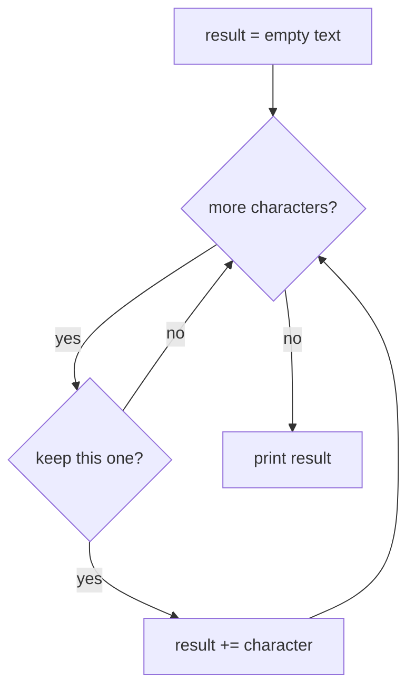

🏠 [Home](../README.md) › 🗺️ [Roadmap](../ROADMAP.md) › 🍳 [Cookbook](README.md) › Recipe 12 · Build a string

# Recipe 12 · Build a string — traverse text, keep a result

> A string is an array of characters. Visit them like [array traversal](11-array-traversal.md), and grow a result string like an [accumulator](02-accumulator.md).

## 🔎 Recognize it

Trigger words: **"each letter"**, **"count the vowels"**, **"remove the spaces"**, **"reverse the word"**, **"keep only the digits"**, **"build a line of…"**, **"join with commas"**.

## 🧠 The idea


A string is a row of characters, like an array:

| Index (position) | 0 | 1 | 2 | 3 |
| --- | --- | --- | --- | --- |
| Character in `"cat!"` | `c` | `a` | `t` | `!` |

- `text.Length` is 4, but the last index is **3**.
- A space is a character too. Empty text `""` has length 0.
- One character uses **single** quotes: `'a'`. A string uses **double** quotes: `"a"`.

Two kinds of result:

| The question asks… | Box starts at | On each turn |
| --- | --- | --- |
| how many letters…? | `count = 0` | `if (c == 'a') count++;` |
| a new text | `result = ""` | `if (keep) result += c;` |



## 📝 Template

```csharp
string result = "";
foreach (char c in text)
{
    if (KEEP(c))            // e.g. c != ' '   or   char.IsDigit(c)
    {
        result += c;
    }
}
```

Building a line from numbers (no comma after the last one):

```csharp
string line = "";
for (int i = 1; i <= n; i++)
{
    line += i;
    if (i < n) line += ", ";
}
Console.WriteLine(line);   // 1, 2, 3
```

Reverse: `for (int i = text.Length - 1; i >= 0; i--) result += text[i];`

## 🔬 Trace tables

Count the letter `'a'` in `"banana"`:

| Index | Character | Is it `'a'`? | `count` after |
| ---: | --- | --- | ---: |
| 0 | b | no | 0 |
| 1 | a | yes | 1 |
| 2 | n | no | 1 |
| 3 | a | yes | 2 |
| 4 | n | no | 2 |
| 5 | a | yes | **3** |

The loop visits **every** character. The count goes up only on a match.

Remove the spaces from `"a b"`:

| Character | Keep? | `result` after |
| --- | --- | --- |
| `a` | yes | `"a"` |
| space | no | `"a"` |
| `b` | yes | **`"ab"`** |

## ⚠️ Common mistakes

- `'a'` (a `char`) vs `"a"` (a `string`).
- Comparing case: `'A' != 'a'`. Use `char.ToLower(c)` if case does not matter.
- `text[text.Length]` does not exist: the last index is `Length - 1`.
- Forgetting the empty text: `""` must give `0` or `""`, not a crash.
- A trailing separator `1, 2, 3, ` → add the separator only *between* items.

## 🏋️ Mini exercises

1. [**T01**](../exercises/T01-count-a-letter.md) Count a letter.
2. [**T02**](../exercises/T02-remove-spaces.md) Remove spaces.
3. [**T03**](../exercises/T03-count-and-keep-digits.md) Count the digits in a text and keep them.

⬅️ Back to the [cookbook](README.md).
