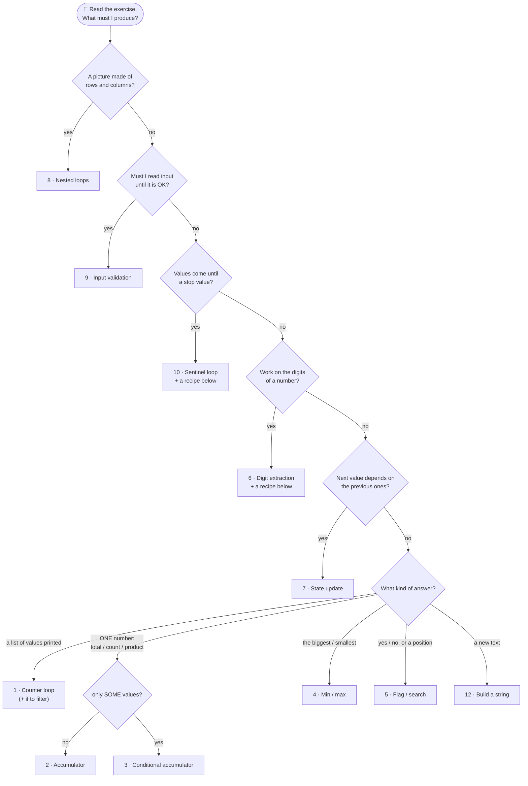

🏠 [Home](../README.md) › 🗺️ [Roadmap](../ROADMAP.md) › 🍳 Cookbook

# 🍳 The loop cookbook

A **recipe** is a small piece of code you can recognize and reuse. Almost every beginner exercise is **one recipe**, or **two or three recipes glued together**.

Learn them like cooking: first follow the recipe exactly, then change one ingredient, then invent your own dish.

> 🔎 Not sure which recipe an exercise needs? First read the statement with [How to read an exercise](../docs/reading-an-exercise.md): its **trigger words** table points to the right recipe.

## The 12 recipes

| # | Recipe | Recognize it when you read… | Box(es) to keep | Loop |
| ---: | --- | --- | --- | --- |
| 1 | [Counter loop](01-counter-loop.md) | "from 1 to N", "N times", "count down" | `i` | `for` |
| 2 | [Accumulator](02-accumulator.md) | "sum", "total", "how many", "product", "factorial", "power" | `sum = 0` / `count = 0` / `product = 1` | `for` |
| 3 | [Conditional accumulator](03-conditional-accumulator.md) | "sum of the **even**…", "count the… **that**…", "multiples of" | box + `if` filter | `for` |
| 4 | [Min / max tracker](04-min-max.md) | "largest", "smallest", "best", "highest" | `max = first value` | `for` / `foreach` |
| 5 | [Flag / search](05-flag-search.md) | "is there", "contains", "is it prime", "find the position" | `found = false` / `index = -1` | `for` + `break` |
| 6 | [Digit extraction](06-digit-extraction.md) | "digits", "reverse the number", "palindrome", "Armstrong" | `remaining`, `digit` | `while (remaining > 0)` |
| 7 | [State update](07-state-update.md) | "each term is the sum of the previous two", "Fibonacci", "sequence" | `previous`, `current`, `next` | `for` / `while` |
| 8 | [Nested loops / 2D grid](08-nested-grid.md) | "draw", "rectangle", "triangle", "grid", "board", "every pair" | `row`, `col` | `for` in `for` |
| 9 | [Input validation](09-input-validation.md) | "between 1 and 10", "ask again", "must be valid" | `valid` | `do … while` |
| 10 | [Sentinel loop](10-sentinel-loop.md) | "until the user enters 0", "-1 to stop" | boxes of other recipes | `while (true)` + `break` |
| 11 | [Array traversal](11-array-traversal.md) | "array", "each element", "lines of a file" | `i`, `values[i]` | `for` / `foreach` |
| 12 | [Build a string](12-string-building.md) | "each letter", "remove", "reverse the word", "join" | `result = ""` | `foreach` |

Then read **[Combining recipes](combining-recipes.md)**: Armstrong, palindromes, primes, Project Euler #1.

## 🧭 How to pick a recipe

Read the exercise. Underline the **result** it asks for. Then follow the arrows.

Values stored in an **array**, a **list** or a **file**? Use [11 · Array traversal](11-array-traversal.md) to visit them, and the recipe from the diagram for the work.

## 🗂️ Recipe card (the same 5 questions every time)

Before writing code, fill this card on paper:

| Question | Example: factorial of 5 |
| --- | --- |
| 1. What is the **result**? | one number: 1 × 2 × 3 × 4 × 5 |
| 2. Which **recipe(s)**? | counter loop + product accumulator |
| 3. Which **boxes**, and their **start** value? | `product = 1` |
| 4. What **repeats**, and what **stops** it? | multiply by `i`, for `i` from 1 to 5 |
| 5. **Tiny example** traced by hand? | 1 → 1 → 2 → 6 → 24 → 120 |

Then translate the card into C#. If you can't fill line 5, you are not ready to code yet — and that's fine.

## How every recipe page is built

1. 🔎 **Recognize it** — trigger words in an exercise.
2. 🧠 **The idea** — a picture (Mermaid diagram) and the boxes to keep.
3. 📝 **Template** — the C# skeleton to adapt.
4. 🔬 **Trace table** — what happens turn by turn.
5. ⚠️ **Common mistakes**.
6. 🏋️ **Mini exercises** — IDs from the [inventory](../exercises/README.md).

For reading a problem statement in general, see [From a problem statement to an algorithm](../docs/problem-solving.md).
