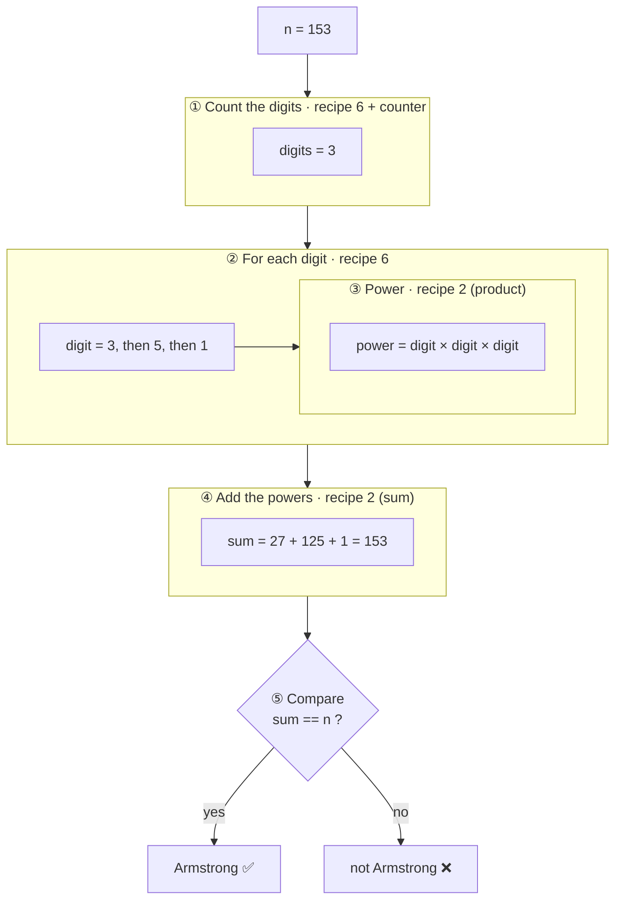
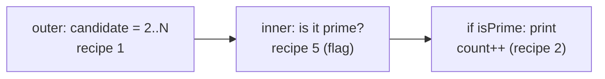

🏠 [Home](../README.md) › 🗺️ [Roadmap](../ROADMAP.md) › 🍳 [Cookbook](README.md) › Combining recipes

# 🧩 Combining recipes

Hard exercises are just **small recipes glued together**. The skill is to **cut** the problem into recipes you already know.

## Example 1 · Armstrong number (the teacher's test)

> A number is an *Armstrong number* if it equals the sum of its digits, each raised to the power **number of digits**.
> 153 → 3 digits → 1³ + 5³ + 3³ = 1 + 125 + 27 = **153** ✅ · 154 → 1 + 125 + 64 = 190 ❌



**The 4 building blocks, each one practised alone first:**

| Block | Recipe | Practise with |
| --- | --- | --- |
| Count the digits | [6 · digit extraction](06-digit-extraction.md) + counter | D03 |
| Take each digit | [6 · digit extraction](06-digit-extraction.md) | D04 |
| `digit` to the power `digits` | [2 · product accumulator](02-accumulator.md) | A07 |
| Add and compare | [2 · sum accumulator](02-accumulator.md) + `if` | D04 |

**Glued together** (a loop **inside** a loop: the power loop runs for each digit):

```csharp
int n = 153;

// ① count the digits
int digits = 0;
int remaining = n;
do
{
    digits++;
    remaining /= 10;
}
while (remaining > 0);          // do-while: 0 has 1 digit

// ② + ④ walk through the digits and add the powers
int sum = 0;
remaining = n;                  // a fresh copy: the first loop emptied it!
while (remaining > 0)
{
    int digit = remaining % 10;

    // ③ power = digit ^ digits (product accumulator)
    int power = 1;
    for (int i = 0; i < digits; i++)
    {
        power *= digit;
    }

    sum += power;
    remaining /= 10;
}

// ⑤ compare
Console.WriteLine(sum == n ? $"{n} is an Armstrong number" : $"{n} is not an Armstrong number");
```

Trace table for 153 (`digits` = 3):

| `remaining` | `digit` | `power` = digit³ | `sum` after |
| ---: | ---: | ---: | ---: |
| 153 | 3 | 27 | 27 |
| 15 | 5 | 125 | 152 |
| 1 | 1 | 1 | **153** |

`sum == n` → ✅. Next level: put all of this inside a counter loop from 100 to 999 to **find every** Armstrong number (M02), then into methods (N01).

## Example 2 · Palindrome number

1221 → reversed is 1221 → same → palindrome ✅.

| Block | Recipe |
| --- | --- |
| Keep a copy of `n` | — |
| Build the reversed number | [6 · digit extraction](06-digit-extraction.md): `reversed = reversed * 10 + digit` |
| Compare | `if (reversed == n)` |

## Example 3 · All primes up to N

| Block | Recipe |
| --- | --- |
| Try every candidate 2..N | [1 · counter loop](01-counter-loop.md) (outer) |
| Is this candidate prime? | [5 · flag / search](05-flag-search.md) (inner) |
| Print it / count it | `if (isPrime)` + [2 · counter](02-accumulator.md) |



## Example 4 · Project Euler #1 (multiples of 3 or 5 below 1000)

Counter loop 1..999 + filter `i % 3 == 0 || i % 5 == 0` + sum = [recipe 3](03-conditional-accumulator.md). Try N = 10 first (answer 23).

## Example 5 · Average until 0

[Sentinel loop](10-sentinel-loop.md) + **two** accumulators (`sum`, `count`) + a safe division after the loop.

## How to cut a new problem

1. Solve a **tiny** example by hand. Write each thing you did as one line.
2. Next to each line, write the recipe name.
3. Code and test **one block at a time** (print intermediate values!).
4. Glue the blocks. Re-test with the tiny example.
5. Later (week 10): turn each block into a **method**.
