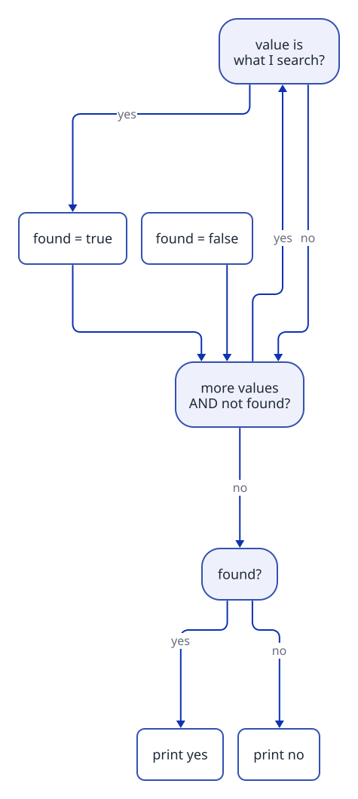

[Home](../../README.md) › [Cookbook](README.md) › Recipe 5 · Flag / search

# Recipe 5 · Flag / search — "is there at least one?"

> A `bool` box that starts at one answer and **flips** when you find proof of the other answer.

**How this page works:** 1 goal → predict → trace → the pattern → complete it → your turn. Do the steps in order, with a pen. See [why](../docs/writing-guide.md#2-lesson-format).

## 1 · Goal

Answer a **yes/no** question about many values with a `bool` box (a *flag*) that flips when you find proof.

## 2 · Predict

Read this code. **Before** you run it, write down what it prints.

```csharp
int n = 9;
bool isPrime = true;
for (int d = 2; d < n; d++)
{
    if (n % d == 0)
    {
        isPrime = false;
        break;
    }
}
Console.WriteLine(isPrime);
```

<details><summary>Check your prediction</summary>

It prints `False`: `9 % 3` is 0, so 3 is a divisor. The loop stops early with `break` at `d = 3`.

</details>

## 3 · Trace it

Trace table: is 9 prime?. Cover the table, fill your own, then compare.

| `d` | `9 % d` | `isPrime` after |
| ---: | ---: | --- |
| 2 | 1 | true |
| 3 | **0** | **false** → break |

Is 7 prime? d = 2: 7 % 2 = 1 · then 3 × 3 = 9 > 7 → stop. `isPrime` stays **true**.

## 4 · The pattern

### Subgoals (the steps, with names you can reuse)

1. **Set the flag** to the answer you believe before you look (`false` for *is there…?*, `true` for *are they all…?*).
2. **Loop** over the candidates.
3. **Look for proof:** an `if` that tests one candidate.
4. **Flip the flag** (and `break` if the answer cannot change).
5. **Answer after the loop**, never inside it.

Say the subgoal names out loud when you write the code. They are the same in every exercise that uses this recipe.

### Recognize it

Trigger words: **"is there"**, **"does it contain"**, **"find"**, **"check if"**, **"is it prime"**, **"all of them…?"**, **"at least one"**, **"position of"**.
The answer is **yes/no** (or a position) → you need a flag.

### The idea

- *"Is there at least one…?"* → start `found = false`; one match → `found = true`.
- *"Are they all…?"* → start `allOk = true`; one counter-example → `allOk = false`.
- *"Is n prime?"* = "are all numbers from 2 to n-1 **not** divisors?" → start `isPrime = true`, one divisor → `false`.

You can stop early with `break` when the answer cannot change anymore.



### Template

```csharp
bool found = false;
for (int i = 0; i < values.Length; i++)
{
    if (values[i] == target)
    {
        found = true;
        break;               // optional: we already know the answer
    }
}
Console.WriteLine(found ? "yes" : "no");
```

Position search: start `int index = -1` (means "not found"), set `index = i` and `break`.

Prime test:

```csharp
bool isPrime = n >= 2;       // 0 and 1 are not prime
for (int d = 2; d * d <= n; d++)   // d <= n - 1 also works, slower
{
    if (n % d == 0)
    {
        isPrime = false;
        break;
    }
}
```

## 5 · Complete it

Part of the code is given. Fill in the rest on paper.

```csharp
// Does the array contain a negative number? Fill the 3 blanks.
bool found = ____;
foreach (int value in values)
{
    if (____)
    {
        found = ____;
    }
}
return found;
```

<details><summary>Answer</summary>

`false`, `value < 0`, `true`.

</details>

## 6 · Your turn

Now alone, in a real file (`./ex start ID`, then `./ex check`):

1. [**P03**](../exercises/P03-has-a-multiple-of-7.md) Is there a multiple of 7 from a to b?
2. [**P04**](../exercises/P04-has-an-even-digit.md) Has N an even digit? (the same flag, on digits)
3. [**P07**](../exercises/P07-all-digits-odd.md) Are all digits odd? (the flag starts true)
4. [**P05**](../exercises/P05-first-multiple.md) The first multiple of k, or -1 (stop with `break`).
5. [**P06**](../exercises/P06-smallest-divisor.md) The smallest divisor of N.
6. [**P01**](../exercises/P01-is-it-prime.md) Is N prime?
7. [**P02**](../exercises/P02-primes-up-to-n.md) Print all primes up to N (a flag loop **inside** a counter loop).
8. Later, in Arrays: [**R04**](../exercises/R04-find-the-position.md) Find the position of a value in an array (-1 if missing).

### Debug it

This code has **one** bug. Find it on paper: trace a small example.

```csharp
// Should say if target is in the array. Contains({ 4, 7, 1 }, 7) gives false. Why?
bool found = false;
foreach (int value in values)
{
    if (value == target)
    {
        found = true;
    }
    else
    {
        found = false;
    }
}
return found;
```

<details><summary>The bug</summary>

The `else` **erases** the match: after 7, the value 1 sets `found` back to `false`. Remove the `else`. A flag only flips one way.

</details>

### Common mistakes

- **Deciding too early:** an `else { found = false; }` inside the loop erases a match found before. The "no" answer can only be given **after** the loop.
- Printing "not found" on every turn instead of once at the end.
- Forgetting 0 and 1 for primes.
- Returning `index` 0 to mean "not found" (0 is a valid position!). Use -1.

Next: [Recipe 6 · Digit extraction](06-digit-extraction.md)
