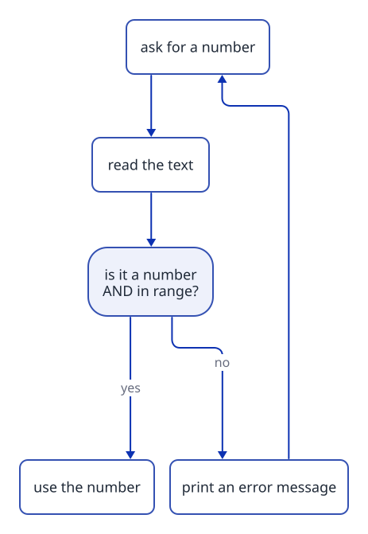

[Home](../../README.md) › [Cookbook](README.md) › Recipe 9 · Input validation loop

# Recipe 9 · Input validation loop — "ask again until it is OK"

> Ask, check, and **ask again** while the answer is not valid.

**How this page works:** 1 goal → predict → trace → the pattern → complete it → your turn. Do the steps in order, with a pen. See [why](../docs/writing-guide.md#2-lesson-format).

## 1 · Goal

Keep asking until the user types a valid answer, so the rest of the program can trust the value.

## 2 · Predict

Read this code. **Before** you run it, write down what it prints.

```csharp
// The user types: 0, then -3, then 4
Console.Write("Positive number: ");
int n = int.Parse(Console.ReadLine()!);
while (n <= 0)
{
    Console.Write("Must be positive, try again: ");
    n = int.Parse(Console.ReadLine()!);
}
Console.WriteLine($"OK: {n}");
```

<details><summary>Check your prediction</summary>

It asks 3 times. `Must be positive, try again:` appears **twice** (for 0 and -3), then `OK: 4`.

</details>

## 3 · Trace it

Trace table: inputs `abc`, `42`, `7`. Cover the table, fill your own, then compare.

| Turn | text | `TryParse` | in 1..10? | `valid` | message |
| ---: | --- | --- | --- | --- | --- |
| 1 | abc | false | — | false | Invalid, try again. |
| 2 | 42 | true (42) | no | false | Invalid, try again. |
| 3 | 7 | true (7) | yes | **true** | (loop ends) |

## 4 · The pattern

### Subgoals (the steps, with names you can reuse)

1. **Ask** once.
2. **Check** the answer (is it a number? is it in range?).
3. **Complain and ask again** while it is not valid.
4. **Use** the value after the loop: here it is always valid.

Say the subgoal names out loud when you write the code. They are the same in every exercise that uses this recipe.

### Recognize it

Trigger words: **"between 1 and 10"**, **"must be positive"**, **"ask again"**, **"until the user enters a valid…"**, **"if the input is wrong…"**, **"make sure the program does not crash"**.

### The idea

You must ask **at least once** before you can check → `do … while` is the natural fit.



`int.TryParse(text, out int number)` returns `true` if the text **is** a number (and puts it in `number`), `false` otherwise. No crash.

### Template

```csharp
int number;
bool valid;
do
{
    Console.Write("Enter a number between 1 and 10: ");
    string? text = Console.ReadLine();
    valid = int.TryParse(text, out number) && number >= 1 && number <= 10;
    if (!valid)
    {
        Console.WriteLine("Invalid, try again.");
    }
}
while (!valid);
// here, number is valid
```

Simpler version (before you know `TryParse`):

```csharp
Console.Write("Enter a positive number: ");
int n = int.Parse(Console.ReadLine()!);
while (n <= 0)
{
    Console.Write("Must be positive, try again: ");
    n = int.Parse(Console.ReadLine()!);
}
```

With exceptions (theme 13): put `int.Parse` in a `try { } catch (FormatException) { }`.

## 5 · Complete it

Part of the code is given. Fill in the rest on paper.

```csharp
// Ask for a mark between 0 and 20. Fill the 2 blanks.
int mark;
do
{
    Console.Write("Mark (0-20): ");
    mark = int.Parse(Console.ReadLine()!);
}
while (mark ____ 0 || mark ____ 20);
```

<details><summary>Answer</summary>

`mark < 0 || mark > 20`: the loop repeats while the mark is **outside** the range.

</details>

## 6 · Your turn

Now alone, in a real file (`./ex start ID`, then `./ex check`):

1. [**L07**](../exercises/L07-ask-until-valid.md) Ask for a number between 1 and 10 until it is valid.
2. [**L08**](../exercises/L08-guess-the-number.md) Guess the number (keep asking until correct, say "higher"/"lower").
3. [**E01**](../exercises/E01-safe-number-reader.md) Read a number safely with `try`/`catch`.

### Debug it

This code has **one** bug. Find it on paper: trace a small example.

```csharp
// Should ask again while n is not between 1 and 10. It accepts 50. Why?
while (n < 1 && n > 10)
{
    Console.Write("Again: ");
    n = int.Parse(Console.ReadLine()!);
}
```

<details><summary>The bug</summary>

No number is below 1 **and** above 10 at the same time, so the test is always false. Use `||` (or): `n < 1 || n > 10`.

</details>

### Common mistakes

- Checking with `if` instead of a loop → only one second chance.
- Reading the input **before** the loop and forgetting to read again **inside** → infinite loop.
- Condition upside down: `while (valid)` instead of `while (!valid)`.
- `&&` vs `||` for ranges: "between 1 and 10" is `n >= 1 && n <= 10`; "outside" is `n < 1 || n > 10`.

Next: [Recipe 10 · Sentinel loop](10-sentinel-loop.md)
