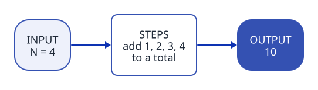

[Home](../../README.md) › How to read an exercise

# How to read an exercise

Before you write code, find **what goes in**, **what comes out**, and **the steps in between**. This page gives you a template for that.



## What to look for

Read the statement twice: once for the story, once with a pencil. Here is an exercise with the parts marked:

> **A01 · Sum from 1 to N**
>
> Give back 1 + 2 + … + N **(2: output)** for a whole number N **(1: input)**. N is 0 or more **(3: rule)**.
>
> Example: N = 4 gives 10 **(4: example)**.

| Mark | Find | In A01 |
| --- | --- | --- |
| 1 | **Input**: what you receive | a whole number `N` |
| 2 | **Output**: what you give back or print | one number, the sum |
| 3 | **Rules**: what is allowed, and what is not | N is 0 or more; write the loop yourself |
| 4 | **Examples**: a result you can check by hand | 4 gives 10; 0 gives 0 |

Some words point to a recipe. "sum" means an *accumulator*, "draw" means *nested loops*. The [cookbook](../cookbook/README.md#the-12-recipes) lists them.

## The template

Copy it onto paper, or into a file such as `practice/notes.md`. Fill it **before** you code.

```text
Exercise: ...........................................

INPUT    What do I receive?        ......................
OUTPUT   What do I give back?      ......................
EXAMPLE  Solve one by hand:        ......................

STEPS    In plain words, no C#:
  1. ...................................................
  2. ...................................................
  3. ...................................................

TRACE    The smallest real example, one row per turn:
  | turn | ........ | ........ |
  |      |          |          |

EDGE CASES  0? 1? negative? empty?  ......................
```

## The template, filled in

```text
Exercise: A01 · Sum from 1 to N

INPUT    What do I receive?        a whole number N
OUTPUT   What do I give back?      one number: 1 + 2 + ... + N
EXAMPLE  Solve one by hand:        N = 4: 1 + 2 + 3 + 4 = 10

STEPS    In plain words, no C#:
  1. start a total at 0
  2. for each number i from 1 to N, add i to the total
  3. give back the total

TRACE    N = 3, one row per turn:
  | turn | i | total |
  |  1   | 1 |   1   |
  |  2   | 2 |   3   |
  |  3   | 3 |   6   |   -> 6, correct

EDGE CASES  N = 0: the loop never runs, the total stays 0
```

When the trace gives the right answer, turn each step into one or two lines of C#.

## When you are stuck

- **Make it smaller.** Try N = 1, then N = 2.
- **Do it by hand, slowly.** Write every value you keep in your head: each one becomes a variable.
- **Find the recipe.** Look for the trigger words in the [cookbook](../cookbook/README.md#the-12-recipes).
- **Open one hint**, then try again for 10 minutes.

---

[Home](../../README.md) · Next: [Solving a problem](problem-solving.md)
