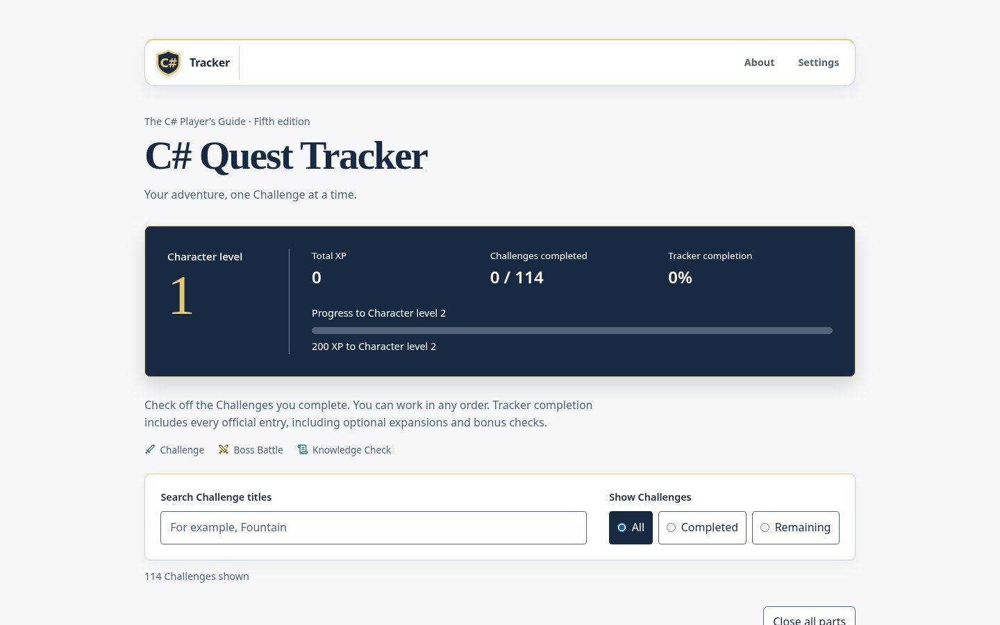

[Home](../../README.md) › [Learn](README.md) › Extra exercises

# Extra exercises: the C# Quest Tracker

Finished a theme and want more? The **C# Quest Tracker** is a free website: tick challenges as you solve them, earn XP and level up, like a game.

<a class="cpf-button" href="https://lfarci.github.io/csharp-quest-tracker/">Open the C# Quest Tracker</a>

## What it offers

- A dashboard with your level, your XP and your progress bar.
- A list of challenges you can search and filter (all, done, remaining).
- No account: progress stays in your browser. **Settings** exports a backup to move it to another computer.

It follows the challenges of the book [The C# Player's Guide](https://csharpplayersguide.com/).

[Source code](https://github.com/lfarci/csharp-quest-tracker)

---

[Certification](certification.md) · [Learn](README.md)
