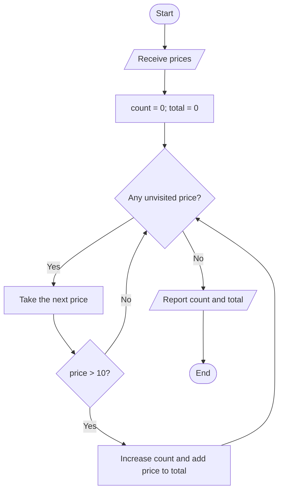

🏠 [Home](../README.md) › 🗺️ [Roadmap](../ROADMAP.md) › From a problem statement to an algorithm

# From a problem statement to an algorithm

An algorithm is a precise sequence of steps. You can design and test it on paper before choosing a programming language.

> 🔎 Short on time? The practical, step-by-step version (trigger words → recipes, worksheet, unstuck techniques, worked Armstrong example) is [How to read an exercise](reading-an-exercise.md). This page explains the *why* in more depth.

## 1. Read for a contract

Read once for the story, then again for the rules. Underline the **input**, circle the **required result**, and list constraints and boundary words: “each”, “only”, “until”, “inclusive”, “at least”. Do not choose a loop just because the statement contains “each”.

Example: **Given a list of prices, report how many prices are above 10 and their total.**

| Question | Answer |
| --- | --- |
| What do I receive? | A list of prices |
| What must I produce? | Two numbers: qualifying count and qualifying total |
| Which prices qualify? | Strictly greater than 10; 10 does not qualify |
| What is unclear? | Currency/rounding and allowed prices; clarify if the assignment needs them |
| What if none qualify? | Count 0, total 0 |

Restate the task in your own words. Distinguish a total from a count, and a final result from intermediate output.

## 2. Solve a tiny example by hand

Use prices 8, 12, 10, 15. Select 12 and 15. There are **2** qualifying prices and their total is **27**. Write this prediction before any code.

Ask: “What did I do, and what did I need to remember?” Here: inspect a price, compare it with 10, keep a count and a total. The same algorithm should work for other lists.

## 3. Break the problem into responsibilities

| Small problem | Rule | Information to remember |
| --- | --- | --- |
| Decide whether to include a price | price > 10 | Current price |
| Count included prices | Add 1 for each match | count, initially 0 |
| Add included prices | Add the price for each match | total, initially 0 |
| Know when finished | No unvisited prices remain | Position in the list |

These are reasoning steps; each one does not need its own method or loop. Count and total can share one traversal. Start with fixed inputs; input parsing can be added after the algorithm works.

## 4. Draw the decisions and repetition

Use a rounded box for start/end, a rectangle for an action, a diamond for a yes/no question, and a parallelogram for input/output. Label both decision exits. Every repeated path must return to a test, and something must make progress toward stopping.



The diagram describes the algorithm, not C# syntax. A straight calculation needs only actions; a choice needs a decision; repetition needs a returning path. Not every exercise needs a loop.

## 5. Write language-independent steps

```text
count ← 0
total ← 0
for each price:
    if price > 10:
        count ← count + 1
        total ← total + price
report count and total
```

Here ← means “replace the stored value”. Explain every step out loud, including what happens when the condition is false.

## 6. Trace the algorithm as a machine would

Follow the steps literally. Do not silently fix them because you know the intended answer.

| Step | Current price | price > 10? | count before → after | total before → after |
| --- | ---: | --- | --- | --- |
| Initialization | — | — | — → 0 | — → 0 |
| 1 | 8 | No | 0 → 0 | 0 → 0 |
| 2 | 12 | Yes | 0 → 1 | 0 → 12 |
| 3 | 10 | No | 1 → 1 | 12 → 12 |
| 4 | 15 | Yes | 1 → 2 | 12 → 27 |
| Finish | No items left | — | 2 → 2 | 27 → 27 |

**Meaning to preserve:** after each step, count and total describe only the qualifying prices already visited. This is an invariant: a sentence that remains true while the algorithm runs.

For a general trace, include every value that can change, the result of each decision, and any output produced. Record initialization and the final failed loop test. For several assignments in a row, use one row per assignment if update order is confusing.

## 7. Check boundaries, then write the C# code

| Input | Expected count | Expected total | What it checks |
| --- | ---: | ---: | --- |
| Empty list | 0 | 0 | No iterations |
| 8, 10 | 0 | 0 | No matches and strict boundary |
| 12 | 1 | 12 | One match |
| 12, 15 | 2 | 27 | All match |

Only now choose C# variables and syntax. Trace the code on the same input and compare it with your paper algorithm. If they disagree, locate the **first** differing step.

## A reusable worksheet

Copy these prompts onto paper for any exercise. A fill-in markdown version is in [How to read an exercise § 4](reading-an-exercise.md#4-the-worksheet-copy-it).

1. In my own words, the task is…
2. Inputs, outputs, constraints, and unclear points…
3. A tiny example and its expected answer…
4. The smaller responsibilities…
5. What I must remember, and its initial value…
6. Steps or a diagram, with decisions and stopping rules…
7. A trace, including initialization and termination…
8. Boundary examples…
9. C# translation, then comparison with the prediction…

## Practice without syntax

- Explain how to choose the larger of two numbers, including equal numbers. Draw the choice and trace both branches.
- For a rectangle's width and height, describe how to calculate perimeter and area. Explain why no repetition is needed.
- Use the worked price example, then change “above 10” to “at least 10”. Predict which trace row changes before recalculating.
- Design a way to count spaces in a short text using the [string model](../cookbook/12-string-building.md). Write the trace before code.

## Guidance for the helper

Ask one question at a time: “What must the result contain?”, “Show me with three items”, “What do you need to remember?”, “What changes here?”, “Why does it stop?” Let the learner draw and explain. If she is stuck, shrink the example or isolate one responsibility before supplying a solution.
