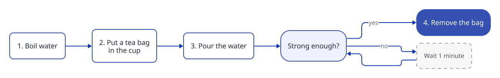
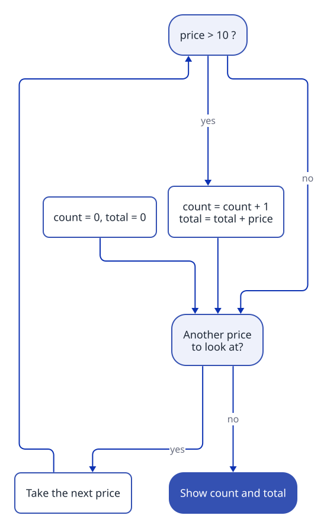

[Home](../README.md) › Solving a problem

# Solving a problem

## What is an algorithm?

An **algorithm** is a list of steps that solves a problem. You already follow algorithms every day. Here is one for a cup of tea:



It has the three things every program has:

- **steps in order** (boil, then pour);
- **a choice** (strong enough? yes or no);
- **a repeat** (wait, then ask again): that is a **loop**.

A program is an algorithm written in a language the computer understands, like C#. So: **find the algorithm first, on paper. Write the C# after.**

## Five steps from a problem to an algorithm

We use this problem: **Given a list of prices, say how many are above 10, and their total.**

### 1. Find the input and the output

| Question | Answer |
| --- | --- |
| What do I receive? | a list of prices |
| What do I give back? | two numbers: how many prices are above 10, and their total |
| Any rule? | "above 10" means more than 10: 10 itself does not count |

### 2. Solve a tiny example by hand

Prices 8, 12, 10, 15. Keep 12 and 15: **2** prices, total **27**. Write this answer down before any code.

### 3. Notice what you remembered

While you did it by hand, you kept two numbers in your head: the **count** and the **total**. Each one becomes a variable. Both start at 0.

### 4. Write the steps in plain words

```text
count = 0, total = 0
for each price in the list:
    if the price is more than 10:
        add 1 to count
        add the price to total
show count and total
```

The same steps as a picture:



### 5. Trace it, then write the code

Run your steps by hand on 8, 12, 10, 15, one row per turn:

| Turn | price | price > 10? | count | total |
| --- | --- | --- | --- | --- |
| start | | | 0 | 0 |
| 1 | 8 | no | 0 | 0 |
| 2 | 12 | yes | 1 | 12 |
| 3 | 10 | no | 1 | 12 |
| 4 | 15 | yes | 2 | 27 |

The last row gives 2 and 27, the answer from step 2. The algorithm works. Now each line becomes C#:

```csharp
int count = 0;
int total = 0;
foreach (int price in prices)
{
    if (price > 10)
    {
        count++;
        total += price;
    }
}
Console.WriteLine($"{count} prices, total {total}");
```

## Next

Use the [template in How to read an exercise](reading-an-exercise.md#the-template) for every exercise. It follows the same five steps.

---

[Home](../README.md) · Next: [Roadmap](../ROADMAP.md)
