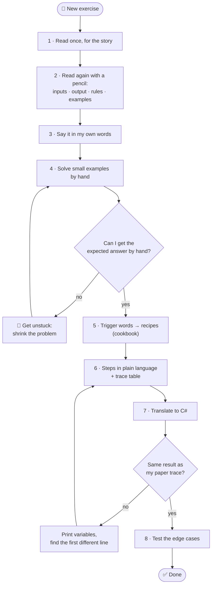
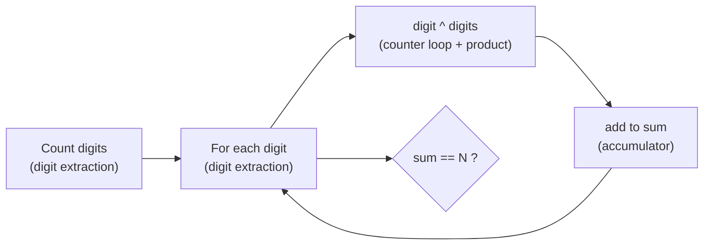

# 🔎 How to read an exercise

Most "I can't do loops" moments are really "I did not understand the question yet".
Reading a statement is a **skill**, and you can learn it like a recipe. This page shows you how.

> 📌 Related: [From a problem statement to an algorithm](problem-solving.md) explains the ideas in more depth. This page is the practical, step-by-step version you use **every time**.

## The process at a glance



## 1. What to look for when you read

Read the statement **twice**. The first time, just for the story. The second time, with a pencil, and mark these six things:

| Look for | Ask yourself | Example (A01 "sum 1 to N") |
| --- | --- | --- |
| 📥 **Inputs** | What do I receive? From where (keyboard, array, file)? What type? | one whole number `N` from the keyboard |
| 📤 **Output** | What exactly must I show? One number? Many lines? A yes/no sentence? | one number: `1 + 2 + … + N` |
| 📏 **Constraints** | Which values are allowed? `N ≥ 0`? Only positive? "inclusive"? | `N ≥ 0` |
| 🧪 **Examples** | What does each example teach me? Can I recompute it myself? | `N = 4` → `10` |
| ⚠️ **Edge cases** | Smallest value? Zero? Negative? Empty? Only one value? | `N = 0` → `0` |
| 🚫 **Forbidden** | What am I **not** allowed to use? (`Math.Pow`, LINQ, arrays…) | no formula, use a loop |

💡 **Output vs. intermediate values:** "print the sum" means *one* line at the end, not a line inside each turn of the loop. Check the examples to be sure.

### Trigger words → recipes

Some words are clues. They tell you which [cookbook](../cookbook/README.md) recipe to use.

| If the statement says… | Think of | Recipe |
| --- | --- | --- |
| "from 1 to N", "N times", "for each number between" | repeat a known number of times | [01 · Counter loop](../cookbook/01-counter-loop.md) |
| "sum", "total", "product", "factorial", "average" | keep a running result | [02 · Accumulator](../cookbook/02-accumulator.md) |
| "how many … that", "sum of the even…", "only the multiples of" | running result + `if` | [03 · Conditional accumulator](../cookbook/03-conditional-accumulator.md) |
| "largest", "smallest", "maximum", "best" | remember the best so far | [04 · Min/max](../cookbook/04-min-max.md) |
| "is there", "does it contain", "is it prime", "the first that" | yes/no flag, maybe stop early | [05 · Flag/search](../cookbook/05-flag-search.md) |
| "digit", "reverse the number", "palindrome", "number of digits" | `% 10` and `/ 10` | [06 · Digit extraction](../cookbook/06-digit-extraction.md) |
| "next term", "each term is the sum of the previous", "Fibonacci" | old values become new values | [07 · State update](../cookbook/07-state-update.md) |
| "rows and columns", "draw", "grid", "table", "triangle of `*`" | a loop inside a loop | [08 · Nested grid](../cookbook/08-nested-grid.md) |
| "ask again until it is valid", "between 1 and 10" | repeat until the input is OK | [09 · Input validation](../cookbook/09-input-validation.md) |
| "until the user types 0", "stop when", "until" | stop on a special value | [10 · Sentinel loop](../cookbook/10-sentinel-loop.md) |
| "array", "list", "each element", "the values" | visit each value | [11 · Array traversal](../cookbook/11-array-traversal.md) |
| "build a line", "separated by commas", "text" | grow a string | [12 · String building](../cookbook/12-string-building.md) |

⚠️ A trigger word is a **clue, not a rule**. Always confirm with a small example by hand. Many exercises need **two or three** recipes together — see [combining recipes](../cookbook/combining-recipes.md).

## 2. Organize your ideas before coding

1. **Say it in your own words.** One or two sentences, as if you explain it to a friend. If you can't, read again.
2. **Work small examples by hand.** Take the examples from the statement and recompute them. Then invent one tiny example (N = 0, 1 or 2).
3. **Ask: "what did I do, and what did I remember?"** Each thing you remembered on paper becomes a **variable** (a box). Write its start value.
4. **Pick the recipes** with the trigger words table above. Write their names down.
5. **Write the steps in plain language** (pseudocode). No C# yet. Example: "start total at 0; for each number from 1 to N, add it to total; show total".
6. **Fill a trace table**: one column per box, one row per turn of the loop. If the last row gives the expected answer, your plan works.
7. **Only now, translate to C#**, line by line from your steps.

## 3. The three guiding questions (for every loop)

| Question | Why it matters |
| --- | --- |
| 🧠 **What do I remember between iterations?** | These are your variables declared **before** the loop (total, count, best, previous…). |
| 🛑 **When does the loop stop?** | This is your loop condition. Check the last value: `<` or `<=`? |
| 🔁 **What changes each time?** | Something must move toward the end (`i++`, `n /= 10`, a new input…), or the loop never stops. |

## 4. The worksheet (copy it)

Copy this into a file (for example `practice/notes.md`) or onto paper, and fill it **before** you write code.

```markdown
# Worksheet · <exercise ID and name>

## 1. Reading
- Inputs (what, from where, type):
- Output (exactly what to show):
- Constraints (allowed values):
- Forbidden (what I must not use):
- Edge cases (0? 1? negative? empty?):

## 2. In my own words
-

## 3. Examples by hand
| Input | Expected output | How I got it |
| --- | --- | --- |
|  |  |  |

## 4. Trigger words → recipes
- Words I spotted:
- Recipes I will use:

## 5. Boxes (variables)
| Box | Meaning | Start value |
| --- | --- | --- |
|  |  |  |

## 6. Guiding questions
- What do I remember between iterations?
- When does the loop stop?
- What changes each time?

## 7. Steps in plain language
1.
2.
3.

## 8. Trace table (smallest real example)
| Turn | ... | ... | ... |
| --- | --- | --- | --- |
| start |  |  |  |

## 9. After coding
- Same result as my trace? 
- Edge cases tested?
```

## 5. When you are stuck

Being stuck is normal. It is a signal to make the problem **smaller**, not to look at the solution.

- 🔬 **Shrink the problem.** Try N = 1, then N = 2, then N = 3. Small numbers show the pattern.
- 🪜 **Solve a simpler version first.** Armstrong too hard? First just *print each digit*. Then *count the digits*. Then *add them*. Each one is a small exercise you know.
- 🖨️ **Print your variables.** Add `Console.WriteLine($"i={i} total={total}");` inside the loop and compare with your trace table. Find the **first** line where they differ.
- ❓ **Ask the three guiding questions** again (§ 3).
- 🍳 **Re-read the recipe** in the cookbook and copy its shape.
- 💡 **Open one hint**, then close the page and try for 10 more minutes.
- 🧩 **Do the exercise listed in "Do these first"** in the inventory — it trains the missing piece.

## 6. Worked example: Armstrong number

Let's go from the statement to the code, using the steps above. (This is exercise [M01](../exercises/M01-armstrong-number.md); try it yourself first if you prefer!)

### The statement

> Read N ≥ 0. An Armstrong number equals the sum of its digits, each raised to the power **number of digits**. Say if N is one. 153 → 1³ + 5³ + 3³ = 153 ✅. No `Math.Pow`.

### 1. Reading

| Look for | Found |
| --- | --- |
| 📥 Inputs | one whole number N, from the keyboard |
| 📤 Output | one sentence: "N is an Armstrong number" or "N is not an Armstrong number" |
| 📏 Constraints | N ≥ 0 |
| 🚫 Forbidden | `Math.Pow` → I must compute powers with a loop |
| ⚠️ Edge cases | 0 (one digit: 0¹ = 0 ✅), one-digit numbers (always ✅), 10 (1² + 0² = 1 ❌) |

**In my own words:** "Count the digits of N. Raise every digit to that count. Add the results. Is the total equal to N?"

### 2. By hand, with 153

- Digits: 1, 5, 3 → **3** digits.
- 3³ = 27, 5³ = 125, 1³ = 1 → total = 153.
- 153 = 153 → ✅ yes.

What did I remember? **the number of digits**, **the running total**, and **what is left of the number**.

### 3. Trigger words → recipes

| Words | Recipe |
| --- | --- |
| "its digits", "number of digits" | [06 · Digit extraction](../cookbook/06-digit-extraction.md) (twice: once to count, once to visit) |
| "the sum of" | [02 · Accumulator](../cookbook/02-accumulator.md) (sum) |
| "raised to the power", no `Math.Pow` | [01 · Counter loop](../cookbook/01-counter-loop.md) + product accumulator |
| "say if N is one" | compare with `if` at the end |



### 4. Steps in plain language

1. Read N.
2. Count the digits: `digits = 0`, `remaining = N`; repeat: add 1 to digits, remove the last digit; until nothing is left.
3. `sum = 0`, `remaining = N`. While something is left:
   1. take the last digit,
   2. compute digit to the power `digits` (multiply 1 by digit, `digits` times),
   3. add it to sum,
   4. remove the last digit.
4. If sum equals N, say yes, else say no.

### 5. Trace table (N = 153, digits = 3)

| Turn | remaining | digit | power | sum |
| --- | --- | --- | --- | --- |
| start | 153 | – | – | 0 |
| 1 | 153 → 15 | 3 | 27 | 27 |
| 2 | 15 → 1 | 5 | 125 | 152 |
| 3 | 1 → 0 | 1 | 1 | 153 |
| stop (remaining = 0) | 0 | | | **153 = N ✅** |

Guiding questions: I **remember** `digits`, `sum`, `remaining`. The loop **stops** when `remaining` is 0. Each turn, `remaining` **changes** (`/ 10`).

### 6. The code

```csharp
Console.Write("N: ");
int n = int.Parse(Console.ReadLine()!);

// Step 2: count the digits (do...while, so 0 has 1 digit)
int digits = 0;
int remaining = n;
do
{
    digits++;
    remaining /= 10;
}
while (remaining > 0);

// Step 3: add digit^digits for every digit
int sum = 0;
remaining = n;
while (remaining > 0)
{
    int digit = remaining % 10;
    int power = 1;
    for (int i = 0; i < digits; i++)
    {
        power *= digit;
    }
    sum += power;
    remaining /= 10;
}

// Step 4: compare
if (sum == n)
{
    Console.WriteLine($"{n} is an Armstrong number");
}
else
{
    Console.WriteLine($"{n} is not an Armstrong number");
}
```

### 7. Check the edge cases

| Input | Expected | Why |
| --- | --- | --- |
| `0` | is an Armstrong number | 1 digit, 0¹ = 0 |
| `7` | is an Armstrong number | 7¹ = 7 |
| `10` | is not | 1² + 0² = 1 |
| `9474` | is an Armstrong number | 9⁴ + 4⁴ + 7⁴ + 4⁴ = 9474 |

Next: [M02 · Armstrong numbers in a range](../exercises/M02-armstrong-numbers-in-a-range.md) — the same recipe inside one more loop.

⬅️ [Back to the README](../README.md) · 🗺️ [Roadmap](../ROADMAP.md) · 🍳 [Cookbook](../cookbook/README.md)
