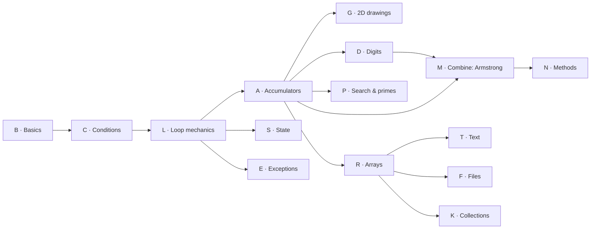

🏠 [Home](../README.md) › 🗺️ [Roadmap](../ROADMAP.md) › 📚 Exercises

# 📚 Exercise inventory

✅ Track what you have done with the [progress checklist](../docs/progress-checklist.md).

One table for **every** exercise: our own original exercises, a few Project Euler milestones and the teacher's topics.
Each custom exercise adds **one** new difficulty. Pick the next one whose prerequisites you have done.

- 🟢 **Guided** — small steps, hints help a lot.  🔵 **Independent** — same idea, alone.  🟣 **Challenge** — new problem, combine recipes.
- ⭐ to ⭐⭐⭐ = effort for a true beginner.
- Solutions are in [`solutions/`](../solutions/README.md). Try first, look later.
- 📖 *The C# Player's Guide* is a **parallel track**, not part of this list: read the book level named in each [roadmap](../ROADMAP.md) step alongside it. Its challenges are tracked in [C# Quest Tracker](https://lfarci.github.io/csharp-quest-tracker/).
- 🔎 Before any exercise, read it with [How to read an exercise](../docs/reading-an-exercise.md).

## Counts

| Source | Exercises |
| --- | ---: |
| Custom (this repo) | 63 |
| Project Euler | 5 |
| Teacher topic | 3 |
| **Total** | **71** |

Custom by level: 🟢 19 guided · 🔵 31 independent · 🟣 13 challenge.

## Map of the families

See the full [graph of every exercise and its prerequisites](dependency-graph.md).

## Custom exercises

### B · Basics: input → compute → output (Step 1–2)

| ID | Exercise | Level | ⭐ | Recipes | Before | Source |
| --- | --- | --- | --- | --- | --- | --- |
| B01 | [Hello you](B01-hello-you.md) | 🟢 Guided | ⭐ | — | — | Custom |
| B02 | [Rectangle calculator](B02-rectangle-calculator.md) | 🟢 Guided | ⭐ | — | B01 | Custom |
| B03 | [Seconds to hours, minutes, seconds](B03-seconds-to-hms.md) | 🔵 Independent | ⭐⭐ | — | B02 | Custom |

### C · Conditions (Step 3)

| ID | Exercise | Level | ⭐ | Recipes | Before | Source |
| --- | --- | --- | --- | --- | --- | --- |
| C01 | [Even or odd](C01-even-or-odd.md) | 🟢 Guided | ⭐ | — | B02 | Custom |
| C02 | [Largest of three](C02-largest-of-three.md) | 🔵 Independent | ⭐⭐ | [Min/max](../cookbook/04-min-max.md) | C01 | Custom |
| C03 | [Ticket price](C03-ticket-price.md) | 🔵 Independent | ⭐⭐ | — | C01 | Custom |
| C04 | [Grade from a score](C04-grade-from-a-score.md) | 🔵 Independent | ⭐⭐ | — | C03 | Custom |

### L · Loop mechanics (Step 4a)

| ID | Exercise | Level | ⭐ | Recipes | Before | Source |
| --- | --- | --- | --- | --- | --- | --- |
| L01 | [Trace a loop (paper)](L01-trace-a-loop.md) | 🟢 Guided | ⭐ | [Counter loop](../cookbook/01-counter-loop.md) | C01 | Custom · 📝 paper |
| L02 | [Boundaries: < or <= ? (paper)](L02-boundaries.md) | 🟢 Guided | ⭐ | [Counter loop](../cookbook/01-counter-loop.md) | L01 | Custom · 📝 paper |
| L03 | [Count up and down](L03-count-up-and-down.md) | 🟢 Guided | ⭐ | [Counter loop](../cookbook/01-counter-loop.md) | L01 | Custom |
| L04 | [Multiplication table](L04-multiplication-table.md) | 🔵 Independent | ⭐ | [Counter loop](../cookbook/01-counter-loop.md) | L03 | Custom |
| L05 | [Until zero](L05-until-zero.md) | 🔵 Independent | ⭐⭐ | [Sentinel loop](../cookbook/10-sentinel-loop.md), [Accumulator](../cookbook/02-accumulator.md) | L03 | Custom |
| L06 | [Even numbers](L06-even-numbers.md) | 🟢 Guided | ⭐ | [Counter loop](../cookbook/01-counter-loop.md) | L03 | Custom |
| L07 | [Ask until valid](L07-ask-until-valid.md) | 🔵 Independent | ⭐⭐ | [Input validation](../cookbook/09-input-validation.md) | L05, C03 | Custom |
| L08 | [Guess the number](L08-guess-the-number.md) | 🟣 Challenge | ⭐⭐ | [Input validation](../cookbook/09-input-validation.md), [Accumulator](../cookbook/02-accumulator.md) | L07 | Custom |
| L09 | [Draw one row](L09-draw-a-row.md) | 🟢 Guided | ⭐ | [Counter loop](../cookbook/01-counter-loop.md), [Nested grid](../cookbook/08-nested-grid.md) | L03 | Custom |
| L10 | [Numbers on one line](L10-numbers-on-one-line.md) | 🔵 Independent | ⭐⭐ | [Counter loop](../cookbook/01-counter-loop.md), [Nested grid](../cookbook/08-nested-grid.md) | L09 | Custom |

### A · Accumulators (Step 4b)

| ID | Exercise | Level | ⭐ | Recipes | Before | Source |
| --- | --- | --- | --- | --- | --- | --- |
| A11 | [Arrange the lines: sum of squares](A11-arrange-sum-of-squares.md) | 🟢 Guided | ⭐ | [Accumulator](../cookbook/02-accumulator.md) | L03 | Custom · 🧩 arrange the lines |
| A01 | [Sum from 1 to N](A01-sum-1-to-n.md) | 🟢 Guided | ⭐ | [Counter loop](../cookbook/01-counter-loop.md), [Accumulator](../cookbook/02-accumulator.md) | L03 | Custom |
| A02 | [Count multiples of 3](A02-count-multiples-of-3.md) | 🟢 Guided | ⭐ | [Conditional accumulator](../cookbook/03-conditional-accumulator.md) | A01, C01 | Custom |
| A12 | [Fix the bugs: count multiples of 7](A12-fix-count-multiples-of-7.md) | 🟢 Guided | ⭐ | [Conditional accumulator](../cookbook/03-conditional-accumulator.md) | A02 | Custom · 🐞 fix the bugs |
| A03 | [Sum of the even numbers](A03-sum-even-values.md) | 🔵 Independent | ⭐ | [Conditional accumulator](../cookbook/03-conditional-accumulator.md) | A02 | Custom |
| A04 | [Factorial](A04-factorial.md) | 🔵 Independent | ⭐⭐ | [Accumulator](../cookbook/02-accumulator.md) | A01 | Custom · teacher: Factorial |
| A05 | [Two accumulators: sum and squares](A05-sum-square-difference.md) | 🔵 Independent | ⭐⭐ | [Accumulator](../cookbook/02-accumulator.md) | A01 | Custom → PE #6 |
| A06 | [Average until zero](A06-average-until-zero.md) | 🔵 Independent | ⭐⭐ | [Sentinel loop](../cookbook/10-sentinel-loop.md), [Accumulator](../cookbook/02-accumulator.md) | L05, A01 | Custom |
| A07 | [Integer power](A07-integer-power.md) | 🔵 Independent | ⭐⭐ | [Accumulator](../cookbook/02-accumulator.md) | A04 | Custom |
| A08 | [Multiples of 3 or 5](A08-multiples-of-3-or-5.md) | 🟣 Challenge | ⭐⭐ | [Conditional accumulator](../cookbook/03-conditional-accumulator.md) | A03 | Custom → PE #1 |
| A09 | [Smallest and largest until zero](A09-min-and-max-until-zero.md) | 🔵 Independent | ⭐⭐ | [Sentinel loop](../cookbook/10-sentinel-loop.md), [Min/max](../cookbook/04-min-max.md) | A06, C02 | Custom |
| A10 | [Sum of a series](A10-sum-of-a-series.md) | 🟣 Challenge | ⭐⭐ | [Accumulator](../cookbook/02-accumulator.md) | A01 | Custom |

### G · 2D drawings (nested loops) (Step 4c)

| ID | Exercise | Level | ⭐ | Recipes | Before | Source |
| --- | --- | --- | --- | --- | --- | --- |
| G07 | [Arrange the lines: a square](G07-arrange-a-square.md) | 🟢 Guided | ⭐ | [Nested grid](../cookbook/08-nested-grid.md) | L09 | Custom · 🧩 arrange the lines |
| G01 | [Draw a rectangle](G01-rectangle.md) | 🟢 Guided | ⭐ | [Nested grid](../cookbook/08-nested-grid.md) | L09 | Custom |
| G02 | [Draw a right triangle](G02-right-triangle.md) | 🔵 Independent | ⭐⭐ | [Nested grid](../cookbook/08-nested-grid.md) | G01 | Custom |
| G03 | [Multiplication grid](G03-multiplication-grid.md) | 🔵 Independent | ⭐⭐ | [Nested grid](../cookbook/08-nested-grid.md) | G01, L04 | Custom |
| G04 | [Hollow rectangle](G04-hollow-rectangle.md) | 🔵 Independent | ⭐⭐ | [Nested grid](../cookbook/08-nested-grid.md) | G01 | Custom |
| G05 | [Checkerboard](G05-checkerboard.md) | 🟣 Challenge | ⭐⭐ | [Nested grid](../cookbook/08-nested-grid.md) | G04, C01 | Custom |
| G06 | [Pyramid](G06-pyramid.md) | 🟣 Challenge | ⭐⭐⭐ | [Nested grid](../cookbook/08-nested-grid.md) | G02 | Custom |

### D · Digits (Step 4d)

| ID | Exercise | Level | ⭐ | Recipes | Before | Source |
| --- | --- | --- | --- | --- | --- | --- |
| D01 | [Last digit](D01-last-digit.md) | 🟢 Guided | ⭐ | [Digit extraction](../cookbook/06-digit-extraction.md) | B03 | Custom |
| D02 | [Remove the last digit](D02-remove-last-digit.md) | 🟢 Guided | ⭐ | [Digit extraction](../cookbook/06-digit-extraction.md) | D01 | Custom |
| D03 | [Count the digits](D03-count-digits.md) | 🔵 Independent | ⭐⭐ | [Digit extraction](../cookbook/06-digit-extraction.md), [Accumulator](../cookbook/02-accumulator.md) | D02, L05 | Custom |
| D04 | [Sum of the digits](D04-digit-sum.md) | 🔵 Independent | ⭐⭐ | [Digit extraction](../cookbook/06-digit-extraction.md), [Accumulator](../cookbook/02-accumulator.md) | D03 | Custom |
| D07 | [Fix the bugs: digit sum](D07-fix-digit-sum.md) | 🔵 Independent | ⭐⭐ | [Digit extraction](../cookbook/06-digit-extraction.md) | D04 | Custom · 🐞 fix the bugs |
| D05 | [Reverse a number](D05-reverse-a-number.md) | 🔵 Independent | ⭐⭐ | [Digit extraction](../cookbook/06-digit-extraction.md) | D04 | Custom |
| D06 | [Palindrome number](D06-palindrome-number.md) | 🟣 Challenge | ⭐⭐⭐ | [Digit extraction](../cookbook/06-digit-extraction.md) | D05 | Custom |

### S · Changing state (Step 4d)

| ID | Exercise | Level | ⭐ | Recipes | Before | Source |
| --- | --- | --- | --- | --- | --- | --- |
| S01 | [Trace two changing variables (paper)](S01-trace-updates.md) | 🟢 Guided | ⭐ | [State update](../cookbook/07-state-update.md) | L01 | Custom · 📝 paper |
| S02 | [Fibonacci](S02-fibonacci.md) | 🔵 Independent | ⭐⭐⭐ | [State update](../cookbook/07-state-update.md) | S01, A01 | Custom · teacher: Fibonacci |
| S03 | [Even Fibonacci sum](S03-even-fibonacci-sum.md) | 🟣 Challenge | ⭐⭐⭐ | [State update](../cookbook/07-state-update.md), [Conditional accumulator](../cookbook/03-conditional-accumulator.md) | S02, A03 | Custom → PE #2 |

### P · Search & primes (Step 4d)

| ID | Exercise | Level | ⭐ | Recipes | Before | Source |
| --- | --- | --- | --- | --- | --- | --- |
| P01 | [Is it prime?](P01-is-it-prime.md) | 🔵 Independent | ⭐⭐ | [Flag/search](../cookbook/05-flag-search.md) | A02 | Custom |
| P02 | [All primes up to N](P02-primes-up-to-n.md) | 🟣 Challenge | ⭐⭐⭐ | [Counter loop](../cookbook/01-counter-loop.md), [Flag/search](../cookbook/05-flag-search.md), [Accumulator](../cookbook/02-accumulator.md) | P01 | Custom |

### M · Combine (mixed) (Step 4)

| ID | Exercise | Level | ⭐ | Recipes | Before | Source |
| --- | --- | --- | --- | --- | --- | --- |
| M01 | [Armstrong number](M01-armstrong-number.md) | 🟣 Challenge | ⭐⭐⭐ | [Digit extraction](../cookbook/06-digit-extraction.md), [Accumulator](../cookbook/02-accumulator.md) | D03, D04, A07 | Custom · teacher: Armstrong |
| M02 | [All Armstrong numbers in a range](M02-armstrong-numbers-in-a-range.md) | 🟣 Challenge | ⭐⭐⭐ | [Counter loop](../cookbook/01-counter-loop.md), [Digit extraction](../cookbook/06-digit-extraction.md), [Accumulator](../cookbook/02-accumulator.md) | M01 | Custom |

### R · Arrays (Step 6)

| ID | Exercise | Level | ⭐ | Recipes | Before | Source |
| --- | --- | --- | --- | --- | --- | --- |
| R01 | [Sum of an array](R01-sum-an-array.md) | 🟢 Guided | ⭐ | [Array traversal](../cookbook/11-array-traversal.md), [Accumulator](../cookbook/02-accumulator.md) | A01 | Custom |
| R02 | [Largest value in an array](R02-largest-in-an-array.md) | 🔵 Independent | ⭐⭐ | [Array traversal](../cookbook/11-array-traversal.md), [Min/max](../cookbook/04-min-max.md) | R01, C02 | Custom |
| R06 | [Fix the bugs: largest value](R06-fix-largest-value.md) | 🔵 Independent | ⭐⭐ | [Array traversal](../cookbook/11-array-traversal.md), [Min/max](../cookbook/04-min-max.md) | R02 | Custom · 🐞 fix the bugs |
| R03 | [Count matches in an array](R03-count-matches.md) | 🔵 Independent | ⭐ | [Array traversal](../cookbook/11-array-traversal.md), [Conditional accumulator](../cookbook/03-conditional-accumulator.md) | R01, A02 | Custom |
| R04 | [Find the position](R04-find-the-position.md) | 🔵 Independent | ⭐⭐ | [Array traversal](../cookbook/11-array-traversal.md), [Flag/search](../cookbook/05-flag-search.md) | R03 | Custom |
| R05 | [Reverse an array](R05-reverse-an-array.md) | 🟣 Challenge | ⭐⭐ | [Array traversal](../cookbook/11-array-traversal.md) | R01 | Custom |

### T · Text (Step 6)

| ID | Exercise | Level | ⭐ | Recipes | Before | Source |
| --- | --- | --- | --- | --- | --- | --- |
| T01 | [Count a letter](T01-count-a-letter.md) | 🟢 Guided | ⭐ | [Build a string](../cookbook/12-string-building.md), [Conditional accumulator](../cookbook/03-conditional-accumulator.md) | R03 | Custom |
| T02 | [Remove spaces](T02-remove-spaces.md) | 🔵 Independent | ⭐ | [Build a string](../cookbook/12-string-building.md) | T01 | Custom |
| T03 | [Count and keep the digits](T03-count-and-keep-digits.md) | 🟣 Challenge | ⭐⭐ | [Build a string](../cookbook/12-string-building.md), [Accumulator](../cookbook/02-accumulator.md) | T02 | Custom |

### F · Files (Step 5)

| ID | Exercise | Level | ⭐ | Recipes | Before | Source |
| --- | --- | --- | --- | --- | --- | --- |
| F01 | [Save numbers to a file](F01-numbers-file.md) | 🔵 Independent | ⭐⭐ | [Sentinel loop](../cookbook/10-sentinel-loop.md), [Array traversal](../cookbook/11-array-traversal.md), [Accumulator](../cookbook/02-accumulator.md) | L05, R01 | Custom |

### E · Exceptions (Step 7)

| ID | Exercise | Level | ⭐ | Recipes | Before | Source |
| --- | --- | --- | --- | --- | --- | --- |
| E01 | [Safe number reader](E01-safe-number-reader.md) | 🔵 Independent | ⭐⭐ | [Input validation](../cookbook/09-input-validation.md) | L07 | Custom |

### K · Collections (Step 9)

| ID | Exercise | Level | ⭐ | Recipes | Before | Source |
| --- | --- | --- | --- | --- | --- | --- |
| K01 | [Shopping list](K01-shopping-list.md) | 🔵 Independent | ⭐⭐ | [Sentinel loop](../cookbook/10-sentinel-loop.md), [Array traversal](../cookbook/11-array-traversal.md) | R01, L05 | Custom |

### N · Methods (Step 10)

| ID | Exercise | Level | ⭐ | Recipes | Before | Source |
| --- | --- | --- | --- | --- | --- | --- |
| N01 | [Armstrong with methods](N01-armstrong-with-methods.md) | 🟣 Challenge | ⭐⭐⭐ | [Digit extraction](../cookbook/06-digit-extraction.md), [Accumulator](../cookbook/02-accumulator.md) | M02 | Custom |

## Project Euler (milestones, not daily homework)

| ID | Problem | Roadmap step | Skills | Do first | ⭐ |
| --- | --- | --- | --- | --- | --- |
| PE1 | [Project Euler #1: Multiples of 3 or 5](https://projecteuler.net/problem=1) | 4 · Loops | conditional accumulator | A08 | ⭐⭐ |
| PE6 | [Project Euler #6: Sum square difference](https://projecteuler.net/problem=6) | 4 · Loops | two accumulators | A05 | ⭐⭐ |
| PE2 | [Project Euler #2: Even Fibonacci numbers](https://projecteuler.net/problem=2) | 4 · Loops | state update + filter | S03 | ⭐⭐⭐ |
| PE4 | [Project Euler #4: Largest palindrome product](https://projecteuler.net/problem=4) | 8 · Recap | nested loops + palindrome + max | D06, G03 | ⭐⭐⭐ |
| PE5 | [Project Euler #5: Smallest multiple](https://projecteuler.net/problem=5) | 8 · Recap | flag/search + `while` | P01 | ⭐⭐⭐ |

Tip: always start with a small version (below 10, up to 100) where you can check the answer by hand.

## Teacher topics

Exact statements are not copied here. Use them as **assessments** once the prerequisites are done.

| ID | Topic | Matching exercises | Recipes | Note |
| --- | --- | --- | --- | --- |
| TCH1 | Factorial (teacher) | A04 | product accumulator | Compare the exact teacher statement with A04 |
| TCH2 | Fibonacci (teacher) | S02 | state update | Compare with S02 / S03 |
| TCH3 | Armstrong numbers (teacher test) | M01 | digits + power + sum | Compare with M01 / M02 |

## When stuck

1. Go back to the recipe in the [cookbook](../cookbook/README.md).
2. Solve a smaller example on paper and fill a trace table.
3. Use the unstuck techniques in [How to read an exercise](../docs/reading-an-exercise.md#5-when-you-are-stuck).
4. Open **one** hint. Wait. Try again.
5. Still stuck? Do the exercise listed in *Before*.

See also [How to practice](../docs/how-to-practice.md).
