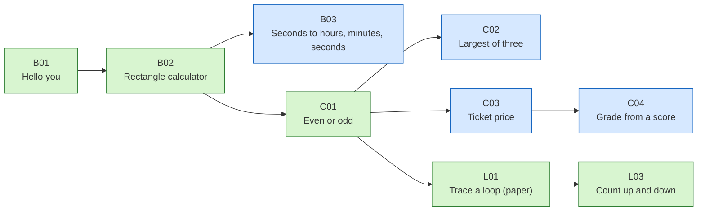
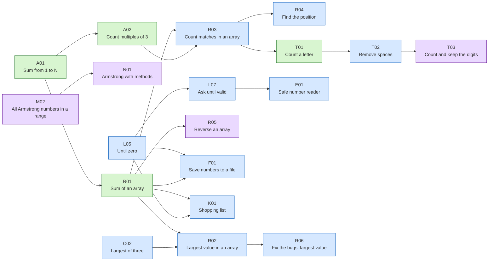

🏠 [Home](../README.md) › 📚 [Exercises](README.md) › Dependency graph

# 🕸️ Exercise dependency graph

An arrow `X → Y` means: do X before Y. Colours: green = guided, blue = independent, purple = challenge. Thick border = teacher topic. The same information is in the [inventory](README.md) tables, as text.

## Loops: from counting to Armstrong (step 4)

```mermaid
flowchart LR
    accTitle: Loops: from counting to Armstrong (step 4)
    accDescr: Each box is one exercise. An arrow from X to Y means do X before Y. The same order is written as text in the Before column of the inventory.
    classDef guided fill:#d8f5d0,stroke:#2e7d32
    classDef indep fill:#d6e8ff,stroke:#1565c0
    classDef chall fill:#ead9ff,stroke:#6a1b9a
    classDef teacher stroke-width:4px
    L01["L01<br/>Trace a loop (paper)"]:::guided
    L02["L02<br/>Boundaries: < or <= ? (paper)"]:::guided
    L03["L03<br/>Count up and down"]:::guided
    L04["L04<br/>Multiplication table"]:::indep
    L05["L05<br/>Until zero"]:::indep
    L06["L06<br/>Even numbers"]:::guided
    L07["L07<br/>Ask until valid"]:::indep
    L08["L08<br/>Guess the number"]:::chall
    A01["A01<br/>Sum from 1 to N"]:::guided
    A02["A02<br/>Count multiples of 3"]:::guided
    A03["A03<br/>Sum of the even numbers"]:::indep
    A04["A04<br/>Factorial"]:::indep
    class A04 teacher
    A05["A05<br/>Two accumulators: sum and squares"]:::indep
    A06["A06<br/>Average until zero"]:::indep
    A07["A07<br/>Integer power"]:::indep
    A08["A08<br/>Multiples of 3 or 5"]:::chall
    A09["A09<br/>Smallest and largest until zero"]:::indep
    A10["A10<br/>Sum of a series"]:::chall
    G01["G01<br/>Draw a rectangle"]:::guided
    G02["G02<br/>Draw a right triangle"]:::indep
    G03["G03<br/>Multiplication grid"]:::indep
    G04["G04<br/>Hollow rectangle"]:::indep
    G05["G05<br/>Checkerboard"]:::chall
    G06["G06<br/>Pyramid"]:::chall
    D01["D01<br/>Last digit"]:::guided
    D02["D02<br/>Remove the last digit"]:::guided
    D03["D03<br/>Count the digits"]:::indep
    D04["D04<br/>Sum of the digits"]:::indep
    D05["D05<br/>Reverse a number"]:::indep
    D06["D06<br/>Palindrome number"]:::chall
    S01["S01<br/>Trace two changing variables (paper)"]:::guided
    S02["S02<br/>Fibonacci"]:::indep
    class S02 teacher
    S03["S03<br/>Even Fibonacci sum"]:::chall
    P01["P01<br/>Is it prime?"]:::indep
    P02["P02<br/>All primes up to N"]:::chall
    M01["M01<br/>Armstrong number"]:::chall
    class M01 teacher
    M02["M02<br/>All Armstrong numbers in a range"]:::chall
    L09["L09<br/>Draw one row"]:::guided
    L10["L10<br/>Numbers on one line"]:::indep
    A11["A11<br/>Arrange the lines: sum of squares"]:::guided
    G07["G07<br/>Arrange the lines: a square"]:::guided
    A12["A12<br/>Fix the bugs: count multiples of 7"]:::guided
    D07["D07<br/>Fix the bugs: digit sum"]:::indep
    L11["L11<br/>Count from a to b"]:::guided
    L12["L12<br/>Count down"]:::guided
    L13["L13<br/>Count by 3"]:::guided
    L14["L14<br/>Count by 5"]:::guided
    L15["L15<br/>Count by any step"]:::indep
    L16["L16<br/>Odd numbers"]:::guided
    L17["L17<br/>Count down by 2"]:::guided
    L18["L18<br/>Square numbers"]:::guided
    L19["L19<br/>Count the turns"]:::guided
    A13["A13<br/>Sum from a to b"]:::guided
    A14["A14<br/>Sum the odd numbers"]:::guided
    A15["A15<br/>Count the even numbers"]:::guided
    A16["A16<br/>Count multiples of 5"]:::guided
    A17["A17<br/>Sum the multiples of k"]:::indep
    A18["A18<br/>Sum of cubes"]:::guided
    A19["A19<br/>Product from a to b"]:::guided
    A20["A20<br/>Power of 2"]:::guided
    A21["A21<br/>Count the divisors"]:::guided
    A22["A22<br/>Sum of the divisors"]:::guided
    G08["G08<br/>Solid square"]:::guided
    G09["G09<br/>Rows of numbers"]:::guided
    G10["G10<br/>Triangle of row numbers"]:::guided
    G11["G11<br/>Counting triangle"]:::guided
    G12["G12<br/>Upside-down triangle"]:::guided
    G13["G13<br/>Diagonal"]:::indep
    D08["D08<br/>First digit"]:::guided
    D09["D09<br/>Count the even digits"]:::guided
    D10["D10<br/>Count one digit"]:::guided
    D11["D11<br/>Largest digit"]:::indep
    D12["D12<br/>Product of the digits"]:::guided
    S04["S04<br/>Doubling"]:::guided
    S05["S05<br/>The n-th Fibonacci number"]:::indep
    G14["G14<br/>Numbers in columns"]:::guided
    L01 --> L02
    L01 --> L03
    L03 --> L04
    L03 --> L05
    L03 --> L06
    L05 --> L07
    L07 --> L08
    L03 --> A01
    A01 --> A02
    A02 --> A03
    A01 --> A04
    A01 --> A05
    L05 --> A06
    A01 --> A06
    A04 --> A07
    A03 --> A08
    A06 --> A09
    A01 --> A10
    L09 --> G01
    G01 --> G02
    G01 --> G03
    L04 --> G03
    G14 --> G03
    G01 --> G04
    G04 --> G05
    G02 --> G06
    D01 --> D02
    D02 --> D03
    L05 --> D03
    D03 --> D04
    D04 --> D05
    D05 --> D06
    L01 --> S01
    S01 --> S02
    A01 --> S02
    S02 --> S03
    A03 --> S03
    A02 --> P01
    P01 --> P02
    D03 --> M01
    D04 --> M01
    A07 --> M01
    M01 --> M02
    L03 --> L09
    L09 --> L10
    L03 --> A11
    L09 --> G07
    A02 --> A12
    D04 --> D07
    L03 --> L11
    L11 --> L12
    L11 --> L13
    L13 --> L14
    L14 --> L15
    L11 --> L16
    L12 --> L17
    L11 --> L18
    L11 --> L19
    A01 --> A13
    A01 --> A14
    L16 --> A14
    A02 --> A15
    A15 --> A16
    A03 --> A17
    A16 --> A17
    A11 --> A18
    A04 --> A19
    A04 --> A20
    A16 --> A21
    A21 --> A22
    G01 --> G08
    G08 --> G09
    G02 --> G10
    G10 --> G11
    G02 --> G12
    L12 --> G12
    G08 --> G13
    G04 --> G13
    D03 --> D08
    D04 --> D09
    D09 --> D10
    D04 --> D11
    D04 --> D12
    L11 --> S04
    S02 --> S05
    L10 --> G14
```

## Before loops (steps 1–3)

## After loops (steps 5–10)

---

⬅️ [All exercises](README.md) · 🗺️ [Roadmap](../ROADMAP.md)
