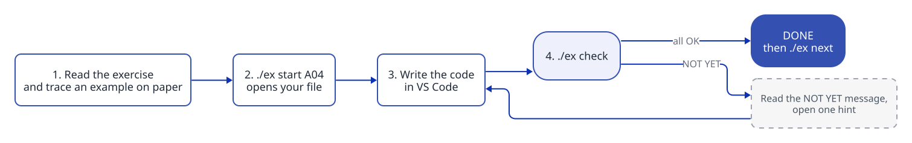

<!-- Website home page. The GitHub front page is README.md: keep the two separate. -->

## How it works

## What is in the course

| Part | What it is for |
| --- | --- |
| [Roadmap](ROADMAP.md) | The themes in order. Start at the top, go at your own pace. |
| [Learn](learn/README.md) | The theory on Microsoft Learn: modules and videos. |
| [Cookbook](cookbook/README.md) | The loop recipes, and which loop to use. |
| [Exercises](exercises/README.md) | Every exercise, grouped by theme, with your progress. |
| [How to read an exercise](docs/reading-an-exercise.md) | A template to organise your ideas before coding. |
| [Solving a problem](docs/problem-solving.md) | What an algorithm is, and how to find one. |
| [Glossary](docs/glossary.md) | The words of programming, in plain language. |

The website does not run C#. Your code runs on your own computer, in your copy of the course. [Getting started](docs/getting-started.md) shows how to set it up in about 15 minutes.
