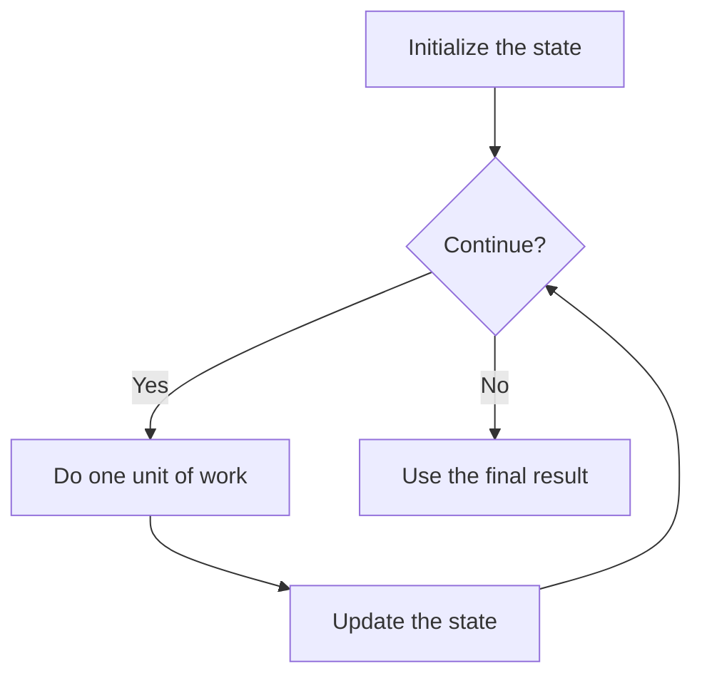

# Pattern: loop mechanics

## Visual model: the test controls entry



The condition is checked **before** each pass, including the first. A loop can run zero times. The update must move this particular algorithm toward its stopping rule.

For “print 1 through 4”, start at 1, continue while at most 4, print, add 1. After printing 4, the value becomes 5; the final test is false and 5 is not printed. An if makes a choice once; a loop returns to its test.

**Mental model:** repeat an action while a condition allows it. Every terminating loop needs a way to eventually stop.

```csharp
for (int i = 1; i <= 4; i++)
{
    Console.WriteLine(i);
}
```

| Iteration | i at start | Output | i after update |
| --- | ---: | ---: | ---: |
| 1 | 1 | 1 | 2 |
| 2 | 2 | 2 | 3 |
| 3 | 3 | 3 | 4 |
| 4 | 4 | 4 | 5 |

The condition `i <= 4` is now false. Output: 1, 2, 3, 4 (each on its own line).

A `while` loop separates initialization and update:

```csharp
int remaining = 4;
while (remaining > 0)
{
    Console.WriteLine(remaining);
    remaining--;
}
```

**Common mistakes:** `<` vs `<=` (off-by-one); forgetting to update the variable; updating in the wrong direction; confusing a loop with an `if`.

**Practice:** L01–L05 in [exercise inventory](../exercises/README.md).
