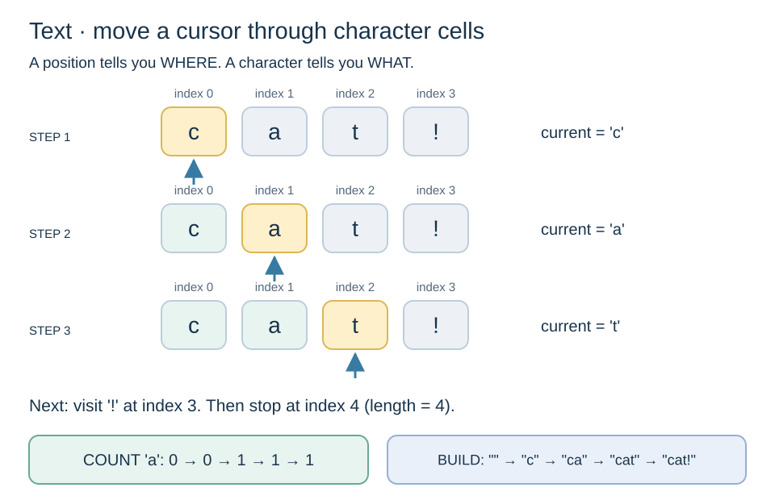

# Pattern: traverse and build text



## Picture: a sequence of positions

For these first exercises, use simple text such as ASCII letters and spaces.

| Index (position) | 0 | 1 | 2 | 3 |
| --- | --- | --- | --- | --- |
| Character in "cat!" | c | a | t | ! |
| Cursor at the third position | visited | visited | **current** | unvisited |

A string is an ordered sequence. The **index** is the position; the **character** is what is at that position. Length is 4, but the last index is 3. A space is also a character. Empty text has length 0 and no valid index.

## Recipe: visit → inspect → update a result → advance

Example: count the letter 'a' in "banana".

```text
matches ← 0
for each character in the text:
    if character is 'a':
        matches ← matches + 1
report matches
```

| Index | Current character | Is 'a'? | matches before → after |
| --- | --- | --- | --- |
| 0 | b | No | 0 → 0 |
| 1 | a | Yes | 0 → 1 |
| 2 | n | No | 1 → 1 |
| 3 | a | Yes | 1 → 2 |
| 4 | n | No | 2 → 2 |
| 5 | a | Yes | 2 → 3 |

The cursor advances on **every** character, even when the condition is false. The counter increases only on a match.

```csharp
string text = "banana";
int matches = 0;
for (int i = 0; i < text.Length; i++)
{
    char character = text[i];
    if (character == 'a')
    {
        matches++;
    }
}
Console.WriteLine(matches); // 3
```

C# uses single quotes for a character ('a') and double quotes for a string ("a"). Matching here is case-sensitive.

## Variant: build a new string

Keep each character except spaces. The result remembers what you have kept so far.

| Current character | Keep? | result before | result after |
| --- | --- | --- | --- |
| a | Yes | "" | "a" |
| space | No | "a" | "a" |
| b | Yes | "a" | "ab" |

```csharp
string text = "a b";
string result = "";
for (int i = 0; i < text.Length; i++)
{
    if (text[i] != ' ')
    {
        result += text[i];
    }
}
Console.WriteLine(result); // ab
```

Strings are immutable in C#: this creates a new string and replaces the value held by result; it does not edit text. Repeated concatenation is fine for these tiny learning examples.

**Recognize:** “for each character”, “count letters”, “keep only”, “remove spaces”. Separate the traversal from the decision and the result update.

**Check:** empty text gives count 0 or result ""; no matches leaves the initial result unchanged; "A" does not match 'a'. In full Unicode text, a visible symbol can occupy more than one C# char; the simple one-cell model here is limited to the first exercises.

**Practice:** T01–T03 in the [inventory](../exercises/README.md).
